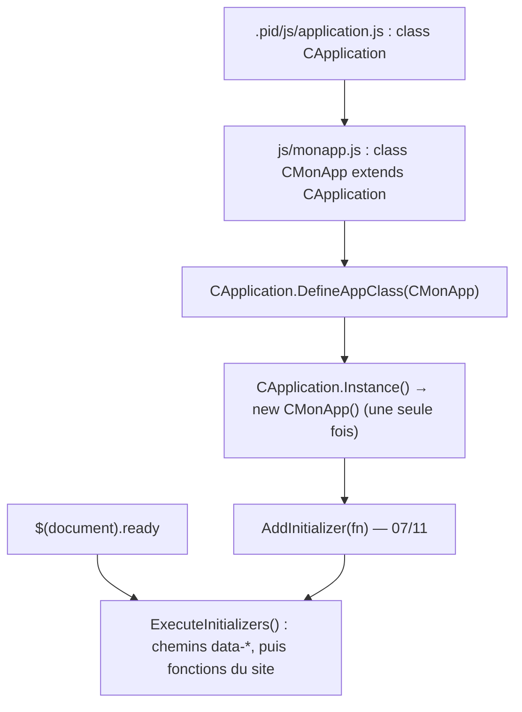

# Classes JS du framework — singleton, `DefineAppClass` et initialiseurs

> **En 30 secondes** — Le JS du framework copie l'architecture PHP : une classe `CApplication` **unique** (singleton) que le site **spécialise** par héritage (`class CMonApp extends CApplication`). Le site déclare sa classe avec `CApplication.DefineAppClass(CMonApp)` ; `CApplication.Instance()` crée alors un `CMonApp`. Le 07/11, le démarrage passe par une **liste d'initialiseurs** exécutée quand la page est prête.



---

## 1. Vue Macro & Utilité (le « Pourquoi »)

> 📘 **Introduction (ajoutée)** — **C'est quoi une `class` en JS ?** Depuis 2015 (ES6 — *ECMAScript 6*, la version du standard JavaScript), JS a un mot-clé `class` avec `constructor`, `extends` et `super()`. **Comment ça marche ?** C'est une *écriture plus lisible* du système de **prototypes** vu le 10/10 : chaque objet garde un lien caché (`__proto__`) vers l'objet « modèle » de sa classe, lui-même lié à celui de la classe mère, etc. Chercher une méthode = remonter cette chaîne. *(Le prof est passé de `function CApplication()` + `prototype` à `class` sans le commenter.)*

- **Problématique** : le framework (`.pid/js/application.js`) doit fournir le moteur (`ExecuteCommand`, chemins), mais **chaque site** veut ajouter ses propres méthodes. Et il ne doit exister **qu'un seul** objet application dans la page, sinon deux objets se disputeraient les chemins et l'état.
- **Emplacement dans la carte globale** : côté navigateur, miroir exact du couple PHP `CApplication` / `CMonApp` ([[CApplication, CMonApp et CPage — Singleton applicatif et charset]]).
- **Analogie (électricité)** : `CApplication` est le **tableau électrique** livré par l'installateur — un seul par maison. Le site y ajoute ses **disjoncteurs** (`CMonApp` et ses méthodes) sans toucher au tableau. Les initialiseurs : la **liste des appareils à allumer** quand le courant arrive (`ready`), dans l'ordre où on les a branchés.

## 2. Le Pont Systémique (sous le capot)

- **Ordre de chargement** : `CApplication` (PHP) ajoute jQuery puis `application.js` ; le constructeur de `CMonApp` (PHP) ajoute `js/monapp.js` **après** (17/10). Le navigateur exécute les `<script>` dans cet ordre : `CApplication` existe quand `monapp.js` déclare `CMonApp extends CApplication`.
- **Mémoire** : les « statiques » (`CApplication.s_Instance`, `s_AppClass`) sont de simples propriétés posées sur l'objet-fonction `CApplication` : elles vivent tant que l'onglet est ouvert. **Rien ne persiste d'une page à l'autre** — contrairement au singleton PHP rangé en session.
- **Chaîne des prototypes** : `CMonApp.prototype.__proto__ === CApplication.prototype`. `IsA` et `DefineAppClass` remontent cette chaîne à la main en comparant `constructor.name`.

## 3. Analyse du Code & Logique

### Bloc 1 — Singleton (17/10)
```js
constructor() {
    if (typeof(CApplication.s_Instance) != "undefined") throw "An application instance already exists !";
    ...
}
CApplication.Instance = function() {
    if (typeof(CApplication.s_Instance) == "undefined")
        CApplication.s_Instance = (typeof(CApplication.s_AppClass) == "undefined")
            ? new CApplication()
            : eval("new " + CApplication.s_AppClass.name + "()");   // crée la classe du site
    return CApplication.s_Instance;
};
```
Double garde : `Instance()` ne crée qu'une fois, et le constructeur **refuse** un second `new`. Le `eval` reconstruit `new CMonApp()` à partir du nom (`new CApplication.s_AppClass()` ferait la même chose sans `eval` — [[Glossaire PHP — eval() et exécution dynamique]]).

### Bloc 2 — Le site choisit sa classe (`DefineAppClass`, `IsA`)
```js
CApplication.DefineAppClass(CMonApp);   // dans js/monapp.js
```
Refusé si l'instance existe déjà (trop tard), si ce n'est pas une fonction, ou si la classe **n'hérite pas** de `CApplication` (boucle sur `__proto__`). Au 17/10, le prof teste avec une classe intermédiaire `CAppInter` (`CMonApp → CAppInter → CApplication`) pour montrer que la recherche traverse plusieurs niveaux ; elle disparaît au 07/11 v2. `IsA(obj, classe)` = un `instanceof` écrit à la main.

### Bloc 3 — Initialiseurs (07/11 v2)
```js
// framework
this.m_Initializers = [];
var _this = this;                       // capture : dans la fonction, "this" ne serait plus l'application
this.AddInitializer(function() { _this.m_PathToRoot = $("body").data("path-to-root"); ... });
$(document).ready(function() { CApplication.Instance().ExecuteInitializers(); });

// site (js/monapp.js)
CApplication.Instance().AddInitializer(function() { console.log("Mon application démarre..."); });
```
- **Pourquoi ce changement** : `monapp.js` crée l'instance **dès son chargement**, avant que le `<body>` soit lu. Lire `data-path-to-root` dans le constructeur deviendrait risqué ; on **diffère** donc la lecture dans un initialiseur exécuté au `ready`. ⚠️ *Probable : raison déduite du code.*
- `ExecuteInitializers` vide la liste (`undefined`) : on ne démarre qu'une fois.

> ⚠️ **À confirmer au prochain cours** — `if (typeof(this.m_Initializers) == undefined)` compare à la **valeur** `undefined` alors que `typeof` renvoie la **chaîne** `"undefined"` : le test est toujours faux. Après `ExecuteInitializers`, un `AddInitializer` tardif ferait donc `undefined.push(...)` → erreur.

## 4. Synthèse & Prochaine Étape

**À retenir (3 puces max)**
- Même schéma qu'en PHP : framework `CApplication`, site `CMonApp extends CApplication`, une seule instance via `Instance()`.
- `DefineAppClass` = « voici ma classe d'application » ; à appeler **avant** le premier `Instance()`.
- Le code de démarrage du site va dans `AddInitializer`, exécuté au `ready`.

**Lien avec la suite** : cet objet porte `ExecuteCommand` → [[Commandes AJAX du framework — ExecuteCommand et TreatCommand]].

**Rappel actif**
> **Q :** Que se passe-t-il si `monapp.js` appelle `DefineAppClass` *après* un `CApplication.Instance()` ? **R :** Refus (`false`) : l'instance existe déjà, de type `CApplication`.

> **Q :** Pourquoi `var _this = this` dans le constructeur ? **R :** Dans une `function(){}` appelée plus tard, `this` ne désigne plus l'application ; `_this` garde la référence (une fonction fléchée `() => {}` l'éviterait).

> **Q :** Le singleton JS survit-il au changement de page ? **R :** Non : chaque page recrée l'objet ; seul le singleton PHP vit en session.

**Pièges fréquents**
- ⚠️ **Inverser l'ordre des scripts** — `CMonApp extends CApplication` échoue si `application.js` n'est pas chargé avant.
- ⚠️ **`typeof x == undefined`** — toujours comparer `typeof` à une chaîne : `"undefined"`.

**Connexions**
- [[Glossaire — JavaScript et jQuery, premier contact avec le navigateur]] — prototype et fonction constructeur (10/10)
- [[Glossaire — Le motif de conception Singleton]] — le même motif, côté PHP
