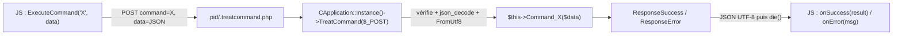

# Commandes AJAX du framework — `ExecuteCommand` ↔ `TreatCommand`

> **En 30 secondes** — Le 17/10, le framework reçoit **un canal unique** pour que le navigateur demande quelque chose au serveur : le JS appelle `CApplication.Instance().ExecuteCommand("Nom", données, onSuccess, onError)`, qui envoie une requête AJAX vers **un seul fichier**, `.pid/.treatcommand.php`. Côté PHP, `TreatCommand` vérifie la demande et appelle la méthode `Command_Nom` de l'application, qui répond en JSON `{ success, data }` ou `{ success:false, errorMessage }`.



---

## 1. Vue Macro & Utilité (le « Pourquoi »)

- **Problématique** : le projet final aura des dizaines d'actions (vérifier un login, calculer un devis…). Écrire un fichier PHP par action, chacun avec ses vérifications, son encodage et son format de réponse, c'est dupliquer le même code partout — et oublier une vérification quelque part.
- **Emplacement dans la carte globale** : c'est la **jonction client ↔ serveur** du framework. Le 10/10 posait le JS dans la page ; le 17/10, il peut enfin **parler** au serveur. Prochaine marche probable : appeler la base de données depuis une commande.
- **Analogie (restauration)** : en salle, le serveur (JS) ne rentre pas en cuisine : il remplit un **bon de commande normalisé** (nom du plat + précisions) et le pose au **passe-plat unique** (`.treatcommand.php`). Le chef (`TreatCommand`) vérifie que le bon est lisible, puis l'envoie au **poste** qui porte ce nom (`Command_Plat`). Le plat revient toujours sur le même type d'assiette (le JSON `success`). *Où ça boite* : en vrai, un chef refuse un plat inconnu ; ici, un nom de commande inconnu fait planter PHP (voir ⚠️ plus bas).

## 2. Le Pont Systémique (sous le capot)

1. **Navigateur** : `$.ajax` construit une requête HTTP `POST` ; le corps contient deux champs texte : `command` et `data` (l'objet JS transformé en texte par `JSON.stringify`). Le cookie de session part avec.
2. **Serveur web** : lance PHP sur `.pid/.treatcommand.php`, qui fait `include("index.php")` : le bootstrap complet tourne (racine, config, autoloader, `session_start`), donc `CApplication::Instance()` **retrouve l'application rangée en session**.
3. **PHP** : `json_decode(..., true)` transforme le texte en tableau associatif, puis `FromUtf8` le convertit vers l'encodage du site (windows-1252).
4. **Réponse** : `header("content-type:application/json;charset=utf-8")`, puis `ToUtf8` et `json_encode`, `print`, et **`die()`** : rien d'autre ne doit partir après le JSON, sinon le JS ne pourrait plus le décoder.
5. **Navigateur** : jQuery lit l'en-tête, décode le JSON en objet, appelle `success` — et le code du prof aiguille vers `onSuccess` ou `onError` selon `response.success`.

## 3. Analyse du Code & Logique

### Bloc 1 — Le point d'entrée (`.pid/.treatcommand.php`, 5 lignes)
```php
include("index.php");                               // bootstrap complet du framework
CApplication::Instance()->TreatCommand($_POST);     // tout le reste est dans la classe
```
Le fichier commence par un point → caché, comme `.pid.config.php`. Un seul fichier pour toutes les commandes.

### Bloc 2 — L'aiguillage (`CApplication::TreatCommand`)
```php
if (!is_array($queryData)) $this->ResponseError("Invalid TreatCommand call !");
if (!isset($queryData["command"])) ...   // 5 contrôles : présence ET type string
$commandData = $this->FromUtf8(@json_decode($queryData["data"], true));
$methodToCall = "Command_" . $queryData["command"];   // préfixe obligatoire
$this->$methodToCall($commandData);                    // appel de méthode par son nom
```
- **Valider aux frontières** : tout ce qui vient de `$_POST` est vérifié avant usage.
- **`$this->$methodToCall(...)`** : appel *dynamique* — le nom de la méthode est dans une variable. Le **préfixe `Command_`** sert de liste blanche : le client ne peut appeler que les méthodes prévues pour lui, jamais `__construct` ou `ToUtf8`.
- Les `Command_*` sont `protected` : `CMonApp` peut en ajouter ou en redéfinir (même principe que les hooks de [[CPage — Générer une page HTML (WriteDocument et points d'extension)]]).

### Bloc 3 — La réponse normalisée (`ResponseSuccess` / `ResponseError` / `ResponseWithJson`)
```php
ResponseSuccess($data)     → ResponseWithJson($data)
ResponseError("msg")       → ResponseWithJson(["success"=>false, "errorMessage"=>"msg"])
// ResponseWithJson : null → [] ; scalaire → ["data"=>valeur] ; ajoute "success"=>true si absent
```
Le contrat est **toujours le même** : un objet JSON avec `success`. Le JS n'a qu'une forme à comprendre.

### Bloc 4 — Côté JS (`CApplication.ExecuteCommand`)
- Arguments **souples** : `ExecuteCommand("X", onSuccess)` est accepté (si `data` est une fonction, les arguments sont décalés).
- Callbacks par défaut : un `console.log` en succès, un `console.warn` en erreur.
- **07/11** : `onSuccess` reçoit la réponse **sans** la clé `success` (boucle `for…in` qui recopie les autres propriétés) ; `onError` affiche le message.
- URL : `this.m_PathToPid + ".treatcommand.php"` — d'où l'utilité des chemins `data-*` du 10/10.

> ⚠️ **À confirmer au prochain cours** *(lu, non exécuté — Probable)*
> - Une `command` inconnue (`Command_Inexistant`) n'est pas vérifiée (`method_exists`) : PHP lèvera une erreur fatale et le JS recevra une réponse non-JSON → `onError`.
> - `json_decode` ne lance pas d'exception sans l'option `JSON_THROW_ON_ERROR` : le `try/catch` autour ne capture rien ; un JSON invalide donne simplement `null`.
> - 07/11 : dans le `catch` de `ResponseWithJson`, `ResponseError(...)` est appelé **sans `$this->`** → fonction globale inexistante.

## 4. Synthèse & Prochaine Étape

**À retenir (3 puces max)**
- Un **seul** fichier d'entrée AJAX, un **seul** format de réponse : `{ success, data | errorMessage }`.
- `command` = nom de méthode préfixé `Command_` → ajouter une action = ajouter une méthode dans `CMonApp`.
- Tout ce qui arrive est **validé** côté serveur ; la réponse se termine par `die()`.

**Lien avec la suite** : les commandes réservées au mode DEV ([[Mode DEV et PROD — fichiers marqueurs et commandes de debug]]) ; plus tard, les commandes qui appelleront la base ([[Schéma PID — tables Role et Utilisateur et fonctions stockées]]).

**Rappel actif**
> **Q :** Que doit écrire le JS pour exécuter `Command_Calculer` côté PHP ? **R :** `CApplication.Instance().ExecuteCommand("Calculer", { … }, onSuccess, onError)`.

> **Q :** Pourquoi `.treatcommand.php` commence-t-il par `include("index.php")` ? **R :** Pour lancer le bootstrap (config, autoloader, session) et retrouver l'instance de `CApplication` en session.

> **Q :** Pourquoi `die()` à la fin de `ResponseWithJson` ? **R :** Pour que rien ne s'ajoute après le JSON : la moindre sortie en plus rend la réponse illisible pour le JS.

**Pièges fréquents**
- ⚠️ **« Le préfixe `Command_` suffit à sécuriser »** — il limite *quelles* méthodes sont appelables, pas *qui* les appelle : les droits (rôle, connexion) restent à vérifier dans chaque commande.
- ⚠️ **`print` ou `var_dump` de debug dans une commande** — il casse le JSON ; c'est pour cela que le prof a retiré ses `console.dir`.

**Connexions**
- [[Classes JS du framework — singleton, DefineAppClass et initialiseurs]] — l'objet JS qui porte `ExecuteCommand`
- [[Glossaire — En-têtes HTTP et header()]] — le `content-type` doit partir avant le JSON
- [[Laravel ↔ framework PID — Correspondances]] — équivalent : une route `POST` + `return response()->json([...])`
