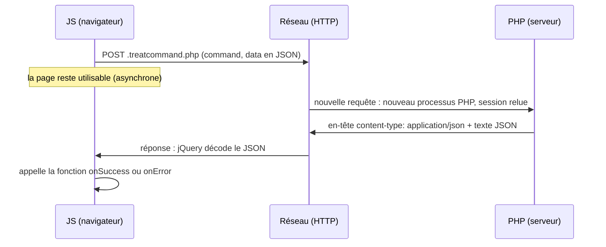

# AJAX, JSON et requête asynchrone

> **En 30 secondes** — **AJAX** (*Asynchronous JavaScript And XML* — « JavaScript et XML asynchrones », le nom date d'avant JSON) = le JavaScript de la page envoie **lui-même** une requête HTTP au serveur, **sans recharger la page**, et traite la réponse quand elle arrive. **JSON** (*JavaScript Object Notation* — notation d'objet JavaScript) = le format texte dans lequel les deux côtés s'échangent les données.

> 📘 **Introduction (ajoutée)** — Le prof a branché AJAX le 17/10 sans présentation préalable de la notion. Ce glossaire pose le « c'est quoi / comment ça marche » ; le détail du code du cours est dans [[Commandes AJAX du framework — ExecuteCommand et TreatCommand]].

## 1. C'est quoi, et pourquoi ça existe ?
- **Problématique** : sans AJAX, la seule façon de parler au serveur est de **charger une nouvelle page** (lien, formulaire). Pour vérifier qu'un login est libre, recalculer un prix de devis ou rafraîchir une liste, recharger toute la page est lent et fait perdre ce que l'utilisateur a saisi.
- **Analogie (Satisfactory)** : la page est une usine déjà construite. Sans AJAX, pour une seule pièce manquante on **démolit et reconstruit toute l'usine**. Avec AJAX, on pose un **tapis roulant** vers l'entrepôt (le serveur) : on envoie une commande, l'usine continue de tourner, et la pièce arrive plus tard par le tapis.

## 2. Comment ça marche (sous le capot)



- **Une requête AJAX est une requête HTTP comme les autres** : PHP redémarre de zéro, relit la session (`$_SESSION`), exécute, répond, meurt. Pas de « connexion permanente ».
- **Asynchrone** = le JS **n'attend pas** la réponse : `$.ajax(...)` revient immédiatement, et le navigateur appellera plus tard la fonction qu'on lui a confiée (*callback* — fonction de rappel). C'est pour le montrer que le prof met un `sleep(10)` côté serveur au 07/11 : la page reste utilisable pendant les 10 secondes.
- **JSON** : du texte qui ressemble aux objets JS — `{"success":true,"data":"Truc"}`. PHP le fabrique avec `json_encode()` (tableau → texte) et le lit avec `json_decode($texte, true)` (texte → tableau associatif). Le JS : `JSON.stringify()` (objet → texte) et `JSON.parse()` (jQuery le fait tout seul si l'en-tête dit `application/json`).
- **JSON exige l'UTF-8.** Le site du prof travaille en windows-1252 : d'où les conversions `ToUtf8` / `FromUtf8` avant/après chaque échange ([[Glossaire — Encodage des caractères (windows-1252 vs UTF-8)]]).

## 3. En pratique
```js
$.ajax({
    url    : "../.pid/.treatcommand.php",           // QUI on appelle
    method : "post",                                 // COMMENT (POST : données dans le corps)
    data   : { command : "FaireQuelqueChose",       // QUOI
               data    : JSON.stringify({ a : 1 }) },
    success: function(response) { /* plus tard : réponse OK */ },
    error  : function(xhr, status, msg) { /* plus tard : échec réseau/HTTP */ }
});
console.log("je passe ici AVANT la réponse");       // ← preuve de l'asynchrone
```

## Utilisé dans ce cours
- [[Commandes AJAX du framework — ExecuteCommand et TreatCommand]] — le canal unique client → serveur du framework (17/10)
- [[Mode DEV et PROD — fichiers marqueurs et commandes de debug]] — `GetSession` / `ClearSession` passent par ce canal (07/11)

## Retenir et vérifier
- **À retenir** : AJAX = requête HTTP lancée par le JS, sans rechargement ; asynchrone = la réponse arrive dans un callback ; JSON = format d'échange, toujours en UTF-8.
> **Q :** Pourquoi le `console.log` placé après `$.ajax(...)` s'affiche-t-il avant le résultat ? **R :** `$.ajax` ne bloque pas : il lance la requête et rend la main ; la réponse est traitée plus tard par `success`.
> **Q :** Une requête AJAX voit-elle la session PHP ? **R :** Oui : le navigateur envoie le cookie de session comme pour une page normale, PHP relit `$_SESSION`.

**Pièges** : ⚠️ croire que le code après `$.ajax` dispose déjà de la réponse · ⚠️ oublier que **tout** ce qui arrive en AJAX vient du client, donc doit être validé côté serveur comme un formulaire.
