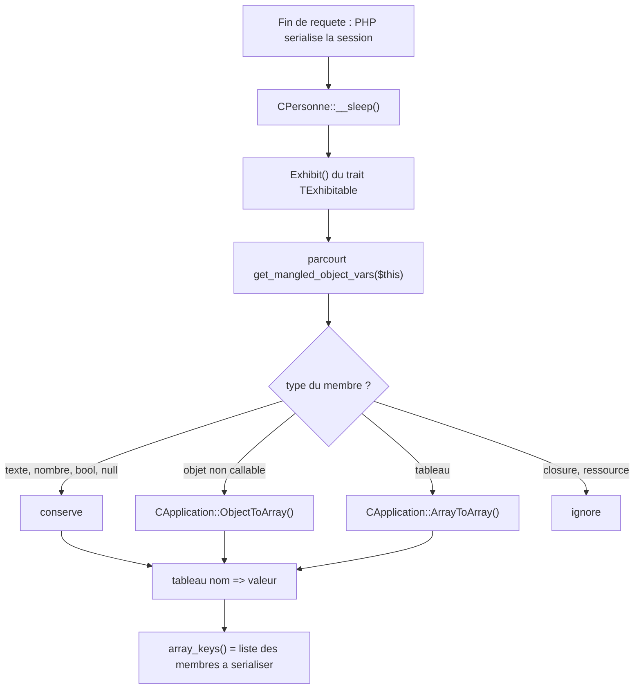

# `IExhibitable` et `TExhibitable` — exposer l'état sérialisable d'un objet

> **En 30 secondes** — Le 10/10, le prof donne à `CPersonne` une **action à faire** (une closure). Problème : une closure ne peut pas être rangée en session. Il écrit donc un **contrat** (`IExhibitable`, une seule méthode `Exhibit()`) et un **trait** (`TExhibitable`) qui dresse l'inventaire des membres « présentables » d'un objet (textes, nombres, booléens, `null`, tableaux et sous-objets de même nature) en ignorant le reste. `__sleep()` s'en sert pour dire à PHP quoi mettre en boîte.



---

## 1. Vue Macro & Utilité (le « Pourquoi »)

- **Problématique** : le framework stocke des objets en session (`CApplication`, `CPersonne`). Dès qu'un objet porte un membre **non sérialisable** (une closure), PHP refuse de le ranger. Il faut un moyen **générique** de savoir « quels membres puis-je ranger ? » sans réécrire cette logique dans chaque classe.
- **Emplacement dans la carte globale** : couche **persistance d'état** du serveur, à côté du singleton `CApplication` ([[CApplication, CMonApp et CPage — Singleton applicatif et charset]]). Le fichier vit dans `.pid/exhibitable.php`, enregistré dans `.class.register.php` sous le nom `TExhibitable`.
- **Analogie (déménagement)** : avant de mettre ses affaires en cartons, on fait l'**inventaire** de ce qui peut voyager (livres, vêtements) et on laisse de côté ce qui ne rentre pas dans un carton (le piano). `Exhibit()` est l'inventaire ; `__sleep()` est le carton.

## 2. Le Pont Systémique (sous le capot)

1. `$_SESSION["unePersonne"] = new CPersonne(..., function(...) {...})` range l'objet dans le tableau de session **en mémoire**.
2. En fin de script, PHP sérialise `$_SESSION`. Pour chaque objet, il appelle `__sleep()` s'il existe et attend **la liste des noms de membres** à écrire ([[Glossaire PHP — Sérialisation (serialize, __sleep, __wakeup)]]).
3. `get_mangled_object_vars($this)` renvoie **tous** les membres, y compris `private`, avec leur nom « déformé » (`"\0CPersonne\0m_Nom"`). C'est exactement le format que `__sleep()` doit renvoyer : voilà pourquoi `array_keys($this->Exhibit())` fonctionne tel quel.
4. Une closure est un objet de classe `Closure` : `is_callable()` la reconnaît, donc le trait l'**écarte** (`is_object($v) && !is_callable($v)` → on ne descend pas dedans, et elle n'est pas ajoutée au résultat).
5. À la requête suivante, l'objet revient **sans** sa closure : `m_ActionAFaire` vaut `null`, donc `FaireAction()` renvoie `false`.

## 3. Analyse du Code & Logique

### Le contrat et le trait (`.pid/exhibitable.php`)
```php
interface IExhibitable { public function Exhibit(); }

trait TExhibitable
{
    public function Exhibit()
    {
        $result = [ ];  $knownObjects = [ ];
        $this->Exhibit_R($result, $knownObjects);
        return $result;
    }
    private function Exhibit_R(&$result, &$knownObjects)
    {
        foreach (get_mangled_object_vars($this) as $memberName => $value) {
            $memberValue = $value;
            if (is_object($memberValue) && !is_callable($memberValue))
                $memberValue = CApplication::Instance()->ObjectToArray($memberValue, $knownObjects);
            if (is_array($memberValue))
                $result[$memberName] = CApplication::Instance()->ArrayToArray($memberValue, $knownObjects);
            else if (is_string($memberValue) || is_bool($memberValue) || ($memberValue === null) || is_numeric($memberValue))
                $result[$memberName] = $memberValue;
        }
    }
}
```
- **Interface + trait ensemble** : l'interface dit *quoi* (`Exhibit()`), le trait fournit *comment* (voir [[Glossaire — Classe abstraite, interface et polymorphisme]] pour l'interface, [[Glossaire PHP — Traits]] pour le trait). Une classe écrit `implements IExhibitable` **et** `use TExhibitable;` : le contrat est rempli sans recopier le code.
- **`&$knownObjects`** : liste, passée par référence, des objets déjà rencontrés — c'est la protection contre les cycles (A → B → A).

### Les outils de `CApplication`
| Méthode | Rôle |
|---------|------|
| `ObjectToArray($object, &$known)` | Si l'objet a déjà été vu → `null`. Sinon le mémorise, puis renvoie `Exhibit()` s'il est `IExhibitable`, ou `get_mangled_object_vars()` à défaut. |
| `ArrayToArray($array, &$known)` | Parcourt un tableau, convertit récursivement objets et sous-tableaux, garde les valeurs simples, **omet** le reste. |
| `GetMemberNamesFrom($obj, ...$exceptions)` | Première version de l'idée (voir plus bas) : liste les membres sérialisables, hors exceptions. |

### `CPersonne` après le 10/10
```php
class CPersonne implements IExhibitable
{
    use TExhibitable;
    private $m_ActionAFaire;                       // une closure, ou null
    public function ActionAFaire($value = null) {  // accesseur validant : doit être "callable" et pas une string
        if ($value !== null) { if (is_string($value) || !is_callable($value)) return false; $this->m_ActionAFaire = $value; return true; }
        return $this->m_ActionAFaire;
    }
    public function FaireAction(...$arguments) {   // appelle la closure en lui passant l'objet lui-même
        if (!is_callable($this->m_ActionAFaire)) return false;
        return ($this->m_ActionAFaire)($this, ...$arguments);
    }
    public function __construct($nom = null, $prenom = null, $actionAFaire = null) { ... }
    public function __sleep() { return array_keys($this->Exhibit()); }
}
```
- **`is_string($value) || !is_callable($value)`** : on refuse une chaîne même si elle nomme une fonction (`"strlen"` est « callable » en PHP) — on veut une vraie closure.
- **`...$arguments`** : [[Glossaire PHP — Opérateur d'étalement (...)]] — collecte les arguments de `FaireAction`, puis les étale dans l'appel de la closure.
- **Constructeur à paramètres optionnels** (`= null`) : PHP doit pouvoir recréer un objet sans argument à la désérialisation.

### La démonstration dans `index.content.php` (code en commentaire)
```php
if (!isset($_SESSION["unePersonne"]))
    $_SESSION["unePersonne"] = new CPersonne("Depré", "Michel",
        function($personne, $a, $b) { $c = $a + $b; print("..."); return $c; });
if ($_SESSION["unePersonne"]->FaireAction(12, 7) === false)
    print("... n'a rien à faire !");
```
- **1er chargement** : l'objet est créé avec sa closure → la somme s'affiche.
- **Rechargement** : l'objet vient de la session, **sans** closure → `FaireAction` renvoie `false` → « n'a rien à faire ! ». C'est précisément ce que la démonstration veut montrer.

### Évolution dans le fichier (version commentée → version finale)
La version commentée de `CPersonne` utilisait `CApplication::Instance()->GetMemberNamesFrom($this)` (avec, en commentaire, un essai manuel : `unset($membres["\0CPersonne\0m_ActionAFaire"])`). La version finale déplace la logique dans **le trait**, réutilisable par toute classe : c'est le passage « solution pour une classe » → « solution générique du framework ».

## 4. Synthèse & Prochaine Étape

**À retenir (3 puces max)**
- Une closure ne se sérialise pas : `__sleep()` doit la retirer de la liste.
- `IExhibitable` (contrat) + `TExhibitable` (code partagé) = tout objet peut dire « voici mon état présentable » ; `__sleep()` en tire les noms de membres.
- Le suivi des objets déjà vus (`$knownObjects`) empêche les boucles infinies sur les références circulaires.

**Question d'oral probable** — *« Pourquoi un objet qui contient une closure perd-il son action après un rechargement de page ? »* → parce que la session est sérialisée en texte à la fin de la requête ; une closure n'est pas sérialisable, donc `__sleep()` l'exclut ; l'objet est reconstruit sans elle.

**⚠️ Points à vérifier (code du prof en cours d'écriture — non exécuté par moi)**
- Dans `application.php`, `ToUtf8_R` a désormais deux paramètres (`$value, &$knownObjects`) mais s'appelle encore avec un seul argument à l'intérieur de la boucle ; `GetMemberNamesFrom` appelle `VerifySerializableArray_R` sans `$this->`. `ToUtf8`/`FromUtf8` ne sont appelées nulle part dans le matériel du 10/10 : ces chemins ne sont donc pas exercés. À confirmer en les testant avant de s'y fier (ou lors du prochain cours, s'il les corrige).
- `CPage::__sleep()` est déclarée `protected` avec un `//TODO` : amorce, non finie.
- `index.content.php` ajoute `unset($_SESSION[PID_APPLICATION_SESSION_ITEM_NAME])` avant `WriteDocument()` : **interprétation (⚠️ Probable)** — forcer la recréation de l'application à chaque requête pendant les essais de sérialisation.

**Lien avec la suite** : cette mécanique de « présenter un objet comme un tableau » prépare la **synchronisation d'objets client/serveur** du plan de cours (envoyer l'état d'un objet au navigateur, typiquement en JSON, via AJAX). Voir [[Laravel ↔ framework PID — Correspondances]] pour l'équivalent Laravel.
