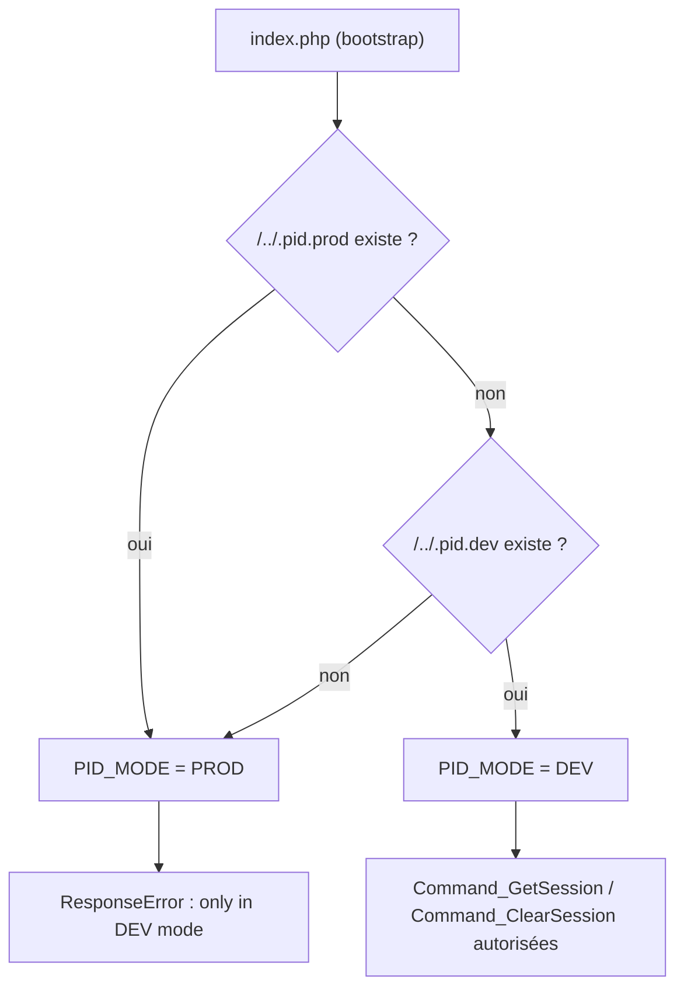

# Mode DEV et PROD — fichiers marqueurs et commandes de debug

> **En 30 secondes** — Le 07/11, le framework sait s'il tourne **chez le développeur (DEV)** ou **en ligne (PROD)** : il cherche un fichier vide `.pid.prod` ou `.pid.dev` placé **un cran au-dessus** de la racine du site. Sans fichier → **PROD par défaut**. Deux commandes AJAX d'aide (`GetSession`, `ClearSession`) ne marchent qu'en DEV.



---

## 1. Vue Macro & Utilité (le « Pourquoi »)

> 📘 **Introduction (ajoutée)** — **C'est quoi un « environnement » ?** Le même code tourne à deux endroits : sur ton PC (XAMPP), où tu veux tout voir pour corriger, et sur le serveur public, où **rien d'interne ne doit fuiter**. **Comment ça marche ?** Le code lit un réglage qui *n'est pas dans le code* (ici un fichier marqueur, ailleurs une variable d'environnement) et adapte son comportement.

- **Problématique** : pour déboguer, le prof veut lire et vider la session depuis la console du navigateur. Laisser ces outils en ligne = permettre à n'importe quel visiteur de lire `$_SESSION` (identité, rôle, données internes).
- **Emplacement dans la carte globale** : configuration + sécurité. Premier pas du cours vers la « sécurité des données » du plan.
- **Analogie (restauration)** : pendant la **mise en place** (DEV), la porte de la cuisine est ouverte, on goûte, on vide les bacs. Pendant le **service** (PROD), la porte est fermée aux clients. Le petit panneau accroché **hors de la salle** (au-dessus de la racine) dit dans quel mode on est — et s'il manque, on considère qu'on est en service.

## 2. Le Pont Systémique (sous le capot)

- **Disque** : `PID_PathTo("/../.pid.dev")` construit `PID_PATH_TO_ROOT . "../.pid.dev"` puis teste `file_exists`. Le fichier est **hors de la racine web** (dossier parent de `_htdocs`) : le serveur ne le sert jamais par URL, et il n'est pas recopié quand on déploie le dossier du site. ⚠️ *Probable : intention déduite de l'emplacement.*
- **Mémoire** : `define("PID_MODE", ...)` une fois par requête, pendant le bootstrap ; constante, donc non modifiable ensuite.
- **Sécurité par défaut** (*secure by default*) : l'absence de marqueur donne **PROD**, le mode le plus fermé. Un oubli au déploiement ne rouvre rien.

## 3. Analyse du Code & Logique

### Bloc 1 — Constantes et config
```php
// index.php (constantes techniques)
define("PID_DEV", "DEV");
define("PID_PROD", "PROD");
// .pid.config.php (nouvelles constantes obligatoires)
define("PID_DEV_FILE_PATH", "/../.pid.dev");
define("PID_PROD_FILE_PATH", "/../.pid.prod");
```
Les deux chemins rejoignent la liste des constantes **vérifiées** au démarrage (`die` si l'une manque). Le matériel v2 fournit d'ailleurs un `.pid.dev` vide à côté de `_htdocs`.

### Bloc 2 — Détermination du mode (bootstrap)
PROD testé **en premier** : si les deux fichiers existent, PROD l'emporte.

### Bloc 3 — Lecture du mode (`CApplication`)
```php
public function InProd() { return defined("PID_MODE") && defined("PID_PROD") && (PID_MODE === PID_PROD); }
public function InDev()  { return !$this->InProd(); }   // version stricte laissée en commentaire
```

### Bloc 4 — Commandes de debug
```php
protected function Command_GetSession()   { if (!$this->InDev()) $this->ResponseError("..."); $this->ResponseSuccess($_SESSION); }
protected function Command_ClearSession() { if (!$this->InDev()) $this->ResponseError("..."); $_SESSION = [ ]; $this->ResponseSuccess(); }
```
Côté JS : méthodes `GetSession()` / `ClearSession()` de `CApplication` + **fonctions globales** du même nom → on tape `GetSession()` dans la console du navigateur.
`ResponseError` se termine par `die()` (via `ResponseWithJson`) : la ligne suivante n'est jamais atteinte en PROD.

> ⚠️ **À confirmer au prochain cours** — `InDev()` vaut « tout sauf PROD » ; si un jour un troisième mode existe (test, recette), il serait traité comme DEV. La version stricte est en commentaire, sans doute volontairement. Le `sleep(10)` ajouté dans `Command_FaireQuelqueChose` semble servir à **montrer l'asynchrone** ([[Glossaire — AJAX, JSON et requête asynchrone]]).

## 4. Synthèse & Prochaine Étape

**À retenir (3 puces max)**
- Le mode est décidé par un **fichier marqueur hors de la racine web** ; sans marqueur = PROD.
- Les outils de debug sont des commandes AJAX **gardées** par `InDev()`.
- Sécurité par défaut : en cas de doute, on ferme.

**Lien avec la suite** : la session lue par `GetSession` contiendra bientôt l'utilisateur connecté ([[Schéma PID — tables Role et Utilisateur et fonctions stockées]]) — d'où l'importance de la fermer en PROD.

**Rappel actif**
> **Q :** Pas de `.pid.dev` ni de `.pid.prod` : quel mode ? **R :** PROD.

> **Q :** Pourquoi placer le marqueur au-dessus de `_htdocs` ? **R :** Il n'est ni accessible par URL ni copié avec le site ; chaque machine garde le sien.

> **Q :** Que reçoit le JS si on appelle `GetSession()` en PROD ? **R :** `{ success:false, errorMessage:"This command can be executed only in DEV mode !" }` → `onError`.

**Pièges fréquents**
- ⚠️ **Déposer `.pid.dev` sur le serveur en ligne** — toute la session devient lisible par n'importe qui.
- ⚠️ **Croire que DEV/PROD protège les autres commandes** — seules celles qui testent `InDev()` sont protégées.

**Connexions**
- [[Glossaire PHP — Superglobales et sessions]] — ce que contient `$_SESSION`
- [[Laravel ↔ framework PID — Correspondances]] — équivalent : `APP_ENV` / `APP_DEBUG` dans `.env`, `app()->isProduction()`
