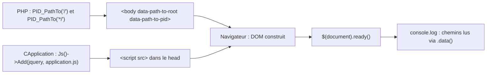

# Premier JavaScript du framework — jQuery, `data-path-to-root` et `application.js`

> **En 30 secondes** — Le framework embarque désormais jQuery 4.0.0 et un fichier `application.js` chargés dans **chaque** page. Pour que le JS sache où se trouvent la racine du site et le dossier `.pid` (chemins **relatifs** à la page, calculés par PHP), `CPage` les écrit dans des attributs `data-*` de la balise `<body>`. Au chargement, le JS les affiche dans la console.



---

## 1. Vue Macro & Utilité (le « Pourquoi »)

- **Problématique** : le JS tournera dans le navigateur et devra plus tard demander des choses au serveur (AJAX). Pour construire une URL correcte **depuis n'importe quelle page** (`dir1/dir2/…` ou la racine), il doit connaître le chemin relatif vers la racine du site — information que seul PHP a ([[Bootstrap PID — Detection de la Racine du Site]]).
- **Emplacement dans la carte globale** : jonction **serveur → client**. PHP prépare, JS consomme. C'est la première brique côté navigateur du cours.
- **Analogie (talkie-walkie)** : la cuisine (PHP) connaît l'adresse exacte de chaque table ; avant de laisser le serveur (JS) partir en salle, elle lui écrit les numéros sur la main (`data-*`).

## 2. Le Pont Systémique (sous le capot)

1. PHP calcule `PID_PathTo("/", false)` : le chemin relatif de la page vers la racine (`"./"`, `"../"`, `"../../"`…). Le second argument `false` **désactive la vérification d'existence** de fichier (c'est un dossier, voir [[PID_PathTo, PID_Include et PID_IncludeOnce]]).
2. Il l'écrit dans l'attribut du `<body>` ; le navigateur le range dans le DOM.
3. Les `<script src>` du `<head>` sont téléchargés dans l'ordre : jQuery, puis `application.js`.
4. Quand le DOM est prêt, `ready` exécute la fonction : `$("body").data("path-to-root")` relit la valeur.

## 3. Analyse du Code & Logique

### Côté PHP
```php
// CApplication::__construct (ajouts)
$this->Js()->Add("*/js/jquery-4.0.0.min.js");
$this->Js()->Add("*/js/application.js");

// CPage::WriteDocument
print("\t<body data-path-to-root=\"" . PID_PathTo("/", false)
    . "\" data-path-to-pid=\"" . PID_PathTo("*/", false) . "\">\r\n");
```
- Les fichiers JS sont ajoutés **dans le constructeur de `CApplication`** : ils passent donc dans la collection « application », écrite avant celle de la page (« ceux de l'application, puis ceux de la page »).
- `*/js/…` : le `*` = dossier `.pid` ([[Dossier .pid et préfixe étoile — Séparer le framework du site]]). `.pid/js/` contient aussi `jquery-4.0.0.js` (non minifiée, lisible) et un `index.php` (le même garde-fou que partout).
- `PID_PathTo("*/", false)` : chemin relatif vers `.pid/` — un correctif du même jour dans `PID_PathTo` retire un `/` initial qui apparaissait après le préfixe `*`.

### Côté JS (`.pid/js/application.js`)
```js
$(document).ready(function()
{
    console.log("PID framework is starting...");
    console.log("* path to root      : " + $("body").data("path-to-root"));
    console.log("* path to framework : " + $("body").data("path-to-pid"));
    //CApplication.Instance().FaireQuelqueChose();   // idée : un singleton JS, pas encore écrit
});

function CApplication() { this.m_Bidule = "Truc"; }
CApplication.prototype.Afficher = function() { console.log("J'ai un bidule : " + this.m_Bidule); };
```
- Le préfixe `m_` des membres est conservé côté JS : même convention de nommage que PHP.
- `CApplication.Instance()` est **commenté** : le prof y songe (singleton JS miroir de PHP) mais ne l'écrit pas encore.

### Petits changements dans `CPage`
- `lang="be-fr"` → `lang="fr-be"` : le code de langue BCP 47 s'écrit **langue-pays** (`fr` puis `BE`) ; `be` est le code du biélorusse. Correction d'une erreur de la version précédente (⚠️ interprétation de la raison).
- `type="text/css"` retiré des `<link rel="stylesheet">` : superflu en HTML5, la valeur par défaut est CSS.

## 4. Synthèse & Prochaine Étape

**À retenir (3 puces max)**
- PHP ne peut pas être appelé depuis le JS directement : il **dépose** ses informations dans la page (ici `data-*`), le JS les **lit**.
- jQuery doit être chargé **avant** le script qui l'utilise ; `ready` attend le DOM.
- Aucun AJAX ni manipulation du DOM encore : c'est une **mise en place** du terrain.

**Question d'oral probable** — *« Comment le JavaScript connaît-il le chemin vers la racine du site ? »* → PHP le calcule (`PID_PathTo`) et le dépose dans des attributs `data-*` du `<body>` ; le JS le lit avec `.data()` une fois le DOM prêt.

**Lien avec la suite** : ces chemins serviront de **base d'URL** pour les futures requêtes AJAX. Équivalent Laravel : `{{ url('/') }}` ou `asset()` injecté dans un attribut `data-*` du layout Blade, ou une balise `<meta>` lue par le JS ([[Laravel ↔ framework PID — Correspondances]]).
