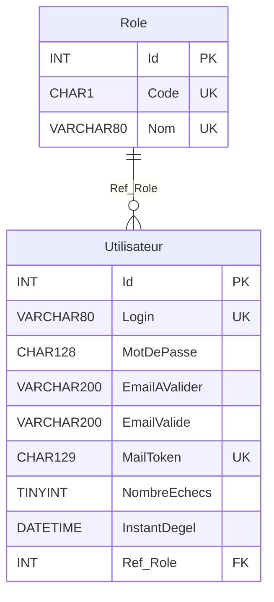

# Schéma PID — tables `Role` et `Utilisateur` et fonctions stockées

> **En 30 secondes** — Le fichier `pid.struct.sql` (07/11, v2) crée la base `pid_exemple`, un utilisateur MySQL limité, deux tables (`Role` : Administrateur / Gérant / Client ; `Utilisateur` : login, mot de passe chiffré, emails, jeton, compteur d'échecs, dégel) et deux **fonctions stockées** : l'une calcule l'empreinte du mot de passe, l'autre crée un utilisateur en une seule étape. C'est **le squelette des comptes** annoncé par le plan du cours.



---

## 1. Vue Macro & Utilité (le « Pourquoi »)

- **Problématique** : le plan du cours promet des comptes de types différents, la validation par email, la protection contre la force brute et des états de compte. Il faut d'abord **où les ranger**. Chaque colonne de `Utilisateur` répond à une ligne du plan.
- **Emplacement dans la carte globale** : couche **donnée**, sous le framework. Aucune ligne PHP ne s'y connecte encore (pas de PDO dans le matériel du 07/11).
- **Analogie (restauration)** : `Role` = la liste des **postes** (gérant, serveur…), courte et fixe. `Utilisateur` = le **registre du personnel** : chaque fiche pointe vers un poste. Le badge (mot de passe) n'est jamais écrit en clair dans le registre — seulement son **empreinte**.

## 2. Le Pont Systémique (sous le capot)

- **Le calcul se fait dans MySQL, pas dans PHP** : `PidEx_CreerUtilisateur(...)` insère la ligne, récupère l'`Id` attribué (`LAST_INSERT_ID()`), puis calcule l'empreinte avec cet `Id`. PHP n'aura qu'**un seul appel** à faire : `SELECT PidEx_CreerUtilisateur(?, ?, ?, ?)`. ⚠️ *Probable : l'appel PHP n'est pas encore montré.*
- **Conséquence réseau** : le mot de passe **en clair** voyage de PHP vers MySQL dans la requête (à chiffrer si MySQL est sur une autre machine).
- **`SQL SECURITY DEFINER`** : la fonction s'exécute avec les droits de **celui qui l'a créée**, pas de celui qui l'appelle. Le compte du site n'a besoin que du droit `EXECUTE`.

## 3. Analyse du Code & Logique

### Bloc 1 — Colonnes de `Utilisateur` ↔ plan du cours
| Colonne | Ligne du plan | Lecture |
|---|---|---|
| `Ref_Role` → `Role.Id` | Comptes de types différents | Un rôle par utilisateur ; `RESTRICT` empêche de supprimer un rôle utilisé |
| `MotDePasse CHAR(128) NULL` | Sécurité des données des comptes | 128 caractères = SHA-512 en hexadécimal ; `NULL` le temps de l'insertion |
| `EmailAValider` / `EmailValide` | Sécurité par email | Deux colonnes : l'adresse reste « à valider » tant que le lien n'est pas cliqué ⚠️ *Probable* |
| `MailToken CHAR(129) UNIQUE` | Validation email, oubli de mot de passe | Jeton du lien envoyé par mail ⚠️ *Probable : 129 et non 128, raison inconnue* |
| `NombreEchecs`, `InstantDegel` | Force brute, états de compte | Compteur d'essais ratés ; compte « gelé » jusqu'à une date |

### Bloc 2 — `PidEx_CrypterMdP(p_Id, p_MdP)`
```sql
SELECT SHA2(CONCAT(CAST(p_Id AS CHAR), Login, p_MdP), 512) INTO v_Result
FROM Utilisateur WHERE Id = p_Id;
```
Empreinte = SHA-512 de **Id + Login + mot de passe**. Les commentaires du prof montrent que `(5,'Bob','secret')` et `(6,'Bob','secret')` donnent deux empreintes différentes : deux comptes au même mot de passe n'ont **pas** la même empreinte (rôle d'un **sel**). Comparaison avec le projet : [[Hachage du mot de passe — SHA-512 du prof ↔ bcrypt du projet]].

### Bloc 3 — `PidEx_CreerUtilisateur(login, mdp, email, codeRole)`
```sql
DECLARE CONTINUE HANDLER FOR 1062 BEGIN SELECT "KO\nCe login existe déjà !" INTO v_Result; END;
SELECT Id INTO v_IdRole FROM Role WHERE Code = p_CodeRole;
IF v_IdRole IS NULL THEN RETURN "KO\nType de rôle inconnu"; END IF;
INSERT INTO Utilisateur SET Login = p_Login, EmailAValider = p_Email, Ref_Role = v_IdRole;
IF v_Result IS NOT NULL THEN RETURN v_Result; END IF;      -- le handler 1062 a été déclenché
SELECT LAST_INSERT_ID() INTO v_IdUtilisateur;
UPDATE Utilisateur SET MotDePasse = PidEx_CrypterMdP(v_IdUtilisateur, p_MotDePasse) WHERE Id = v_IdUtilisateur;
SELECT CONCAT("OK\n", CAST(v_IdUtilisateur AS CHAR)) INTO v_Result;
RETURN v_Result;
```
- **Protocole de retour texte** : première ligne `OK` ou `KO`, deuxième ligne l'Id ou le message. Simple à découper côté PHP (`explode("\n", …)`).
- **Gestionnaire d'erreur 1062** : le doublon de login n'arrête pas la fonction, il remplit `v_Result` ; la ligne suivante le détecte. La **base** tranche la course entre deux inscriptions.

> ⚠️ **À confirmer au prochain cours** *(lu, non exécuté)*
> - Tables créées `Role` / `Utilisateur`, mais `ALTER TABLE utilisateur ... REFERENCES role` en minuscules : fonctionne sous Windows (XAMPP), **échoue** sous Linux où la casse compte.
> - `SELECT Id INTO v_IdRole ...` sans ligne trouvée laisse `v_IdRole` à `NULL` (variable non initialisée) : le test fonctionne, mais MySQL émet un avertissement « No data ».
> - Le fichier contient le mot de passe MySQL d'exemple en clair : normal pour un exercice local, à ne pas reproduire dans un dépôt.

## 4. Synthèse & Prochaine Étape

**À retenir (3 puces max)**
- 2 tables, 1 lien : `Utilisateur.Ref_Role → Role.Id` ; chaque colonne prépare une ligne du plan (rôles, email, force brute).
- La création d'utilisateur et le calcul de l'empreinte se font **dans MySQL** (fonctions stockées), avec un retour `OK\n…` / `KO\n…`.
- La base fait respecter l'unicité (login, jeton) elle-même.

**Lien avec la suite** : la connexion PHP → MySQL (probablement PDO) puis une commande AJAX `Command_Inscrire` qui appellera `PidEx_CreerUtilisateur` ([[Commandes AJAX du framework — ExecuteCommand et TreatCommand]]).

**Rappel actif**
> **Q :** Pourquoi `MotDePasse` est-il `NULL` autorisé ? **R :** L'empreinte dépend de l'`Id`, connu seulement **après** l'`INSERT` ; la colonne est remplie juste après par `UPDATE`.

> **Q :** Que renvoie `PidEx_CreerUtilisateur('Bob', …)` si Bob existe déjà ? **R :** `"KO\nCe login existe déjà !"` (erreur 1062 interceptée).

> **Q :** À quoi serviront `NombreEchecs` et `InstantDegel` ? **R :** Compter les connexions ratées et bloquer le compte jusqu'à une date : protection contre la force brute.

**Pièges fréquents**
- ⚠️ **Confondre l'utilisateur MySQL (`u_pid_exemple`) et la table `Utilisateur`** — le premier est le compte **du site** auprès de MySQL ; la seconde contient les **visiteurs** du site.
- ⚠️ **Casse des noms de tables** — écrire partout la même (`Role`, `Utilisateur`).

**Connexions**
- [[Glossaire — MySQL, tables, clés et droits]] — le vocabulaire utilisé ici
- [[Mode DEV et PROD — fichiers marqueurs et commandes de debug]] — même séance
