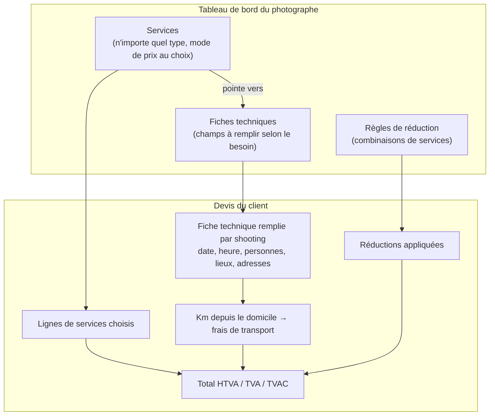
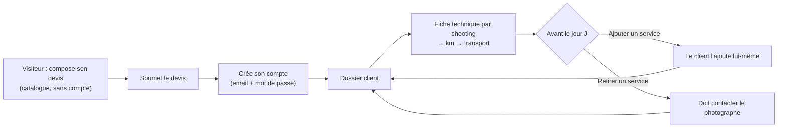
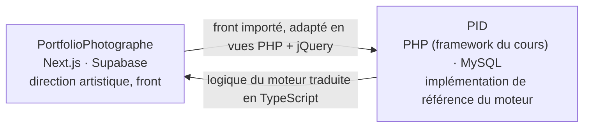

# Niveau 1 — Vision & Cadrage : moteur du générateur de devis

> Projet : PID · Périmètre : **logique métier uniquement** (le visuel et le front sont faits dans le projet PortfolioPhotographe)
> Démarré le : 2026-11-11 · Méthode : **page blanche** (décision mentalyas) — les anciens fichiers `docs/brainstorm/L*-*.md` ne servent pas d'entrée ; comparaison à la fin seulement.
> Statut : ✅ niveau 1 rédigé (11/11) — points ⏳ à confirmer en niveau 2

---

## 1. Concept global

Un **générateur de devis en libre-service** pour un photographe événementiel. Le client compose lui-même sa prestation à partir d'un **catalogue de services détaillés**. Son devis se construit **au fur et à mesure**, ligne par ligne, de façon ludique. Il voit le prix exact de ce qu'il demande, sans contacter le photographe.

**Pourquoi** (vécu de mentalyas) :
- Aujourd'hui, un mariage d'une journée complète (des préparatifs jusqu'au gâteau, minuit au plus tard) est vendu **1 250 € au forfait, transport inclus**.
- Une fois facturé via Smart, il reste 600 à 700 € à mentalyas.
- Le forfait absorbe tous les imprévus : déplacements supplémentaires dans la journée, lieux multiples, kilomètres non prévus. **La prestation n'est pas détaillée, donc rien de ce qui s'ajoute n'est facturé.**

**Double objectif :**
1. **Protéger le photographe** : chaque élément vendu est nommé et chiffré, rien n'est englobé dans un tout.
2. **Servir le client** : il simule son prix seul, sans surprise ni flou, et on évite les échanges inutiles.

Le site devient ensuite **la plateforme du dossier client** jusqu'au jour J. On y échange les formalités et les informations. Le client y fait évoluer son devis, et le photographe le suit depuis son tableau de bord (ERP — *Enterprise Resource Planning*, ici le logiciel de gestion interne : clients, dossiers, suivi).

> 🧭 **Principe directeur : la généricité.** Aucune règle de calcul n'est figée dans le code. Quand plusieurs variantes d'une règle sont valables, le moteur les propose **toutes**, sous forme d'options que le photographe choisit, Il les règle au niveau **général**, et chaque service peut les **remplacer** (mentalyas, 11/11).
>
> 🧭 **Aucune valeur en dur.** Le code ne contient **aucun tarif ni aucune valeur chiffrée** : prix, taux de TVA, seuils de km, prix au km, pourcentages de réduction, frais de retrait, dates limites, valeurs par défaut… **Tout** est saisi par le photographe dans l'ERP. Le moteur livré est vide de tarifs. Les documents de conception n'utilisent que des **noms de paramètres** (`prixService`, `seuilKm`…), jamais de montants (mentalyas, 11/11).
>
> *Seule exception : les cas de test du moteur. Ils utilisent des valeurs **fictives** pour vérifier les calculs, et ne sont jamais chargés comme tarifs.*
>
> *Les montants du « Pourquoi » ci-dessus décrivent la situation actuelle de mentalyas. Ce sont du contexte, pas des tarifs du moteur.*

**Le moteur est un calculateur générique, pas un outil comptable.** Il applique les prix que le photographe a encodés et produit des montants HTVA et TVAC. Il ne gère ni Smart, ni les déclarations, ni la facturation.

## 2. Acteurs

| Acteur | Ce qu'il fait avec le moteur |
|--------|------------------------------|
| **Visiteur** (anonyme) | Parcourt le catalogue, compose et simule un devis sans compte |
| **Client** (compte créé à la soumission) | Retrouve son dossier, remplit les fiches techniques de ses shootings, ajoute des services avant le jour J |
| **Photographe** (mentalyas) | Crée, modifie et supprime ses services et ses fiches techniques depuis son tableau de bord ; suit les dossiers ; traite les demandes de retrait |
| **Smart** (externe) | Facture à la place de mentalyas. **Hors du moteur.** |

## 3. Les briques du moteur (ce qui se dégage)

### 3.1 Services — génériques au maximum
- Le photographe peut créer **n'importe quel type de service** : un shooting (mariage, engagement, famille), un produit (album photo), etc.
- **Modes de prix** (proposés le 11/11, retenus par principe de généricité — ⏳ confirmation explicite de mentalyas) :

| # | Mode | Calcul | Réglages |
|---|------|--------|----------|
| P1 | Forfait | prix fixe | — |
| P2 | Durée | prix × durée | unité (heure, demi-journée, journée…), minimum facturé, arrondi |
| P3 | Forfait + dépassement | forfait jusqu'à une durée, puis tarif par tranche au-delà | durée incluse, tarif de dépassement, arrondi |
| P4 | Quantité | prix × nombre | min, max, pas |
| P5 | Par personne | prix × personnes (repris de la fiche technique) | personnes incluses |
| P6 | Paliers | prix selon une tranche | tranches libres |
- **Prix encodé HTVA ou TVAC**, au choix du photographe. Le moteur calcule l'autre montant. ⏳ Taux de TVA : un seul taux global ou un taux par service ?

### 3.1 bis Options — briques partagées entre services (11/11)
- Une **option** est un élément que le client peut ajouter **sur un service** (ex. second photographe, drone, heure sup en soirée).
- Le photographe **crée, modifie et paramètre** ses options comme ses services. ⏳ Probable : mêmes modes de prix (P1-P6).
- Relation **plusieurs à plusieurs** : un service pointe vers une ou plusieurs options ; une option peut être proposée par plusieurs services.

### 3.2 Fiches techniques — les informations pratiques d'un shooting
- Pour chaque shooting du devis, le client remplit une fiche : **date, heure, nombre de personnes, un ou plusieurs lieux avec leurs adresses**.
- Les besoins diffèrent selon le service : la fiche d'un mariage n'est pas celle d'un shooting engagement.
- Le photographe **crée des types de fiches** et **relie chaque service à la fiche adaptée**. Le choix entre « fiches partagées » et « une fiche par service » est à trancher (§8).

### 3.3 Transport — en deux temps (décision D2 = C, 11/11)
- **Pendant la simulation** : le visiteur indique seulement la **commune ou le code postal** de chaque shooting. Le moteur **estime** les km et les frais de transport, et la ligne est marquée « estimation ».
- **Après la soumission** : la fiche technique donne les adresses exactes, et le moteur **recalcule** précisément les km depuis le domicile du photographe.
- **Seuil de gratuité** : le photographe définit à partir de combien de km le déplacement est facturé. Le client voit donc directement si son déplacement est **offert ou payant**.
- **Tout est paramétrable** (principe de généricité). Réglage général, que chaque service peut remplacer :

| Paramètre | Options proposées au photographe |
|-----------|----------------------------------|
| **Km comptés** | Aller seul vers le premier lieu · Aller-retour vers le lieu le plus éloigné · Itinéraire complet (domicile → tous les lieux dans l'ordre → domicile) · ⏳ autres ? |
| **Application du seuil** | Franchise (seuls les km au-delà du seuil sont facturés) · Tout ou rien (au-delà du seuil, tous les km sont facturés) |
| **Seuil** | Nombre de km (0 = toujours facturé) |
| **Prix au km** | Montant (HTVA ou TVAC, comme les autres prix) |

### 3.4 Réductions — « où je veux » (décision D3, 11/11)
- Une réduction se compose d'une **condition**, d'un **effet** et d'une **cible**. La cible peut être **n'importe quelle partie du devis** : un service, une catégorie, le transport, le dossier entier.
- Exemple : shooting familial + album photo + mariage à une autre date → réduction.

| Brique | Options proposées au photographe |
|--------|----------------------------------|
| **Condition** | Nombre de services · Combinaison précise de services · Catégorie de service · Montant total du dossier · Dates différentes · Code promo · *aucune* (réduction permanente) — combinables |
| **Effet** | Pourcentage · Montant fixe · Élément offert (gratuit) |
| **Cible** | Un service précis · Une catégorie · Le transport · Le dossier entier |
| **Cumul** | Toutes cumulées · Seulement la plus avantageuse · Ordre de priorité défini — réglage général, remplaçable par réduction |

## 4. Cycle de vie du devis

**Étapes proposées (S1-S6, ⏳ à confirmer en niveau 2)** : Brouillon (navigateur) → Soumis (compte créé, prix figés) → Accepté / Refusé (photographe) → Confirmé (acompte ou contrat, coché par le photographe) → Réalisé · Annulé à tout moment avant Réalisé.

**Modifications (décisions D7, 11/11)** :
- **Date limite** : le photographe fixe jusqu'à quand un dossier peut être modifié. ⏳ Probable, par généricité : réglage général, remplaçable par service.
- **Ajout** : le client le **demande** dans son dossier ; il ne s'applique qu'**après validation du photographe**.
- **Retrait** : uniquement via le photographe. Il décide **au cas par cas** d'appliquer des frais ou non (ex. extrême urgence → pas de frais).
- **Instantané des prix** : un prix soumis **ne change jamais**, ni dans un devis ni dans une facture. ⏳ Probable : un service ajouté plus tard est figé au prix du jour de sa demande.

Simulation : services + commune/code postal de chaque shooting → transport **estimé**. Après soumission : fiche technique complète → transport **recalculé** (décision D2 = C).

## 5. Règles métier exprimées

| # | Règle | Source |
|---|-------|--------|
| M1 | Le devis est **détaillé** : chaque service choisi apparaît sur sa propre ligne avec son prix ; aucun forfait global opaque | mentalyas, 11/11 |
| M2 | Le visiteur compose et simule **sans compte** ; le compte (email + mot de passe) n'est créé qu'à la **soumission** | mentalyas, 11/11 |
| M3 | Le client peut **demander l'ajout** de services jusqu'à la date limite ; ⚠️ *Correction du 11/11* : l'ajout ne s'applique qu'après **validation du photographe** (et non « sans passer par le photographe ») | mentalyas, 11/11 |
| M4 | Le client **ne peut pas retirer** un service seul : un retrait passe par un contact avec le photographe | mentalyas, 11/11 |
| M5 | Le client retrouve son dossier et son devis en se reconnectant | mentalyas, 11/11 |
| M6 | Le photographe encode chaque prix **HTVA ou TVAC** ; le moteur affiche les deux | mentalyas, 11/11 |
| M7 | Le moteur **ne traite ni Smart ni les déclarations** : il calcule, c'est tout | mentalyas, 11/11 |
| M8 | Le photographe **crée, modifie et supprime** ses services et ses fiches techniques sans toucher au code | mentalyas, 11/11 |
| M9 | Chaque shooting du devis a **sa** fiche technique, du type relié à son service | mentalyas, 11/11 |
| M10 | Les frais de transport sont **calculés automatiquement** à partir des adresses de la fiche et du domicile du photographe | mentalyas, 11/11 |
| M11 | Plusieurs services dans un même dossier peuvent donner droit à une **réduction** | mentalyas, 11/11 |
| M12 | Pendant la simulation, le transport est **estimé** à partir de la commune ou du code postal ; il est **recalculé** à partir de la fiche technique après la soumission | D2, 11/11 |
| M13 | Le déplacement est **offert** sous un seuil de km défini par le photographe et **facturé** au-delà ; le client voit lequel des deux s'applique | mentalyas, 11/11 |
| M14 | Les types de fiches techniques sont **partagés** entre services et **duplicables** ; une fiche déjà remplie garde ses réponses si son type change | D1, 11/11 |
| M15 | Les réglages du transport (km comptés, application du seuil, seuil, prix au km) sont des **options** : un réglage général, remplaçable par service | mentalyas, 11/11 |
| M16 | Une réduction peut viser **n'importe quelle partie du devis**, transport compris ; condition, effet, cible et cumul sont des options | mentalyas, 11/11 |
| M17 | Les **options** sont des objets autonomes du catalogue, reliés aux services en **plusieurs à plusieurs** | mentalyas, 11/11 |
| M18 | Le photographe fixe une **date limite de modification** du dossier | mentalyas, 11/11 |
| M19 | Toute modification d'un dossier soumis est **validée par le photographe** | mentalyas, 11/11 |
| M20 | Un retrait accepté peut comporter des **frais**, appliqués ou non **au cas par cas** par le photographe | mentalyas, 11/11 |
| M21 | **Un prix soumis ne change jamais**, ni dans un devis ni dans une facture (instantané) | mentalyas, 11/11 |
| M22 | **Aucun tarif ni aucune valeur chiffrée dans le code** : tout est saisi par le photographe dans l'ERP, y compris les valeurs par défaut | mentalyas, 11/11 |

## 6. Fonctionnalités du moteur

### Cœur (MVP) — à confirmer
- [ ] Gestion des services : créer, modifier, supprimer ; modes de prix multiples ; HTVA/TVAC
- [ ] Gestion des types de fiches techniques et liaison aux services
- [ ] Composition du devis ligne par ligne, calcul en direct
- [ ] Fiche technique par shooting
- [ ] Calcul des km et des frais de transport
- [ ] Réductions multi-services
- [ ] Soumission du devis et création du compte client
- [ ] Dossier client : ajout de services avant le jour J ; demande de retrait
- [ ] Suivi des dossiers par le photographe

### Plus tard (v2+)
- [ ] Aide aux déclarations (Smart, comptabilité)
- [ ] ⏳ Échange de documents dans le dossier : MVP ou v2 ?

### Hors périmètre de PID
- Interface visuelle et front : projet PortfolioPhotographe
- Facturation et déclarations : Smart

## 7. Contraintes

- **Cours PID** : l'implémentation suit le rythme du cours (`docs/RYTHME-COURS.md`). Le brainstorm, lui, peut avancer librement.
- **Répartition PID ↔ PortfolioPhotographe (décision D8, 11/11)** :

  - **PID** = implémentation **de référence** du moteur, défendue au cours. Le front de PortfolioPhotographe y est importé.
  - **PortfolioPhotographe** = direction artistique et front ; il reçoit ensuite le moteur **traduit en TypeScript**.
  - **Conséquence de conception** : le moteur doit être **indépendant du langage et du framework** (règles pures, aucune dépendance à PHP, MySQL ou Next.js), pour que la traduction soit mécanique.
  - **Proposition de Claude** : un **jeu de cas de calcul commun** (entrées → résultat attendu, en JSON), écrit pendant le niveau 2, sert de tests aux **deux** implémentations : si PHP et TypeScript donnent les mêmes résultats, la traduction est juste. ⏳ À valider.
- **Sécurité** : données personnelles (identité, email, adresses, dates) ; montants engageants, donc prix toujours recalculé par le serveur.

## 8. Décisions

| # | Question | Proposition de Claude |
|---|----------|-----------------------|
| D1 | Fiches techniques : partagées ou une par service ? | ✅ **Types partagés + duplication** (validé 11/11) |
| D2 | À quel moment la fiche technique est-elle remplie ? | ✅ **C** : commune/code postal à la simulation (estimation), fiche complète après soumission (recalcul) — validé 11/11 |
| D3 | Forme des réductions | ✅ Condition + effet + cible libres (transport compris), cumul paramétrable (11/11) |
| D4 | Règle de calcul du transport | ✅ Tout paramétrable : km comptés, application du seuil, seuil, prix au km ; général + remplaçable par service (11/11) |
| D5 | Liste des modes de prix | P1-P6 retenus par généricité — ⏳ confirmation |
| D6 | Taux de TVA : global ou par service | ✅ Par principe de généricité : taux général par défaut, remplaçable par service (Claude, 11/11 — à contester si besoin) |
| D7 | Modifications et retraits | ✅ Date limite ; toute modif validée par le photographe ; frais de retrait au cas par cas ; prix soumis jamais modifiés (11/11) |
| D8 | Où vit le moteur | ✅ PID = référence (front importé) ; traduction TypeScript dans PortfolioPhotographe (11/11) |

**D1, retenu** : des **types de fiches partagés**, avec un bouton « dupliquer ».
- Plusieurs services ont les mêmes besoins (famille, engagement, portrait) : une seule fiche à créer et à maintenir.
- Si un service a un besoin particulier, on duplique la fiche la plus proche et on l'ajuste.
- Une fiche **déjà remplie** par un client garde ses champs, même si le type de fiche est modifié ensuite.

## 9. Signal de complexité — Niveau 1

**Fonctionnalités core du moteur (6)** — une fiche L2 chacune :

| # | Fonctionnalité | Fichier L2 prévu |
|---|----------------|------------------|
| F1 | Catalogue : services, options, modes de prix, TVA | `L2-catalogue.md` |
| F2 | Fiches techniques : types, champs, liaison aux services | `L2-fiches-techniques.md` |
| F3 | Moteur de calcul : lignes, modes de prix, HTVA/TVAC, arrondis | `L2-moteur-calcul.md` |
| F4 | Transport : estimation, recalcul, paramètres | `L2-transport.md` |
| F5 | Réductions : condition, effet, cible, cumul | `L2-reductions.md` |
| F6 | Cycle de vie du dossier : soumission, statuts, modifications, retraits, instantané | `L2-cycle-dossier.md` |

**Signaux détectés** : logique métier complexe (F1, F3, F4, F5, F6) · API tierce (F4 : géocodage, distance routière) · données sensibles moyennes (adresses, montants contractuels) · multi-rôles (photographe ↔ client sur F1, F2, F6).

**Recommandation** : Niveau 2 sur F1→F6, puis Niveau 3 sur les fonctionnalités flaguées. **Pas de Niveau 4** : les parcours écran relèvent de PortfolioPhotographe.

Hors de ce funnel : création de compte et authentification (le moteur déclenche seulement la création à la soumission).
