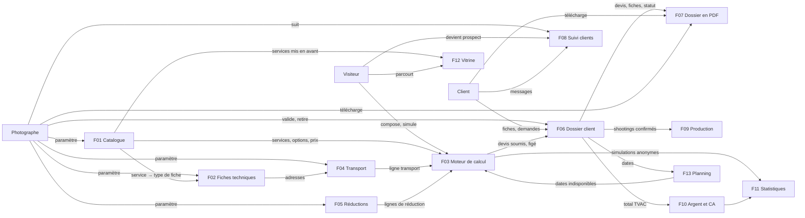
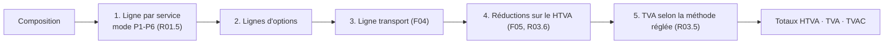
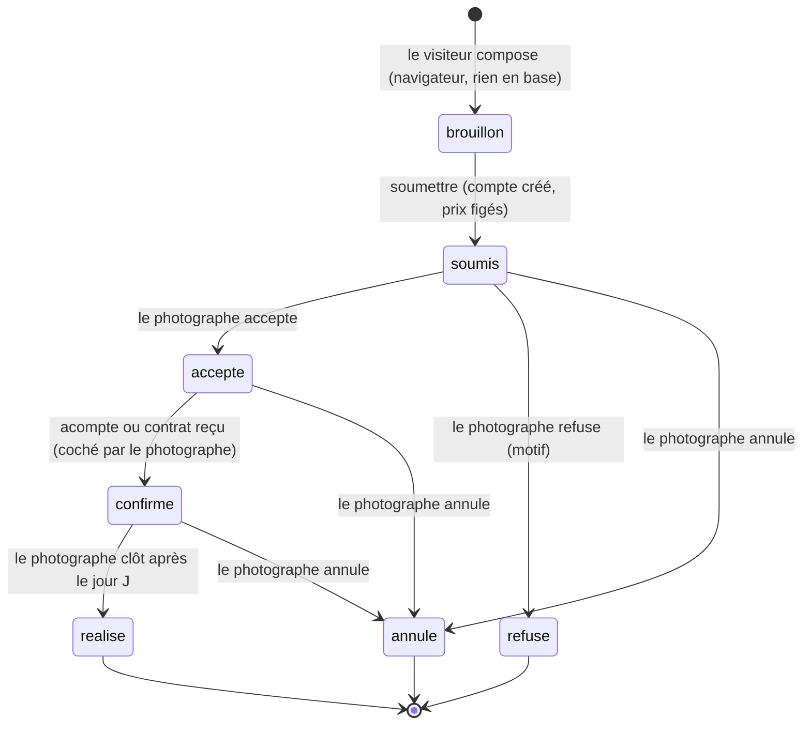

# PRD — PID · Moteur du générateur de devis

> Statut : validé · Version : 2.1 · Validé le : 2026-11-11 · Lit : —
> PRD (Product Requirements Document, document d'exigences produit) : ce qu'on construit, exactement.
> Source : `docs/brainstorm/generateur-devis/L1-fondation.md` (règles M1-M22, décisions D1-D8 du 11/11), reprise intégralement.

## En bref
- **Couvre :** la logique métier du générateur de devis (F01-F07 : catalogue paramétrable, fiches techniques, calcul HTVA/TVAC, transport, réductions, cycle de vie du dossier, PDF) et l'ERP du photographe (F08-F13 : suivi clients, production, argent et CA, statistiques, vitrine, planning).
- **Décisions majeures :** généricité totale, toute variante de règle étant une option du photographe (P01) · aucun tarif ni valeur chiffrée dans le code (P02) · un prix soumis ne change jamais (P05) · moteur indépendant du langage, implémenté en PHP dans PID puis traduit en TypeScript (P06).
- **Ne couvre pas :** la direction artistique (PortfolioPhotographe), l'authentification (hors de ce dossier), la facturation, les déclarations et les dépenses (Smart, v2).
- **IDs définis ici :** P01-P06, F01-F13, UC01.1-UC13.4, R01.1-R13.7, CA01.1-CA13.4, MSG01-MSG23.

## 1. Vision

Un générateur de devis en libre-service pour un photographe événementiel affilié à Smart. Le visiteur compose sa prestation à partir d'un catalogue de services détaillés, et son devis se construit ligne par ligne, avec le prix exact affiché à chaque ajout. À la soumission, il crée un compte. Le site devient alors le dossier du client jusqu'au jour J : ses fiches techniques, ses demandes d'ajout ou de retrait, son suivi. Le photographe définit tout le catalogue, tous les tarifs et toutes les règles depuis son ERP (Enterprise Resource Planning, logiciel de gestion), sans toucher au code.

**L'idée en une phrase :** un moteur de devis dont chaque prix, chaque règle et chaque variante de calcul est paramétré par le photographe, et qui détaille au client tout ce qu'il paie.

**Problème résolu :** aujourd'hui, une prestation est vendue au forfait global. Les déplacements supplémentaires, les lieux multiples et les kilomètres imprévus sont absorbés dans ce forfait sans être facturés. Exemple actuel : un mariage d'une journée complète vendu 1 250 €, transport inclus, laisse 600 à 700 € une fois facturé via Smart *(contexte, pas un tarif du moteur)*.

**Ce qui rend le projet différent :**
- le client simule seul un prix exact, sans contacter le photographe ;
- chaque élément vendu est une ligne nommée et chiffrée ;
- le moteur ne contient aucune règle figée.

## 2. Principes directeurs

| ID | Principe | Raison | Conséquence |
|----|----------|--------|-------------|
| P01 | **Généricité** : quand plusieurs variantes d'une règle sont valables, le moteur les propose toutes comme options. Le photographe les règle au niveau général, et chaque service peut remplacer ce réglage | Le photographe doit pouvoir créer n'importe quel service sans développement (M8, 11/11) | Une question « variante A ou B ? » se traduit toujours par « options A et B, au choix du photographe » |
| P02 | **Aucune valeur en dur** : aucun tarif, taux, seuil, pourcentage, frais, délai ni valeur par défaut dans le code. Tout est saisi dans l'ERP | Le photographe fixe seul ses prix (M22, 11/11) | Le moteur livré est vide de tarifs. Les documents nomment des paramètres (`prixService`, `seuilKm`), jamais des montants. Les cas de test utilisent des valeurs fictives |
| P03 | **Calculateur, pas outil comptable** : le moteur produit des montants HTVA (hors TVA) et TVAC (TVA comprise). Il ne gère ni Smart, ni les déclarations, ni la facturation | La facturation passe par Smart (M7, 11/11) | Aucune donnée fiscale ou sociale du photographe dans le moteur |
| P04 | **Devis détaillé** : chaque élément facturé est une ligne avec son libellé et son montant ; aucun forfait global opaque | Protéger le photographe et informer le client (M1) | Le total est toujours la somme des lignes affichées |
| P05 | **Instantané des prix** : un prix soumis ne change jamais, ni dans un devis, ni dans une facture | Le devis engage les deux parties (M21) | Modifier le catalogue n'agit que sur les devis futurs |
| P06 | **Moteur indépendant du langage** : les règles de calcul ne dépendent ni de PHP, ni de MySQL, ni de Next.js | PID est l'implémentation de référence ; PortfolioPhotographe la traduira en TypeScript (D8, 11/11) | Le calcul est une fonction pure (données en entrée, lignes en sortie) |

## 3. Utilisateurs et rôles

| Rôle | Qui c'est | Ce qu'il veut faire | Accès |
|------|-----------|---------------------|-------|
| Visiteur | Particulier non connecté | Parcourir le catalogue, composer et simuler un devis | Catalogue publié, simulation ; rien n'est enregistré côté serveur |
| Client | Visiteur qui a soumis un devis et créé son compte (email + mot de passe) | Retrouver son dossier, remplir ses fiches techniques, demander un ajout ou un retrait | Son propre dossier uniquement |
| Photographe | mentalyas | Créer et paramétrer le catalogue, les fiches, le transport et les réductions ; suivre et traiter les dossiers | Tout le catalogue et tous les dossiers |
| Smart | Coopérative qui facture pour mentalyas | — | Aucun : hors système |

**Matrice rôles × actions**

| Action | Visiteur | Client | Photographe |
|--------|:--------:|:------:|:-----------:|
| Voir le catalogue publié | ✅ | ✅ | ✅ |
| Simuler un devis | ✅ | ✅ | ✅ |
| Soumettre un devis (crée le compte) | ✅ | ✅ | — |
| Remplir une fiche technique | — | ✅ (son dossier) | ✅ |
| Demander l'ajout d'un service | — | ✅ (avant la date limite) | — |
| Valider ou refuser une demande d'ajout | — | — | ✅ |
| Retirer un service | — | ❌ (contact obligatoire) | ✅ (frais au cas par cas) |
| Créer, modifier, supprimer services, options, fiches, réductions, réglages | — | — | ✅ |
| Télécharger et consulter le dossier en PDF | — | ✅ (son dossier) | ✅ |
| Recevoir son devis par email (devenir prospect) | ✅ | — | — |
| Écrire dans le fil de messages du dossier | — | ✅ (son dossier) | ✅ |
| Voir l'avancement de la production, ses échéances de paiement | — | ✅ (son dossier) | ✅ |
| Gérer fiches clients, production, paiements, vitrine, planning ; consulter statistiques | — | — | ✅ |
| Voir la vitrine et les dates disponibles | ✅ | ✅ | ✅ |

Aucun rôle Administrateur distinct dans ce périmètre : le Photographe a tous les droits de gestion (décision Q5, 11/11).

## 4. Périmètre

### MVP (Minimum Viable Product, la plus petite version utile)
- F01 — Catalogue : services, options, modes de prix, TVA
- F02 — Fiches techniques : types, champs, liaison aux services
- F03 — Moteur de calcul du devis
- F04 — Transport : calculé depuis les adresses du devis
- F05 — Réductions
- F06 — Cycle de vie du dossier client
- F07 — Dossier en PDF
- F08 — ERP : Suivi clients
- F09 — ERP : Suivi de production
- F10 — ERP : Argent et chiffre d'affaires
- F11 — ERP : Statistiques
- F12 — ERP : Gestion de la vitrine
- F13 — ERP : Planning

### v2 et au-delà
- Aide aux déclarations (Smart, comptabilité) — demandé « sur des versions plus tard » (11/11)
- Images du moodboard récupérées via l'API Pinterest (R07.7)
- Dépenses et marge (R10.7)
- Export iCal du planning (R13.7)

### Hors scope (explicitement exclu)
- Direction artistique — conçue dans PortfolioPhotographe, reprise dans PID (04-UX-UI) ; les pages de la vitrine sont dans PID depuis F12
- Authentification (inscription, connexion, mot de passe) — traitée hors de ce dossier ; F06 déclenche seulement la création du compte
- Facturation et déclarations — faites par Smart (P03)
- Dépôt ou échange de fichiers quelconques entre client et photographe — le dossier n'est pas un conteneur de documents ; seul F07 produit un document (décision Q7, 11/11)

## 5. Carte des fonctionnalités

## 6. Fonctionnalités

> Phase en cours : vision et principes d'abord (§1-§5), puis rédaction des fiches F01 à F06 (cas d'usage, critères d'acceptation). Les règles déjà décidées le 11/11 sont reportées ci-dessous.

### F01 — Catalogue : services, options, modes de prix, TVA
**Objectif :** le photographe crée, modifie, archive et supprime n'importe quel type de service ou de produit, et ses options, sans développement. Le moteur ne contient aucun tarif (P02).
**Rôles :** Photographe (gestion) ; Visiteur et Client (lecture des services visibles) · **Périmètre :** MVP

#### Cas d'usage
**UC01.1 — Créer un service**
- Acteur : Photographe · Déclencheur : « Nouveau service » dans l'ERP
- Scénario nominal :
  1. Le photographe saisit le libellé, la description, le mode de prix (R01.5) et ses paramètres.
  2. Il indique si les montants sont saisis HTVA ou TVAC (R01.3), et remplace ou non le taux de TVA général (R01.6).
  3. Il relie, s'il le veut, un type de fiche technique (F02) et des options (R01.4).
  4. Le moteur enregistre le service.
- Alternatives et erreurs :
  - Libellé vide → refus, message « Le libellé du service est obligatoire. »
  - Paramètre du mode de prix manquant (ex. P3 sans durée incluse) → refus, message « Le mode de prix choisi demande : <liste des paramètres manquants>. »
  - Montant négatif → refus, message « Un montant ne peut pas être négatif. »
  - Aucun taux de TVA général saisi et aucun taux propre au service → refus, message « Aucun taux de TVA n'est défini : saisissez le taux général dans les réglages ou un taux propre à ce service. »
- Post-condition : le service existe dans le catalogue.

**UC01.2 — Créer une option et la relier à des services**
- Acteur : Photographe · Déclencheur : « Nouvelle option »
- Scénario nominal :
  1. Le photographe saisit le libellé, le mode de prix (R01.5), ses paramètres et la base HTVA ou TVAC.
  2. Il coche les services qui proposent cette option.
- Alternatives et erreurs : mêmes contrôles que UC01.1.
- Post-condition : l'option est proposée sur chaque service coché.

**UC01.3 — Modifier un service ou une option**
- Acteur : Photographe
- Scénario nominal : le photographe change un libellé, un paramètre de prix, la TVA, les liaisons ; le moteur enregistre.
- Alternatives et erreurs : mêmes contrôles que UC01.1.
- Post-condition : le changement s'applique aux **simulations et dossiers futurs** ; les dossiers soumis gardent leurs prix (P05).

**UC01.4 — Retirer un service ou une option du catalogue**
- Acteur : Photographe · Déclencheur : « Supprimer »
- Scénario nominal :
  1. Le moteur vérifie si l'élément figure dans au moins un dossier soumis.
  2. Jamais utilisé → suppression définitive.
  3. Déjà utilisé → **archivage** : l'élément disparaît du catalogue et reste intact dans les dossiers existants. Message « Ce service figure dans des dossiers : il est archivé, pas supprimé. »
- Post-condition : l'élément n'est plus proposé aux visiteurs.

**UC01.5 — Régler la TVA générale**
- Acteur : Photographe · Déclencheur : écran des réglages généraux de l'ERP
- Scénario nominal : le photographe saisit `tauxTvaGeneral` ; le moteur l'applique à tout service ou option sans taux propre.
- Post-condition : les simulations suivantes utilisent ce taux.

**UC01.6 — Gérer les catégories**
- Acteur : Photographe · Déclencheur : écran « Catégories » de l'ERP
- Scénario nominal : le photographe crée, renomme ou supprime une catégorie ; il attribue une ou plusieurs catégories à chaque service et option.
- Alternatives et erreurs :
  - Libellé vide ou déjà utilisé → refus, message « Cette catégorie existe déjà. » ou « Le libellé de la catégorie est obligatoire. »
  - Catégorie ciblée par une réduction active (F05) → refus de suppression, message « Cette catégorie est utilisée par une réduction : retirez-la de la réduction d'abord. »
- Post-condition : les réductions (R05.2, R05.4) peuvent viser cette catégorie.

#### Règles métier
| ID | Règle | Raison |
|----|-------|--------|
| R01.1 | Le photographe doit pouvoir créer, modifier, archiver et supprimer services et options depuis l'ERP | P01, M8 |
| R01.2 | Un service peut être un shooting (relié à un type de fiche technique) ou un produit sans fiche (ex. album photo) | Exemples du 11/11 |
| R01.3 | Chaque service et chaque option indique si ses montants sont saisis **HTVA ou TVAC** ; le moteur calcule l'autre (formules en F03) | M6 |
| R01.4 | Une **option** est un objet autonome du catalogue, reliée aux services en **plusieurs à plusieurs** | M17 |
| R01.5 | Modes de prix, pour services et options : **P1** forfait · **P2** durée (`unite` ∈ {heure, demi-journée, journée}, `minimumFacture`, `arrondi`) · **P3** forfait + dépassement (`dureeIncluse`, `prixDepassement`, `arrondi`) · **P4** quantité (`min`, `max`, `pas`) · **P5** par personne (`personnesIncluses`, `prixParPersonne`) · **P6** paliers (tranches libres `de`–`a` → `prix`) | P01 ; validé 11/11 |
| R01.6 | Taux de TVA : `tauxTvaGeneral` dans les réglages, remplaçable par un taux propre à chaque service et à chaque option | P01 ; validé 11/11 |
| R01.7 | Un élément présent dans au moins un dossier soumis ne se supprime pas : il s'**archive** | P05 ; validé 11/11 |
| R01.8 | Un élément archivé n'est jamais proposé dans une simulation | Maîtrise du catalogue |
| R01.9 | Aucun montant ni taux n'a de valeur par défaut dans le code (P02) | M22 |
| R01.10 | Les **catégories** sont créées librement par le photographe ; un service ou une option peut en avoir plusieurs | P01, P02 ; validé 11/11 |

#### Critères d'acceptation
*Valeurs fictives de test (P02).*
- [ ] **CA01.1** — Étant donné un service P1 saisi HTVA à 100,00 et un `tauxTvaGeneral` de 21 %, quand un visiteur l'ajoute à sa simulation, alors la ligne affiche 100,00 HTVA, 21,00 de TVA et 121,00 TVAC.
- [ ] **CA01.2** — Étant donné le même service avec un taux propre de 6 %, quand il est simulé, alors la TVA vaut 6,00 et le taux général n'est pas utilisé.
- [ ] **CA01.3** — Étant donné une option reliée aux services A et B, quand un visiteur simule le service C, alors l'option n'est pas proposée.
- [ ] **CA01.4** — Étant donné un service présent dans un dossier soumis, quand le photographe clique « Supprimer », alors le service est archivé, n'apparaît plus dans le catalogue, et le dossier affiche toujours son libellé et ses prix d'origine.
- [ ] **CA01.5** — Étant donné un service jamais utilisé, quand le photographe clique « Supprimer », alors il est supprimé définitivement.
- [ ] **CA01.6** — Étant donné un service soumis dans un dossier à 100,00 HTVA, quand le photographe change son prix à 150,00, alors le dossier affiche toujours 100,00 et une nouvelle simulation affiche 150,00.
- [ ] **CA01.7** — Étant donné un moteur fraîchement installé sans réglage, quand on lit le catalogue, alors il ne contient aucun service, aucune option et aucun taux de TVA.

### F02 — Fiches techniques : types, champs, liaison aux services
**Objectif :** recueillir, pour chaque shooting d'un dossier, les informations pratiques adaptées à son type (mariage, engagement, famille…), sans développement.
**Rôles :** Photographe (crée les types de fiches) ; Client (remplit les fiches de son dossier) · **Périmètre :** MVP

#### Cas d'usage
**UC02.1 — Créer un type de fiche**
- Acteur : Photographe · Déclencheur : « Nouveau type de fiche » dans l'ERP
- Scénario nominal :
  1. Le photographe nomme le type (ex. « Fiche mariage »).
  2. Il ajoute des champs (R02.4) : libellé, type, obligatoire ou non, valeurs possibles pour une liste.
  3. Il regroupe des champs dans un **groupe répétable** s'il le faut (ex. « Lieu » = nom + adresse + heure d'arrivée + heure de fin).
  4. Il ordonne les champs.
- Alternatives et erreurs :
  - Nom du type vide ou déjà utilisé → refus, message « Ce type de fiche existe déjà. »
  - Liste de choix sans valeur → refus, message « Une liste de choix demande au moins une valeur. »
- Post-condition : le type de fiche peut être relié à des services (UC01.1).

**UC02.2 — Dupliquer un type de fiche**
- Acteur : Photographe · Scénario nominal : « Dupliquer » crée une copie indépendante nommée « <nom> (copie) », que le photographe ajuste.
- Post-condition : modifier la copie ne change pas l'original.

**UC02.3 — Remplir une fiche technique**
- Acteur : Client · Déclencheur : ouverture d'un shooting dans son dossier soumis
- Scénario nominal :
  1. Le moteur affiche les champs du type de fiche relié au service, **pré-remplis** avec les valeurs du devis soumis (date, lieux et adresses, durée, nombre de personnes).
  2. Le client complète et enregistre ; il peut reprendre plus tard.
- Alternatives et erreurs :
  - Champ `lien` qui n'est pas une adresse web `https://` → refus du champ, message « Ce lien n'est pas valide : il doit commencer par https:// »
  - Champ obligatoire vide → la fiche est enregistrée comme « incomplète », message « Il manque <n> information(s) obligatoire(s) : <libellés>. »
  - Valeur qui change le prix (durée, nombre de personnes, quantité, adresse d'un lieu) → le prix n'est pas modifié ; une **demande de modification** est créée et soumise au photographe (R02.5, R06.3). Message « Ce changement modifie le prix : il sera appliqué après validation du photographe. »
- Post-condition : la fiche est complète ou incomplète.

**UC02.4 — Modifier un type de fiche déjà utilisé**
- Acteur : Photographe · Scénario nominal : il ajoute, modifie ou retire un champ ; les fiches **à remplir** suivent la nouvelle version ; les fiches **déjà remplies** gardent leurs réponses (R02.3).

#### Règles métier
| ID | Règle | Raison |
|----|-------|--------|
| R02.1 | Chaque shooting d'un dossier a **sa** fiche technique, du type relié à son service | M9 |
| R02.2 | Les types de fiches sont **partagés** entre services et **duplicables** ; un service est relié à au plus un type | D1 : une fiche commune se maintient une fois |
| R02.3 | Une fiche déjà remplie garde ses réponses si son type est modifié ensuite | M14 |
| R02.4 | Types de champs : `texte` · `nombre` · `date` · `heure` · `adresse` · `liste` (choix unique) · `case` (oui/non) · `lien` (adresse web, ex. moodboard Pinterest) · **groupe répétable** de ces champs | Validé 11/11 |
| R02.5 | Une valeur de la fiche qui influence le prix ne modifie jamais le prix directement : elle crée une demande de modification validée par le photographe | P05, R06.3 ; validé 11/11 |
| R02.6 | Seuls les champs `adresse` alimentent le calcul du transport (F04) | Le transport doit reposer sur une adresse structurée |
| R02.7 | La fiche reste modifiable par le client jusqu'à la date limite de modification (R06.4) | Validé 11/11 (Q9) |

#### Critères d'acceptation
- [ ] **CA02.1** — Étant donné le type « Fiche portrait » relié aux services Famille et Engagement, quand le photographe y ajoute le champ « Animal présent », alors les fiches à remplir de ces deux services affichent ce champ.
- [ ] **CA02.2** — Étant donné une fiche déjà remplie, quand le photographe retire un champ de son type, alors la fiche remplie affiche toujours la réponse donnée à ce champ.
- [ ] **CA02.3** — Étant donné un type avec un groupe répétable « Lieu », quand le client ajoute 4 lieux, alors la fiche enregistre 4 lieux, chacun avec son adresse et ses heures.
- [ ] **CA02.4** — Étant donné un devis soumis pour 4 personnes en mode P5, quand le client saisit 6 personnes dans la fiche, alors le prix du dossier ne change pas et une demande de modification apparaît dans l'ERP.
- [ ] **CA02.5** — Étant donné une fiche dont un champ obligatoire est vide, quand le client enregistre, alors la fiche est marquée « incomplète » et le message liste le champ manquant.
- [ ] **CA02.6** — Étant donné un type dupliqué, quand le photographe modifie la copie, alors l'original est inchangé.

### F03 — Moteur de calcul du devis
**Objectif :** transformer une composition (services, options, quantités, durées, personnes, adresses) en lignes chiffrées et en totaux HTVA, TVA et TVAC, de façon identique en PHP et en TypeScript (P06).
**Rôles :** Système · **Périmètre :** MVP

#### Ordre de calcul

#### Cas d'usage
**UC03.1 — Calculer une simulation**
- Acteur : Système · Déclencheur : ajout, retrait ou changement d'un élément dans la simulation du visiteur
- Scénario nominal :
  1. Le moteur reçoit la composition et les réglages du catalogue en vigueur.
  2. Il produit les lignes dans l'ordre de calcul ci-dessus, puis les totaux.
  3. Il renvoie le résultat ; rien n'est enregistré.
- Alternatives et erreurs :
  - Élément archivé ou inexistant → la ligne est retirée, message « Ce service n'est plus proposé : il a été retiré de votre devis. »
  - Paramètre hors limites (quantité sous le `min` ou au-dessus du `max` d'un mode P4, durée sous le `minimumFacture` d'un mode P2) → la valeur est ramenée à la limite, message « La quantité est comprise entre <min> et <max>. » ou « La durée minimale facturée est de <minimumFacture>. »
  - Adresse manquante ou introuvable → ligne transport « Adresse requise », soumission impossible (R04.1, UC04.1)
- Post-condition : le visiteur voit chaque ligne et les totaux.

**UC03.2 — Recalculer à la soumission**
- Acteur : Système · Déclencheur : le visiteur soumet son devis (F06)
- Scénario nominal : le serveur refait le calcul complet à partir de la composition seule (R03.3), puis fige le résultat (P05).
- Alternatives et erreurs : total différent de celui affiché au visiteur (catalogue modifié entre-temps) → le nouveau détail est présenté avant confirmation, message « Les prix ont été mis à jour depuis votre simulation. Vérifiez le nouveau total avant de soumettre. »
- Post-condition : le devis soumis contient les lignes et totaux figés.

#### Règles métier
| ID | Règle | Raison |
|----|-------|--------|
| R03.1 | Le devis se compose ligne par ligne et le total est recalculé à chaque changement | Expérience « catalogue » (11/11) |
| R03.2 | Le total est la somme des lignes affichées | P04 |
| R03.3 | Le serveur recalcule toujours le devis à partir de la composition ; un montant envoyé par le navigateur n'est jamais repris | Le client ne doit pas pouvoir modifier un prix |
| R03.4 | Une ligne contient : origine (`service` · `option` · `transport` · `reduction`), libellé, quantité et unité, montant HTVA, taux de TVA, montant TVA, montant TVAC, marqueur `volOiseau` (distance de repli, R04.6) | P04 ; P06 : format commun aux deux implémentations |
| R03.5 | Méthode de TVA, réglage général : `parLigne` (TVA arrondie sur chaque ligne, total = somme) · `parTaux` (HTVA additionnés par taux, TVA calculée une fois par taux) | P01 ; validé 11/11 |
| R03.6 | Les réductions s'appliquent sur le **HTVA** ; la TVA est calculée ensuite sur le montant réduit | Validé 11/11 |
| R03.7 | Un montant saisi **TVAC** reste exactement ce montant TVAC : HTVA = TVAC ÷ (1 + taux), arrondi au centime, et TVA = TVAC − HTVA | Le client paie le prix affiché par le photographe |
| R03.8 | Montants calculés en décimal exact, arrondis au centime, demi-centime arrondi au centime supérieur | P06 : même résultat en PHP et en TypeScript |
| R03.9 | Le calcul est une fonction pure : mêmes entrées → mêmes lignes, sans accès réseau ni base pendant le calcul | P06 |
| R03.10 | Un **jeu de cas de calcul commun** (entrées → lignes et totaux attendus, valeurs fictives, format JSON) sert de tests aux implémentations PHP et TypeScript | P06 : la traduction est juste si les deux donnent les mêmes résultats ; validé 11/11 |

#### Critères d'acceptation
*Valeurs fictives de test (P02).*
- [ ] **CA03.1** — Étant donné un service P3 (forfait 250,00 HTVA jusqu'à 2 h, dépassement 60,00 par heure, arrondi à la demi-heure entamée) et une durée de 3 h 10, quand le moteur calcule, alors la ligne vaut 250,00 + 1,5 × 60,00 = 340,00 HTVA.
- [ ] **CA03.2** — Étant donné deux lignes HTVA de 10,03 à 21 %, quand la méthode est `parLigne`, alors la TVA totale vaut 2,11 + 2,11 = 4,22 (2,1063 arrondi par ligne) ; quand la méthode est `parTaux`, alors elle vaut 4,21 (21 % × 20,06 = 4,2126).
- [ ] **CA03.3** — Étant donné un service saisi 121,00 TVAC à 21 %, quand le moteur calcule, alors la ligne affiche 100,00 HTVA, 21,00 TVA et 121,00 TVAC.
- [ ] **CA03.4** — Étant donné une simulation dont le navigateur envoie un total de 1,00, quand le visiteur soumet, alors le devis soumis contient le total recalculé par le serveur.
- [ ] **CA03.5** — Étant donné le jeu de cas de calcul commun (R03.10), quand on l'exécute sur l'implémentation PHP puis TypeScript, alors chaque ligne et chaque total sont identiques au centime.

### F04 — Transport : calculé depuis les adresses du devis
**Objectif :** facturer les déplacements réels depuis le domicile du photographe, selon ses réglages, à partir des adresses que le visiteur saisit **dans son devis**.
**Rôles :** Photographe (réglages, domicile) ; Visiteur (adresses) ; Système (calcul) · **Périmètre :** MVP

> ⚠️ **Correction du 11/11** — La décision D2 du L1 (commune estimée à la simulation, recalcul après la fiche) est **abandonnée** : « le client doit d'office me soumettre son adresse dans son devis, donc impossible d'avoir un prix sans adresse » (mentalyas). Plus d'estimation ni de recalcul : le transport est exact avant la soumission, et P05 s'applique sans exception.

#### Cas d'usage
**UC04.1 — Saisir les lieux d'un shooting dans le devis**
- Acteur : Visiteur · Déclencheur : ajout d'un service relié à un type de fiche contenant un champ `adresse`
- Scénario nominal :
  1. Le moteur demande l'adresse de chaque lieu (rue, numéro, code postal, commune) et, pour un itinéraire complet, l'heure de début de chaque lieu.
  2. Le moteur localise chaque adresse, calcule les km selon les réglages (R04.4, R04.5) et ajoute la ligne transport.
- Alternatives et erreurs :
  - Adresse non saisie → ligne transport « Adresse requise », total marqué « incomplet », bouton de soumission bloqué ; message « Indiquez l'adresse de chaque lieu pour obtenir le prix complet. »
  - Adresse introuvable → message « Adresse introuvable : vérifiez la rue, le numéro et le code postal. » ; soumission bloquée.
  - Service de distance routière indisponible → repli selon R04.6.
- Post-condition : la ligne transport est calculée ; le devis peut être soumis.

**UC04.2 — Régler le transport**
- Acteur : Photographe · Déclencheur : réglages généraux, ou réglages d'un service
- Scénario nominal : le photographe saisit son adresse de domicile et les paramètres R04.4 et R04.5 ; chaque service peut remplacer les réglages généraux.
- Alternatives et erreurs : domicile absent → aucun service avec lieu ne peut être simulé, message à la simulation « Ce service n'est pas disponible pour le moment. » et au photographe « Saisissez votre adresse de domicile pour activer le calcul du transport. »
- Post-condition : les simulations suivantes appliquent ces réglages.

**UC04.3 — Changer une adresse après la soumission**
- Acteur : Client · Déclencheur : modification d'une adresse dans la fiche technique (UC02.3)
- Scénario nominal : le moteur calcule le nouveau transport et crée une **demande de modification** (R02.5, R06.3) ; le prix du dossier ne change qu'après validation du photographe.

#### Règles métier
| ID | Règle | Raison |
|----|-------|--------|
| R04.1 | L'adresse de chaque lieu est **obligatoire dans le devis** ; sans elle, pas de prix complet ni de soumission | mentalyas, 11/11 (remplace D2) |
| R04.2 | Le transport est calculé avant la soumission à partir de ces adresses, puis figé avec le reste du devis (P05) | P05 sans exception |
| R04.3 | Le déplacement est **offert** sous un seuil de km et **facturé** au-delà ; le client voit lequel s'applique | M13 |
| R04.4 | Réglages, au niveau général et remplaçables par service : km comptés (`allerSeul` · `allerRetourPlusEloigne` · `itineraireComplet`) · application du seuil (`franchise` · `toutOuRien`) · `seuilKm` · `prixKm` | P01, M15 |
| R04.5 | Portée du seuil, réglable : `parShooting` (chaque shooting a son seuil) · `parDossier` (un seuil sur le total des km du dossier). Une ligne transport par shooting dans les deux cas | P01 ; validé 11/11 |
| R04.6 | Type de distance, réglable : `routiere` · `volOiseau`. Si la distance routière est indisponible, repli réglable : `volOiseau` (ligne marquée « distance à vol d'oiseau ») · `bloquer` (soumission impossible, message « Le calcul de distance est momentanément indisponible. Réessayez plus tard. ») | P01 ; validé 11/11 |
| R04.7 | L'itinéraire complet suit l'ordre chronologique des heures de début des lieux | Reflète le trajet réel de la journée |
| R04.8 | L'adresse du domicile du photographe n'est jamais affichée au client ; le détail montre « Départ photographe → <lieu> : <km> » | Vie privée du photographe |

#### Critères d'acceptation
*Valeurs fictives de test (P02).*
- [ ] **CA04.1** — Étant donné un mariage sans adresse saisie, quand le visiteur tente de soumettre, alors la soumission est bloquée et le message « Indiquez l'adresse de chaque lieu pour obtenir le prix complet. » s'affiche.
- [ ] **CA04.2** — Étant donné `itineraireComplet`, `franchise`, `seuilKm` = 25 et `prixKm` = 0,50, et des trajets de 10 + 8 + 12 + 20 km, quand le moteur calcule, alors la ligne transport vaut (50 − 25) × 0,50 = 12,50 HTVA.
- [ ] **CA04.3** — Étant donné les mêmes trajets en `toutOuRien`, quand le moteur calcule, alors la ligne vaut 50 × 0,50 = 25,00 HTVA ; avec un total de 20 km, elle vaut 0,00 et affiche « Déplacement offert ».
- [ ] **CA04.4** — Étant donné `parDossier` et deux shootings de 15 km et 20 km avec `seuilKm` = 25 en franchise, quand le moteur calcule, alors 10 km sont facturés au total.
- [ ] **CA04.5** — Étant donné `routiere` avec repli `volOiseau` et le service de distance indisponible, quand le visiteur saisit ses adresses, alors la ligne est calculée à vol d'oiseau et marquée « distance à vol d'oiseau ».
- [ ] **CA04.6** — Étant donné un dossier soumis, quand le client change une adresse dans sa fiche, alors le prix du dossier ne change pas et une demande de modification apparaît dans l'ERP avec le nouveau montant de transport.
- [ ] **CA04.7** — Étant donné n'importe quelle simulation, quand le client lit le détail du transport, alors l'adresse du domicile du photographe n'apparaît nulle part.

### F05 — Réductions
**Objectif :** accorder des rabais paramétrables, placés où le photographe le veut, notamment quand un client cumule plusieurs services.
**Rôles :** Photographe (crée) ; Système (applique, suggère) ; Visiteur et Client (bénéficient, saisissent un code) · **Périmètre :** MVP

#### Cas d'usage
**UC05.1 — Créer une réduction**
- Acteur : Photographe · Déclencheur : « Nouvelle réduction » dans l'ERP
- Scénario nominal :
  1. Le photographe nomme la réduction (libellé affiché au client).
  2. Il choisit une ou plusieurs conditions (R05.2), un effet (R05.3) et une cible (R05.4).
  3. Il règle, s'il le veut, les limites (R05.6), le cumul (R05.5) et la suggestion (R05.8).
  4. Le moteur enregistre ; la réduction s'applique aux simulations suivantes.
- Alternatives et erreurs :
  - Pourcentage hors de 0 à 100 → refus, message « Un pourcentage est compris entre 0 et 100. »
  - Effet « élément offert » sans élément choisi → refus, message « Choisissez l'élément offert. »
  - Condition « code promo » sans code, ou code déjà utilisé par une autre réduction → refus, message « Ce code promo existe déjà. »
  - Date de fin antérieure à la date de début → refus, message « La date de fin précède la date de début. »
- Post-condition : la réduction est active.

**UC05.2 — Appliquer les réductions à un calcul**
- Acteur : Système · Déclencheur : chaque calcul (UC03.1, UC03.2)
- Scénario nominal :
  1. Le moteur évalue les conditions de chaque réduction active et dans sa période de validité.
  2. Il écarte celles dont une limite est atteinte (utilisations, une fois par client).
  3. Il applique les retenues selon la règle de cumul, sur le HTVA (R03.6), plafonnées par la remise maximale.
  4. Chaque réduction appliquée est une ligne distincte (origine `reduction`).
- Post-condition : les lignes de réduction figurent dans le devis.

**UC05.3 — Saisir un code promo**
- Acteur : Visiteur · Scénario nominal : il saisit le code ; la réduction correspondante est évaluée comme les autres.
- Alternatives et erreurs : code inconnu, expiré ou épuisé → message « Ce code promo n'est pas valable. » (même message dans les trois cas, pour ne pas révéler quels codes existent).

**UC05.4 — Suggérer une réduction proche**
- Acteur : Système · Scénario nominal : pour chaque réduction marquée « suggérer », dont une seule condition n'est pas remplie, le moteur renvoie le libellé et ce qu'il manque (ex. « Ajoutez un album : <libellé de la réduction> »). L'interface l'affiche.

**UC05.5 — Réduction déclenchée par un ajout après soumission**
- Acteur : Système · Déclencheur : demande d'ajout du client (R06.3)
- Scénario nominal : la demande de modification présente le nouveau total, réductions nouvellement remplies comprises ; tout s'applique à la validation du photographe. Les réductions déjà accordées restent figées (P05).

**UC05.6 — Parrainer un proche**
- Acteurs : Client (parrain), Visiteur (filleul) · Déclencheur : le filleul saisit le code de parrainage du parrain dans sa simulation
- Scénario nominal :
  1. Le moteur reconnaît le code personnel du parrain (R05.11).
  2. Si le réglage le prévoit, la réduction « filleul » s'applique à la simulation (R05.12).
  3. À la soumission, le dossier du filleul est rattaché au parrain.
  4. Quand le dossier du filleul atteint l'étape d'acquisition réglée (R05.13), le moteur crée un **bon de réduction** personnel pour le parrain, si le réglage le prévoit.
- Alternatives et erreurs :
  - Code inconnu → message « Ce code de parrainage n'est pas valable. »
  - Le parrain saisit son propre code (même compte ou même email) → refus, même message
  - Dossier du filleul annulé avant l'étape d'acquisition → aucun bon créé
- Post-condition : le parrain voit son bon dans son dossier ; il l'utilise sur un prochain dossier ou une demande d'ajout.

#### Règles métier
| ID | Règle | Raison |
|----|-------|--------|
| R05.1 | Une réduction = **conditions** + **effet** + **cible** | Le photographe veut « mettre des réductions où il veut » (11/11) |
| R05.2 | Conditions, combinables : nombre de services · combinaison précise de services · catégorie (R01.10) · montant total du dossier · dates différentes · code promo · parrainage (R05.9) · aucune | P01 |
| R05.3 | Effets : pourcentage · montant fixe · élément offert | P01 |
| R05.4 | Cibles : un service · une option · une catégorie · le transport · le dossier entier | M16 |
| R05.5 | Cumul : `toutes` · `plusAvantageuse` · `priorite` (ordre défini) ; réglage général, remplaçable par réduction | P01 |
| R05.6 | Limites optionnelles : période de validité (date de soumission comprise entre `debut` et `fin`) · nombre d'utilisations maximum · une fois par client · remise maximale | Validé 11/11 |
| R05.7 | Une réduction ne rend jamais une ligne ni le total négatif : la retenue est plafonnée au montant de sa cible | Un devis ne peut pas devenir un avoir |
| R05.8 | Chaque réduction a un réglage « suggérer au visiteur » (oui / non) | P01 ; validé 11/11 |
| R05.9 | **Parrainage** : condition « code de parrainage valide » (R05.2), récompenses selon R05.12 | Demandé le 11/11 |
| R05.10 | Une utilisation est comptée à la **soumission** du devis, pas à la simulation | Une simulation abandonnée ne consomme pas de code |
| R05.11 | Chaque client a un **code de parrainage personnel et unique**, visible dans son dossier | Validé 11/11 |
| R05.12 | Récompenses, réglables : `filleul` · `parrain` · `les deux`. Chaque récompense est une réduction F05 configurée par le photographe (effet, cible, plafond, limites) | P01, P02 ; validé 11/11 |
| R05.13 | La récompense du parrain est un **bon de réduction** personnel, acquis quand le dossier du filleul atteint l'étape réglée : `soumis` · `confirme` · `realise` | Validé 11/11 ; aucune étape par défaut dans le code (P02) |
| R05.14 | Un bon est utilisable une fois, par son titulaire seulement, sur un nouveau dossier ou une demande d'ajout | Le bon récompense une personne |
| R05.15 | Un client ne peut pas être son propre parrain (même compte ou même email) | Empêche l'auto-parrainage |

#### Critères d'acceptation
*Valeurs fictives de test (P02).*
- [ ] **CA05.1** — Étant donné la réduction « mariage + album → −10 % sur le dossier », quand un visiteur a dans sa simulation un mariage à 1 000,00 HTVA et un album à 200,00 HTVA, alors une ligne « −120,00 » apparaît et le total HTVA vaut 1 080,00.
- [ ] **CA05.2** — Étant donné deux réductions de −10 % et −50,00 sur le dossier en cumul `plusAvantageuse` et un total de 300,00 HTVA, quand le moteur calcule, alors seule la réduction de −50,00 s'applique.
- [ ] **CA05.3** — Étant donné une remise de −10 % plafonnée à 50,00 et un total de 1 000,00, quand le moteur calcule, alors la retenue vaut 50,00.
- [ ] **CA05.4** — Étant donné un code promo limité à 1 utilisation déjà consommée, quand un visiteur le saisit, alors le message « Ce code promo n'est pas valable. » s'affiche et aucune ligne de réduction n'apparaît.
- [ ] **CA05.5** — Étant donné une réduction « transport offert », quand le moteur calcule un transport de 12,50, alors la ligne de réduction vaut −12,50 et le transport net vaut 0,00.
- [ ] **CA05.6** — Étant donné une réduction « mariage + album » marquée « suggérer » et une simulation contenant seulement un mariage, quand le moteur calcule, alors il renvoie la suggestion « Ajoutez un album ».
- [ ] **CA05.7** — Étant donné un dossier soumis avec un mariage, quand le client demande l'ajout d'un album, alors la demande de modification affiche l'album et la réduction « mariage + album », et rien ne change avant la validation du photographe.
- [ ] **CA05.8** — Étant donné une récompense `les deux` et une acquisition à `confirme`, quand le dossier du filleul passe à `confirme`, alors un bon apparaît dans le dossier du parrain ; tant qu'il est à `soumis`, aucun bon n'existe.
- [ ] **CA05.9** — Étant donné le code de parrainage d'un client, quand ce même client le saisit dans une nouvelle simulation, alors le message « Ce code de parrainage n'est pas valable. » s'affiche.

### F06 — Cycle de vie du dossier client
**Objectif :** du devis soumis au jour J, faire avancer le dossier, encadrer les modifications et figer les prix.
**Rôles :** Visiteur (soumet), Client (demande), Photographe (décide) · **Périmètre :** MVP

#### Étapes du dossier
`etape ∈ {brouillon, soumis, accepte, refuse, confirme, realise, annule}` — validé 11/11 (Q2).

#### Cas d'usage
**UC06.1 — Soumettre le devis**
- Acteur : Visiteur · Déclencheur : « Soumettre mon devis »
- Scénario nominal :
  1. Le moteur recalcule le devis (UC03.2) et vérifie que chaque adresse est saisie (R04.1).
  2. Le visiteur crée son compte (email + mot de passe, hors de ce dossier) ou se connecte.
  3. Le moteur enregistre le dossier à l'étape `soumis` avec ses prix figés (P05) et compte les utilisations de réductions (R05.10).
- Alternatives et erreurs :
  - Adresse manquante → soumission bloquée (CA04.1)
  - Catalogue modifié depuis la simulation → nouveau détail présenté avant confirmation (UC03.2)
  - Création du compte abandonnée → rien n'est enregistré ; la composition reste dans le navigateur
- Post-condition : dossier `soumis`, visible du client et du photographe.

**UC06.2 — Accepter ou refuser un dossier soumis**
- Acteur : Photographe · Scénario nominal : il passe le dossier à `accepte`, ou à `refuse` avec un motif visible du client.
- Alternatives et erreurs : refus sans motif → refus, message « Indiquez le motif du refus : il sera affiché au client. »

**UC06.3 — Confirmer, clore, annuler**
- Acteur : Photographe · Scénario nominal : il passe le dossier à `confirme` (acompte ou contrat reçu hors système), puis `realise` après le jour J, ou à `annule` depuis `soumis`, `accepte` ou `confirme`, avec des frais d'annulation appliqués ou non au cas par cas.
- Alternatives et erreurs : transition absente du diagramme → refus, message « Ce dossier ne peut pas passer de <étape> à <étape>. »

**UC06.4 — Demander l'ajout d'un service ou d'une option**
- Acteur : Client · Déclencheur : « Ajouter au dossier », étape `soumis`, `accepte` ou `confirme`, avant la date limite
- Scénario nominal :
  1. Le client compose l'ajout ; le moteur calcule les nouvelles lignes au **prix du catalogue du jour de la demande** (R06.7), réductions nouvellement remplies comprises (UC05.5).
  2. Une demande de modification est créée ; le dossier ne change pas.
- Alternatives et erreurs : date limite dépassée → refus, message « La date limite de modification est passée. Contactez le photographe. »
- Post-condition : demande en attente dans l'ERP.

**UC06.5 — Traiter une demande de modification**
- Acteur : Photographe · Déclencheur : demande en attente (ajout UC06.4, changement de fiche UC02.3, changement d'adresse UC04.3)
- Scénario nominal : il voit l'ancien et le nouveau détail, puis valide ; les nouvelles lignes sont figées au prix calculé à la demande.
- Alternatives et erreurs : refus → motif obligatoire, visible du client ; le dossier reste tel quel et une valeur de fiche refusée reprend sa valeur précédente.

**UC06.6 — Retirer un service d'un dossier**
- Acteur : Photographe · Déclencheur : le client a contacté le photographe (hors système)
- Scénario nominal : le photographe retire la ligne depuis l'ERP et choisit d'ajouter ou non une ligne de frais de retrait, dont il saisit le montant.
- Post-condition : le dossier est recalculé sans la ligne retirée ; les autres lignes gardent leurs prix figés.

**UC06.7 — Demander la suppression de son compte**
- Acteur : Client · Déclencheur : « Supprimer mon compte » dans son espace
- Scénario nominal :
  1. Le client confirme en saisissant son mot de passe.
  2. Le moteur anonymise le compte et tous ses dossiers (R06.15).
  3. Le client est déconnecté ; message « Votre compte a été supprimé. Vos données personnelles ont été effacées. »
- Alternatives et erreurs : mot de passe incorrect → message « Mot de passe incorrect. » ; rien n'est modifié.
- Post-condition : plus aucune donnée personnelle du client ; montants et historique conservés.

**UC06.8 — Anonymiser les dossiers échus**
- Acteur : Système · Déclencheur : commande `dossiers:anonymiser` (lancée à la main ou par le planificateur)
- Scénario nominal : chaque dossier clos depuis plus de `retentionMois` (R06.14) est anonymisé (R06.15).
- Alternatives et erreurs : `retentionMois` non réglé → aucune anonymisation automatique ; avertissement dans E23.

#### Règles métier
| ID | Règle | Raison |
|----|-------|--------|
| R06.1 | Le visiteur compose et simule sans compte ; le compte est créé à la **soumission** | M2 |
| R06.2 | Le client retrouve son dossier en se reconnectant | M5 |
| R06.3 | Le client peut **demander** l'ajout d'un service ou d'une option jusqu'à la date limite ; l'ajout ne s'applique qu'après validation du photographe | M3, M19 |
| R06.4 | **Date limite de modification** : nombre de jours avant la date du shooting, réglage général remplaçable par service ; au-delà, ni demande d'ajout ni modification de fiche | M18 ; validé 11/11 (Q9) |
| R06.5 | Le client ne peut pas retirer un service : le retrait passe par le photographe | M4 |
| R06.6 | Un retrait peut comporter des frais ; le photographe décide au cas par cas de les appliquer et saisit leur montant | M20 |
| R06.7 | Les prix d'un dossier soumis sont figés (P05) ; un ajout validé est figé au **prix du jour de sa demande** | Validé 11/11 (Q6) |
| R06.8 | Seul le photographe fait avancer le dossier après `soumis` ; seules les transitions du diagramme sont permises | Maîtrise du dossier |
| R06.9 | Tout refus (dossier ou demande) porte un **motif** visible du client | Validé 11/11 |
| R06.10 | Les demandes d'ajout et les modifications de fiche sont possibles aux étapes `soumis`, `accepte` et `confirme` seulement | Un dossier refusé, annulé ou réalisé est clos |
| R06.11 | Dans un dossier à plusieurs shootings, la date limite se calcule pour chaque shooting à partir de sa propre date | Validé 11/11 |
| R06.12 | Une annulation peut comporter des frais, appliqués ou non au cas par cas, comme un retrait | Validé 11/11 |
| R06.13 | Le tableau de bord du photographe liste les shootings des N prochains jours ; N est réglé par le photographe | Validé 11/11 ; P02 |
| R06.14 | Durée de conservation `retentionMois` après la clôture d'un dossier (`realise`, `refuse`, `annule`), réglée par le photographe | RGPD ; P02 ; validé 11/11 |
| R06.15 | **Anonymisation** à l'échéance de R06.14 ou à la demande du client : données personnelles effacées (email, nom, téléphone, adresses, réponses de fiche, fichiers PDF) ; montants, lignes, étapes et historique conservés | Droit à l'effacement ; traçabilité des montants ; validé 11/11 |

#### Critères d'acceptation
*Valeurs fictives de test (P02).*
- [ ] **CA06.1** — Étant donné une simulation complète, quand le visiteur soumet et crée son compte, alors un dossier à l'étape `soumis` existe avec exactement les lignes et totaux recalculés.
- [ ] **CA06.2** — Étant donné un dossier `refuse`, quand le client tente une demande d'ajout, alors l'action est indisponible.
- [ ] **CA06.3** — Étant donné une date limite de 30 jours et un shooting dans 20 jours, quand le client demande un ajout, alors le message « La date limite de modification est passée. Contactez le photographe. » s'affiche.
- [ ] **CA06.4** — Étant donné un album à 200,00 au jour de la demande d'ajout, puis passé à 250,00 avant la validation, quand le photographe valide, alors la ligne de l'album vaut 200,00.
- [ ] **CA06.5** — Étant donné une demande de changement de 4 à 6 personnes, quand le photographe la refuse avec le motif « Capacité du studio : 4 personnes », alors la fiche reprend 4 personnes et le client voit le motif.
- [ ] **CA06.6** — Étant donné un dossier `soumis`, quand le photographe tente de le passer directement à `realise`, alors le message « Ce dossier ne peut pas passer de soumis à realise. » s'affiche.
- [ ] **CA06.7** — Étant donné un retrait d'album avec des frais de 30,00, quand le photographe valide le retrait, alors la ligne de l'album disparaît, une ligne « Frais de retrait : 30,00 » apparaît et les autres lignes gardent leurs prix.
- [ ] **CA06.8** — Étant donné un client avec deux dossiers, quand il supprime son compte, alors son email, ses adresses et ses PDF n'existent plus, et le photographe voit toujours les deux dossiers avec leurs montants et « client supprimé ».
- [ ] **CA06.9** — Étant donné `retentionMois` = 24 et un dossier clos depuis 25 mois, quand `dossiers:anonymiser` s'exécute, alors ce dossier est anonymisé et un dossier clos depuis 23 mois ne l'est pas.

### F07 — Dossier en PDF
**Objectif :** le moteur génère le dossier du client en PDF (Portable Document Format), versionné à chaque changement, que le client et le photographe consultent et téléchargent.
**Rôles :** Client (son dossier), Photographe (tous) ; Système (génère) · **Périmètre :** MVP

#### Cas d'usage
**UC07.1 — Générer une version du dossier**
- Acteur : Système · Déclencheur : soumission (UC06.1), changement d'étape (UC06.2, UC06.3), demande de modification validée (UC06.5), retrait (UC06.6)
- Scénario nominal :
  1. Le moteur assemble le contenu R07.4 à partir de l'état du dossier.
  2. Il produit le PDF de la version suivante, numérotée et datée (ex. « Dossier n° <numéro> — version 3 — 2027-03-14 »).
  3. Les versions précédentes restent inchangées.
- Alternatives et erreurs : échec de génération → le changement du dossier est conservé, la génération est relancée ; le dossier affiche « Le document de cette version est en préparation. »
- Post-condition : une nouvelle version est téléchargeable.

**UC07.2 — Consulter et télécharger le dossier**
- Acteurs : Client, Photographe · Scénario nominal : la liste des versions s'affiche (numéro, date, événement déclencheur) ; un clic ouvre ou télécharge la version choisie.
- Alternatives et erreurs : un client demande le PDF d'un autre dossier → refus (accès interdit), message « Ce dossier n'existe pas ou ne vous appartient pas. »

#### Règles métier
| ID | Règle | Raison |
|----|-------|--------|
| R07.1 | Le PDF est **généré par le moteur** à partir des données du dossier ; aucun fichier n'est déposé par un utilisateur | Le dossier n'est pas un conteneur de documents (Q7, 11/11) |
| R07.2 | Le PDF reprend les prix figés du dossier (P05) | Le document fait foi |
| R07.3 | Un client ne peut obtenir que les PDF de son propre dossier | Données personnelles |
| R07.4 | Contenu : devis détaillé (lignes, HTVA, TVA, TVAC) · fiches techniques remplies · coordonnées et mentions du photographe · coordonnées du client · historique du dossier (étapes et demandes traitées, avec dates) · liens saisis dans les fiches, dont le moodboard | Validé 11/11 |
| R07.5 | Coordonnées et mentions du photographe : texte saisi dans l'ERP, aucun texte en dur | P02 |
| R07.6 | **Une version par changement** : chaque événement de UC07.1 crée une version numérotée et datée ; une version n'est jamais modifiée ni supprimée, **sauf à l'anonymisation du dossier** (R06.15) : le fichier est supprimé, la trace de la version (numéro, date, événement) reste | Preuve de ce qui était convenu à chaque moment ; validé 11/11 |
| R07.7 | Moodboard : seul le **lien** est conservé et affiché, cliquable ; aucune image n'est récupérée chez Pinterest dans le MVP | Validé 11/11 ; images via l'API Pinterest en v2 |

#### Critères d'acceptation
- [ ] **CA07.1** — Étant donné un dossier soumis, quand le photographe valide une demande d'ajout, alors une version 2 apparaît et la version 1 reste téléchargeable, identique.
- [ ] **CA07.2** — Étant donné une fiche avec un lien Pinterest, quand le PDF est généré, alors le lien y figure, cliquable.
- [ ] **CA07.3** — Étant donné un client A connecté, quand il demande le PDF du dossier du client B, alors l'accès est refusé avec le message « Ce dossier n'existe pas ou ne vous appartient pas. »
- [ ] **CA07.4** — Étant donné des mentions saisies dans l'ERP, quand le photographe les modifie, alors les versions déjà générées gardent les anciennes mentions et la version suivante affiche les nouvelles.

### F08 — ERP : Suivi clients
**Objectif :** le photographe retrouve tout ce qui concerne un client ou un prospect au même endroit, crée un client lui-même et échange avec lui par écrit dans le dossier.
**Rôles :** Photographe ; Client (fil de messages) ; Visiteur (devient prospect) · **Périmètre :** MVP

#### Cas d'usage
**UC08.1 — Devenir prospect**
- Acteur : Visiteur · Déclencheur : « Recevoir ce devis par email » sur E01
- Scénario nominal :
  1. Le visiteur saisit son email et coche « J'accepte que le photographe conserve ce devis et me recontacte à son sujet. »
  2. Le moteur enregistre le prospect et sa simulation, puis envoie le détail du devis par email.
- Alternatives et erreurs :
  - Case non cochée → refus, message « Cochez la case pour recevoir votre devis. »
  - Email invalide → message « Cette adresse email n'est pas valide. »
  - Email déjà prospect → la nouvelle simulation s'ajoute à son historique.
- Post-condition : le prospect apparaît dans l'ERP. S'il soumet plus tard un devis avec le même email, il devient client et garde son historique.

**UC08.2 — Consulter la fiche d'un client ou d'un prospect**
- Acteur : Photographe · Scénario nominal : il voit les coordonnées, l'origine, les étiquettes, les dossiers (étape, total), les simulations envoyées, les notes privées et le journal des échanges.

**UC08.3 — Enrichir la fiche**
- Acteur : Photographe · Scénario nominal : il modifie les notes privées, ajoute une entrée au journal des échanges (date, canal, résumé), choisit l'origine, ajoute ou retire des étiquettes.
- Alternatives et erreurs : entrée de journal sans résumé → message « Le résumé de l'échange est obligatoire. »

**UC08.4 — Créer un client et son dossier depuis l'ERP**
- Acteur : Photographe · Déclencheur : « Nouveau client » (client qui a appelé)
- Scénario nominal :
  1. Il saisit l'email et le nom du client.
  2. Il compose le devis avec le même moteur et les mêmes prix que E01 (F03).
  3. Il soumet : le dossier est créé à l'étape `soumis` (R06.8) et le client reçoit un email « Activez votre compte » pour choisir son mot de passe et retrouver son dossier.
- Alternatives et erreurs : email déjà client → message « Ce client existe déjà : ouvrir sa fiche. » ; le dossier est créé sur le compte existant.

**UC08.5 — Échanger par messages dans le dossier**
- Acteurs : Client, Photographe · Scénario nominal : l'un écrit un message texte dans le dossier ; l'autre reçoit un email « Nouveau message dans le dossier <numéro> » ; le message est daté et horodaté.
- Alternatives et erreurs : message vide → bouton inactif ; pièce jointe → impossible (R07.1).
- Post-condition : le fil garde tous les messages, du plus ancien au plus récent.

#### Règles métier
| ID | Règle | Raison |
|----|-------|--------|
| R08.1 | Un prospect n'est enregistré qu'avec son **consentement explicite** (case cochée, date du consentement gardée) | RGPD ; validé 11/11 |
| R08.2 | Un prospect qui soumet un devis avec le même email devient client et garde son historique de simulations | Pas de doublon |
| R08.3 | Fiche client : coordonnées, origine, étiquettes, notes privées, journal des échanges, dossiers, simulations | Validé 11/11 |
| R08.4 | Les **notes privées** et le **journal des échanges** ne sont jamais visibles du client | Notes de travail du photographe |
| R08.5 | La liste des **origines** et les **étiquettes** sont créées librement par le photographe | P01, P02 |
| R08.6 | Un dossier créé par le photographe suit les mêmes règles qu'un dossier en ligne (prix figés, étapes, demandes) | P05, F06 |
| R08.7 | Le fil de messages est du **texte seul** ; une demande de retrait (R06.5) peut s'y faire | R07.1 ; validé 11/11 |
| R08.8 | Chaque nouveau message envoie un email de notification au destinataire, sans le contenu du message | Le contenu reste dans le dossier, derrière la connexion |
| R08.9 | Les prospects sont anonymisés `retentionProspectsMois` après leur dernière simulation, durée réglée par le photographe | RGPD ; P02 |

#### Critères d'acceptation
- [ ] **CA08.1** — Étant donné une simulation, quand le visiteur demande « Recevoir ce devis par email » sans cocher la case, alors le message « Cochez la case pour recevoir votre devis. » s'affiche et rien n'est enregistré.
- [ ] **CA08.2** — Étant donné un prospect `lea@example.be`, quand Léa soumet plus tard un devis avec cet email, alors sa fiche client montre ses anciennes simulations et son dossier.
- [ ] **CA08.3** — Étant donné une note privée sur un client, quand ce client consulte son dossier, alors la note n'apparaît nulle part.
- [ ] **CA08.4** — Étant donné un client créé par le photographe, quand le client suit le lien « Activez votre compte » et choisit son mot de passe, alors il voit son dossier à l'étape `soumis`.
- [ ] **CA08.5** — Étant donné un message du client, quand il l'envoie, alors le photographe reçoit un email de notification qui ne contient pas le texte du message.

### F09 — ERP : Suivi de production
**Objectif :** suivre chaque shooting après le jour J, d'étape en étape jusqu'à la livraison, et repérer les retards avant qu'ils arrivent.
**Rôles :** Photographe (fait avancer) ; Client (voit l'avancement) · **Périmètre :** MVP

#### Cas d'usage
**UC09.1 — Créer un modèle de production**
- Acteur : Photographe · Déclencheur : « Nouveau modèle de production »
- Scénario nominal : il nomme le modèle (ex. « Production mariage ») et ordonne ses étapes (ex. « Tri », « Retouche », « Export », « Livraison ») ; il relie le modèle à un ou plusieurs services et règle, par service, le délai de livraison en jours après le shooting.
- Alternatives et erreurs : modèle sans étape → message « Un modèle de production demande au moins une étape. » ; la dernière étape est toujours l'étape de livraison (R09.3).

**UC09.2 — Faire avancer un shooting**
- Acteur : Photographe · Déclencheur : shooting d'un dossier `confirme` dont la date est passée
- Scénario nominal : il passe le shooting à l'étape suivante du modèle ; la date de chaque passage est gardée.
- Post-condition : le client voit la nouvelle étape et la date de livraison prévue dans son dossier.

**UC09.3 — Livrer**
- Acteur : Photographe · Scénario nominal : à l'étape de livraison, il colle le lien de livraison (adresse `https://`) et valide ; le client reçoit un email « Vos photos sont prêtes » et voit le lien dans son dossier.
- Alternatives et erreurs : lien absent ou invalide → message « Collez un lien de livraison commençant par https:// »

**UC09.4 — Voir les retards et les échéances proches**
- Acteur : Photographe · Scénario nominal : l'ERP liste les shootings non livrés, triés par échéance ; ceux dont l'échéance est dépassée sont marqués « en retard », ceux dont l'échéance tombe dans les `joursAlerteProduction` jours sont marqués « échéance proche ».

#### Règles métier
| ID | Règle | Raison |
|----|-------|--------|
| R09.1 | Les étapes de production viennent d'un **modèle de production** créé par le photographe et relié aux services | P01 ; validé 11/11 |
| R09.2 | Échéance de livraison = date du shooting + `delaiLivraisonJours` du service, réglé par le photographe | P02 ; validé 11/11 |
| R09.3 | La dernière étape d'un modèle est la livraison ; elle demande un **lien de livraison** | Validé 11/11 |
| R09.4 | Aucun fichier photo n'est stocké dans PID : la livraison passe par un lien externe | Validé 11/11 ; R07.1 |
| R09.5 | Le client voit l'étape en cours, la date de livraison prévue et, une fois livré, le lien | Validé 11/11 |
| R09.6 | Un shooting entre en production quand son dossier est `confirme` et que sa date est passée | Pas de production pour un dossier non confirmé |
| R09.7 | Seuil d'alerte `joursAlerteProduction` réglé par le photographe | P02 |
| R09.8 | Un modèle de production modifié s'applique aux shootings qui n'ont pas encore commencé ; les shootings en cours gardent leurs étapes | Comme R02.3 |

#### Critères d'acceptation
- [ ] **CA09.1** — Étant donné un service avec un délai de 30 jours et un shooting le 2027-06-19, quand le dossier est confirmé, alors l'échéance affichée est le 2027-07-19.
- [ ] **CA09.2** — Étant donné un shooting non livré dont l'échéance est passée d'un jour, quand le photographe ouvre la liste de production, alors ce shooting est marqué « en retard » et apparaît en premier.
- [ ] **CA09.3** — Étant donné l'étape de livraison, quand le photographe valide sans lien, alors le message « Collez un lien de livraison commençant par https:// » s'affiche et l'étape ne change pas.
- [ ] **CA09.4** — Étant donné une livraison validée, quand le client ouvre son dossier, alors il voit le lien et a reçu l'email « Vos photos sont prêtes ».

### F10 — ERP : Argent et chiffre d'affaires
**Objectif :** savoir ce qui est dû, ce qui est reçu et ce qui va rentrer, dossier par dossier et par période, sans facturer (Smart, P03).
**Rôles :** Photographe ; Client (voit ses échéances) ; Système (rappels) · **Périmètre :** MVP

#### Cas d'usage
**UC10.1 — Créer un modèle d'échéancier**
- Acteur : Photographe · Scénario nominal : il nomme le modèle et liste ses échéances ; chaque échéance a un libellé (ex. « Acompte »), un montant (pourcentage du total TVAC ou montant fixe), un moment (`aLaConfirmation` · `joursAvantShooting` · `joursApresShooting` · `aLaLivraison`) et ses rappels (R10.5). Il relie le modèle à des services.
- Alternatives et erreurs : pourcentages qui dépassent 100 % → message « La somme des pourcentages dépasse 100 %. » ; le reste non couvert va toujours sur la dernière échéance (R10.2).

**UC10.2 — Établir les échéances d'un dossier**
- Acteur : Système, Photographe · Déclencheur : passage du dossier à `accepte` (UC06.2)
- Scénario nominal : le moteur applique le modèle d'échéancier ; si les services du dossier ont des modèles différents, le photographe choisit lequel au moment d'accepter ; il peut ensuite ajuster dates et montants.
- Post-condition : le client voit ses échéances (libellé, montant, date) dans son dossier.

**UC10.3 — Enregistrer un paiement reçu**
- Acteur : Photographe · Scénario nominal : sur une échéance, il note le paiement (date, montant, moyen ∈ {virement, espèces, autre}) ; une échéance est `payee` quand ses paiements atteignent son montant, `partielle` sinon.
- Alternatives et erreurs : montant supérieur au reste dû → message « Ce paiement dépasse le reste dû de <montant>. Confirmez-vous ? »
- Post-condition : CA encaissé et reste à percevoir mis à jour ; si c'est la première échéance payée d'un dossier `accepte`, l'ERP propose « Passer le dossier à confirmé ? » (UC06.3).

**UC10.4 — Consulter les chiffres**
- Acteur : Photographe · Scénario nominal : sur une période choisie (mois, trimestre, année, dates libres), il voit le CA signé, le CA encaissé, le reste à percevoir (échéances dépassées en premier) et le prévisionnel par mois, en HTVA et en TVAC.

**UC10.5 — Rappeler un paiement**
- Acteur : Système · Déclencheur : commande planifiée quotidienne
- Scénario nominal : pour chaque échéance non payée, le moteur envoie les rappels réglés dans son modèle (`joursAvantRappel`, `joursApresRetard`) ; chaque envoi est noté dans le journal des échanges du client (F08).

#### Règles métier
| ID | Règle | Raison |
|----|-------|--------|
| R10.1 | Les échéances viennent d'un **modèle d'échéancier** relié aux services ; montant en pourcentage du total TVAC ou fixe | P01, P02 ; validé 11/11 |
| R10.2 | La somme des échéances d'un dossier est toujours égale à son total TVAC ; l'écart d'arrondi et le reste vont sur la dernière échéance | Aucun centime perdu |
| R10.3 | Quand le total du dossier change (ajout validé, retrait), les échéances **non payées** sont recalculées ; les échéances payées ne changent jamais | P05 ; validé 11/11 |
| R10.4 | Chiffres calculés : **CA signé** (dossiers `confirme` et `realise`, par date de confirmation) · **CA encaissé** (paiements, par date de paiement) · **reste à percevoir** · **prévisionnel** (échéances futures par mois) ; en HTVA et TVAC | Validé 11/11 |
| R10.5 | Rappels par modèle d'échéancier, réglables : avant l'échéance (N jours), après un retard (N jours), ou aucun | P01 ; validé 11/11 |
| R10.6 | Aucune facture, aucune déclaration : ces chiffres sont un suivi interne | P03 |
| R10.7 | Dépenses et marge : **v2** | Validé 11/11 |

#### Critères d'acceptation
*Valeurs fictives de test (P02).*
- [ ] **CA10.1** — Étant donné un modèle « 30 % à la confirmation + solde 7 jours après le shooting » et un dossier de 1 000,01 TVAC, quand le dossier est accepté, alors les échéances valent 300,00 et 700,01.
- [ ] **CA10.2** — Étant donné une échéance de 300,00 et un paiement de 200,00, quand le photographe l'enregistre, alors l'échéance est `partielle` et le reste à percevoir du dossier diminue de 200,00.
- [ ] **CA10.3** — Étant donné un dossier confirmé en mars de 1 210,00 TVAC (1 000,00 HTVA), quand le photographe consulte le CA signé de mars, alors il voit 1 000,00 HTVA et 1 210,00 TVAC.
- [ ] **CA10.4** — Étant donné un rappel « 3 jours après retard » et une échéance du 1er mai non payée, quand la commande tourne le 4 mai, alors le client reçoit un email de rappel et le journal des échanges le note.
- [ ] **CA10.5** — Étant donné un acompte payé de 300,00, quand un ajout validé augmente le total de 100,00, alors l'acompte reste à 300,00 et le solde augmente de 100,00.

### F11 — ERP : Statistiques
**Objectif :** comprendre ce qui se vend, ce qui convertit et ce que coûtent réductions et déplacements, pour ajuster le catalogue.
**Rôles :** Photographe · **Périmètre :** MVP

#### Indicateurs
| Famille | Indicateurs | Source |
|---------|-------------|--------|
| Ventes | services et options les plus vendus (nombre, montant HTVA) · panier moyen par dossier · répartition par catégorie | lignes des dossiers `confirme` et `realise` |
| Conversion | simulations → prospects → devis soumis → acceptés → confirmés, taux à chaque marche · répartition des motifs de refus et d'annulation | simulations anonymes (R11.2), prospects (F08), dossiers (F06) |
| Réductions et parrainage | réductions les plus utilisées · montant total accordé · dossiers venus d'un parrainage · origine des clients (F08) | lignes `reduction`, utilisations, bons, fiches clients |
| Transport et production | km facturés et offerts · montant du transport · délai moyen de livraison · nombre de retards | lignes `transport`, production (F09) |

#### Cas d'usage
**UC11.1 — Consulter les statistiques**
- Acteur : Photographe · Scénario nominal :
  1. Il choisit une période (mois, trimestre, année, dates libres).
  2. L'ERP affiche chaque famille d'indicateurs en tableau et en graphique, avec la même période de l'année précédente et l'évolution en %.
- Alternatives et erreurs : aucune donnée sur la période → MSG19 ; période de comparaison sans données → colonne « — » au lieu d'un pourcentage.

**UC11.2 — Exporter**
- Acteur : Photographe · Scénario nominal : « Exporter en CSV » télécharge un fichier par famille d'indicateurs, séparateur point-virgule, montants en euros avec virgule décimale (format Excel belge).

#### Règles métier
| ID | Règle | Raison |
|----|-------|--------|
| R11.1 | Indicateurs : les quatre familles du tableau ci-dessus | Validé 11/11 |
| R11.2 | Chaque simulation calculée est comptée **sans donnée personnelle** : date, services et options choisis, total ; ni email, ni IP, ni adresse | Conversion mesurable dès la simulation, RGPD respecté ; validé 11/11 |
| R11.3 | Consultation par période libre, comparaison avec la même période de l'année précédente, graphiques et export CSV | Validé 11/11 |
| R11.4 | Les montants des statistiques viennent des lignes figées (P05) : un changement de catalogue ne réécrit pas le passé | Cohérence avec F10 |
| R11.5 | Les dossiers anonymisés (R06.15) restent comptés dans les statistiques | Les montants sont conservés |

#### Critères d'acceptation
- [ ] **CA11.1** — Étant donné 40 simulations, 10 devis soumis et 5 dossiers confirmés en mars, quand le photographe ouvre la conversion de mars, alors il voit 25 % de simulation à devis et 50 % de devis à confirmation.
- [ ] **CA11.2** — Étant donné une simulation enregistrée, quand on lit sa ligne en base, alors elle ne contient ni email, ni IP, ni adresse.
- [ ] **CA11.3** — Étant donné mars 2027 et mars 2026, quand le photographe affiche mars 2027, alors chaque indicateur montre la valeur de mars 2026 et l'évolution en %.
- [ ] **CA11.4** — Étant donné un export CSV, quand il est ouvert dans Excel en français, alors les montants s'affichent avec une virgule décimale et chaque indicateur est dans sa colonne.

### F12 — ERP : Gestion de la vitrine
**Objectif :** le photographe gère le contenu du site public (photos, galeries, textes, témoignages, services mis en avant) depuis l'ERP, sans développement.
**Rôles :** Photographe (gère) ; Visiteur (voit la vitrine) · **Périmètre :** MVP

#### Cas d'usage
**UC12.1 — Ajouter et préparer une photo**
- Acteur : Photographe · Scénario nominal : il envoie une ou plusieurs photos (JPEG, PNG, WebP) ; chacune est déposée chez Cloudinary (API02) ; il saisit le texte alternatif, recadre et choisit où elle apparaît (galerie, section).
- Alternatives et erreurs :
  - Format refusé → message « Formats acceptés : JPEG, PNG, WebP. »
  - Fichier trop lourd (au-delà de la limite d'API02) → message « Cette photo dépasse la taille maximale de <taille>. »
  - Texte alternatif vide → la photo peut être enregistrée mais pas publiée ; message « Ajoutez un texte alternatif pour publier cette photo. »
  - Cloudinary indisponible → message « L'envoi n'a pas abouti. Réessayez dans quelques instants. » ; aucune photo à moitié enregistrée.
- Post-condition : la photo est dans la médiathèque de l'ERP.

**UC12.2 — Gérer une galerie (pellicule)**
- Acteur : Photographe · Scénario nominal : il crée une galerie (titre, texte, date, photo de couverture), y ajoute des photos, les ordonne, puis la publie ou la dépublie.
- Alternatives et erreurs : publication sans photo de couverture → message « Choisissez une photo de couverture avant de publier. »

**UC12.3 — Modifier les textes des sections**
- Acteur : Photographe · Scénario nominal : il modifie les textes de chaque section du site (titres, paragraphes) ; la vitrine affiche la nouvelle version dès l'enregistrement.

**UC12.4 — Gérer les témoignages**
- Acteur : Photographe · Scénario nominal : il ajoute un témoignage (citation, auteur, photo facultative, dossier réalisé lié facultatif), l'ordonne, le publie ou le dépublie.

**UC12.5 — Mettre des services en avant**
- Acteur : Photographe · Scénario nominal : il coche les services du catalogue (F01) à afficher dans la vitrine et les ordonne ; chacun s'affiche avec son libellé, sa description, « à partir de <prix> » et le bouton « Simuler mon devis », qui ouvre E01 avec ce service déjà dans E01.a.

**UC12.6 — Voir la vitrine**
- Acteur : Visiteur · Scénario nominal : il parcourt l'accueil, les galeries publiées, les témoignages publiés et les services mis en avant.

#### Règles métier
| ID | Règle | Raison |
|----|-------|--------|
| R12.1 | Contenus gérés : photos, galeries, textes des sections, témoignages, services mis en avant | Validé 11/11 |
| R12.2 | Les photos sont stockées chez **Cloudinary** (API02) ; PID garde seulement leur identifiant, leurs métadonnées et leur recadrage | Formats web automatiques ; images partageables avec PortfolioPhotographe ; validé 11/11 |
| R12.3 | Une photo publiée a un **texte alternatif** | Accessibilité WCAG AA |
| R12.4 | Seuls les galeries et témoignages publiés sont visibles des visiteurs | Maîtrise de ce qui est montré |
| R12.5 | Le prix « à partir de » est le **plus petit prix possible** du service selon son mode (P1 prix ; P2 minimum facturé ; P3 forfait ; P4 quantité minimale ; P5 personnes incluses ; P6 plus petite tranche), transport et options exclus, calculé par le moteur | Un seul calcul (F03), aucun prix saisi deux fois |
| R12.6 | Un service archivé (R01.7) disparaît de la vitrine | R01.8 |
| R12.7 | Un témoignage lié à un dossier ne publie aucune donnée du dossier, seulement la citation et l'auteur saisis | Données personnelles |

#### Critères d'acceptation
*Valeurs fictives de test (P02).*
- [ ] **CA12.1** — Étant donné une galerie sans photo de couverture, quand le photographe clique « Publier », alors le message « Choisissez une photo de couverture avant de publier. » s'affiche et la galerie reste non publiée.
- [ ] **CA12.2** — Étant donné une photo sans texte alternatif, quand le photographe tente de la publier, alors le message « Ajoutez un texte alternatif pour publier cette photo. » s'affiche.
- [ ] **CA12.3** — Étant donné un service P3 à forfait de 250,00 HTVA mis en avant, quand un visiteur ouvre la vitrine, alors il voit « à partir de 302,50 » TVAC (taux fictif de 21 %) et le bouton « Simuler mon devis » ouvre E01.a de ce service.
- [ ] **CA12.4** — Étant donné un service mis en avant puis archivé, quand un visiteur ouvre la vitrine, alors le service n'y apparaît plus.
- [ ] **CA12.5** — Étant donné Cloudinary indisponible, quand le photographe envoie une photo, alors le message « L'envoi n'a pas abouti. Réessayez dans quelques instants. » s'affiche et aucune photo incomplète n'apparaît dans la médiathèque.

### F13 — ERP : Planning
**Objectif :** voir sur un calendrier les shootings, les dates bloquées et les échéances, et empêcher qu'un jour soit réservé au-delà de la capacité du photographe.
**Rôles :** Photographe ; Visiteur (voit les dates indisponibles) ; Système (vérifie la capacité) · **Périmètre :** MVP

#### Cas d'usage
**UC13.1 — Régler la capacité**
- Acteur : Photographe · Scénario nominal : il règle `capaciteJour` (nombre d'unités disponibles par jour) et, pour chaque service, son `occupation` (unités consommées par un shooting de ce service) ; il choisit le comportement au-delà : `bloquer` ou `avertir`.
- Alternatives et erreurs : occupation supérieure à la capacité → message « Ce service occupe plus que votre capacité journalière : il ne pourra jamais être réservé. »

**UC13.2 — Bloquer une date**
- Acteur : Photographe · Scénario nominal : il bloque un jour entier ou un créneau (début, fin) avec un libellé privé (ex. « Congés »).
- Alternatives et erreurs : date déjà occupée par un dossier → avertissement « <n> shooting(s) prévu(s) ce jour-là. Bloquer quand même ? »

**UC13.3 — Choisir une date dans le simulateur**
- Acteur : Visiteur · Scénario nominal : le calendrier de E01.a grise les jours où le service ne tient plus (capacité atteinte en mode `bloquer`, ou date bloquée par un jour entier) ; il choisit une date libre.
- Alternatives et erreurs : la date devient indisponible entre la simulation et la soumission → à la soumission, message « Cette date vient d'être réservée. Choisissez une autre date. »
- Post-condition : aucune information sur les autres clients n'est montrée.

**UC13.4 — Consulter le planning**
- Acteur : Photographe · Scénario nominal : vue mois, semaine ou jour ; chaque shooting (horaires, lieux, couleur selon l'étape du dossier), chaque date bloquée, chaque échéance de livraison (F09) et de paiement (F10) ; clic sur un élément → son dossier (E12).
- Alternatives et erreurs : jour au-delà de la capacité en mode `avertir` → jour signalé « surchargé ».

#### Règles métier
| ID | Règle | Raison |
|----|-------|--------|
| R13.1 | Capacité : `capaciteJour` (réglage général) et `occupation` par service (ex. un mariage occupe toute la capacité, un portrait une partie) | P01, P02 ; validé 11/11 |
| R13.2 | Au-delà de la capacité, comportement réglable : `bloquer` (date indisponible) · `avertir` (signalée seulement) | P01 ; validé 11/11 |
| R13.3 | Comptent dans la capacité les shootings des dossiers `accepte` et `confirme` ; ceux des dossiers `soumis` sont seulement signalés au photographe | Un devis soumis puis refusé ne doit pas bloquer un jour ; validé 11/11 |
| R13.4 | La disponibilité est revérifiée côté serveur à la soumission et à l'acceptation | Deux visiteurs sur la même date |
| R13.5 | Le visiteur voit seulement « disponible » ou « indisponible », jamais le motif ni les autres clients | Vie privée |
| R13.6 | Le planning montre shootings, dates bloquées, échéances de livraison et de paiement | Validé 11/11 |
| R13.7 | Export iCal vers un agenda externe : **v2** | Validé 11/11 |

#### Critères d'acceptation
*Valeurs fictives de test (P02).*
- [ ] **CA13.1** — Étant donné `capaciteJour` = 2, un mariage d'occupation 2 confirmé le 2027-06-19 et le mode `bloquer`, quand un visiteur ouvre le calendrier d'un portrait, alors le 19/06/2027 est grisé.
- [ ] **CA13.2** — Étant donné le mode `avertir` et la même situation, quand un visiteur choisit le 19/06/2027, alors la date est acceptée et le planning du photographe signale ce jour « surchargé ».
- [ ] **CA13.3** — Étant donné deux visiteurs qui soumettent le même jour la dernière place libre, quand le second soumet, alors il reçoit « Cette date vient d'être réservée. Choisissez une autre date. »
- [ ] **CA13.4** — Étant donné une date bloquée « Congés », quand un visiteur ouvre le calendrier, alors la date est grisée et le mot « Congés » n'apparaît nulle part côté visiteur.

## 6 bis. Messages d'interface

Textes exacts des états vides, erreurs de chargement et confirmations, qui ne relèvent d'aucun cas d'usage. Les messages d'un cas d'usage restent dans sa fiche. L'App Flow cite ces IDs pour dire où ils apparaissent.

| ID | Texte affiché | Écran (03-APP-FLOW) |
|----|---------------|---------------------|
| MSG01 | « Aucune prestation n'est disponible pour le moment. » | E01 |
| MSG02 | « Ajoutez une prestation pour voir votre prix. » | E01 |
| MSG03 | « Le calcul n'a pas pu être fait. Réessayez. » | E01 |
| MSG04 | « La soumission n'a pas abouti. Votre devis est conservé. » | E01.b |
| MSG05 | « Vous n'avez pas encore de dossier. » | E02 |
| MSG06 | « Vos dossiers n'ont pas pu être chargés. Réessayez. » | E02 |
| MSG07 | « Ce dossier ne contient pas de prestation avec fiche technique. » | E03 |
| MSG08 | « Aucune demande. » | E03 |
| MSG09 | « Aucun dossier pour le moment. » | E10 |
| MSG10 | « Le tableau de bord n'a pas pu être chargé. » | E10 |
| MSG11 | « Aucun dossier ne correspond aux filtres. » | E11 |
| MSG12 | « Aucun service. Créez le premier. » | E13 / E15 |
| MSG13 | « Service enregistré. » | E14, E16 (« Option enregistrée. » pour une option) |
| MSG14 | « Réglages enregistrés. » | E22 |
| MSG15 | « Partagez votre code : vos proches bénéficient d'une réduction. » | E03.e |
| MSG16 | « Indiquez un nombre entier. » | E03.b (champ `nombre`) |
| MSG17 | « Format de date ou d'heure invalide. » | E03.b (champs `date`, `heure`) |
| MSG18 | « Un taux de TVA est compris entre 0 et 100 %. » | E14, E16, E23 |
| MSG19 | « Aucune donnée sur cette période. » | statistiques (F11) |
| MSG20 | « Votre devis vous a été envoyé. » | E01.c |
| MSG21 | « Aucune galerie pour le moment. » | E05 |
| MSG22 | « Aucun client pour le moment. » | E25 |
| MSG23 | « Aucune production en cours. » | E28 |

## 7. Exigences non fonctionnelles (côté produit)
| Exigence | Attendu |
|----------|---------|
| Plateformes | Web ; le moteur est consommé par les vues PHP de PID et, après traduction, par PortfolioPhotographe |
| Langue | Français |
| Devise | Euro (€) |
| Pays | Belgique (TVA belge, adresses belges) |
| Accessibilité | WCAG AA — portée par le front (PortfolioPhotographe) |

## 8. Références
| Référence | Ce qu'on garde | Ce qu'on fait différemment |
|-----------|----------------|----------------------------|
| Pratique actuelle de mentalyas (forfait global) | La prestation complète d'une journée | Chaque élément devient une ligne chiffrée |

## Glossaire
| Terme | Définition |
|-------|------------|
| Dossier | Espace du client après soumission : devis figé, fiches techniques, demandes |
| ERP (Enterprise Resource Planning) | Tableau de bord de gestion du photographe |
| Fiche technique | Formulaire d'informations pratiques d'un shooting, dont le type dépend du service |
| HTVA / TVAC | Montant hors TVA / TVA comprise |
| Instantané | Copie figée des prix au moment de la soumission (P05) |
| Moodboard | Planche d'inspiration du client (ex. tableau Pinterest), fournie par un lien |
| Option | Élément ajoutable sur un service, objet autonome du catalogue |
| PDF (Portable Document Format) | Format de document figé, généré par F07 |
| PRD (Product Requirements Document) | Document d'exigences produit |
| Service | Élément du catalogue : shooting ou produit |
| Smart | Coopérative belge qui facture à la place du photographe |
| TVA | Taxe sur la valeur ajoutée |

## Historique
| Version | Date | Changement |
|---------|------|------------|
| 0.1 | 2026-11-11 | Création depuis `L1-fondation.md` (bascule vers `/brainstorm-it`) ; D2 abandonnée en F04 (adresse obligatoire dans le devis) |
| 1.0 | 2026-11-11 | Fiches F01-F07 complètes (UC, règles, CA) ; F07 ajoutée (Q7) ; parrainage (F05) ; validé par mentalyas |
| 1.1 | 2026-11-11 | Section « Messages d'interface » (MSG01-MSG18) et R06.13, demandées par l'App Flow ; validé par mentalyas |
| 1.2 | 2026-11-11 | Demandes du Backend : exception RGPD à R07.6, R06.14-R06.15, UC06.7-UC06.8, CA06.8-CA06.9, MSG16-MSG18 ; validé par mentalyas |
| 2.0 | 2026-11-11 | Ajout de l'ERP : F08 suivi clients, F09 production, F10 argent et CA, F11 statistiques, F12 vitrine, F13 planning ; pages de la vitrine dans PID |
| 2.1 | 2026-11-11 | MSG20-MSG23 demandés par l'App Flow v1.2 (Q26) ; validé par mentalyas |

## Demandes de modification
| Date | Source | Demande | Statut |
|------|--------|---------|--------|
