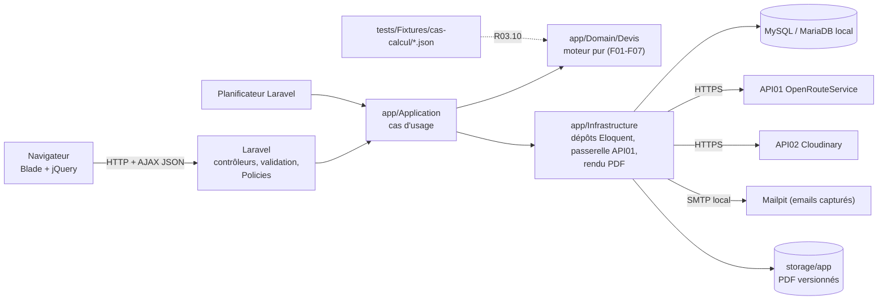
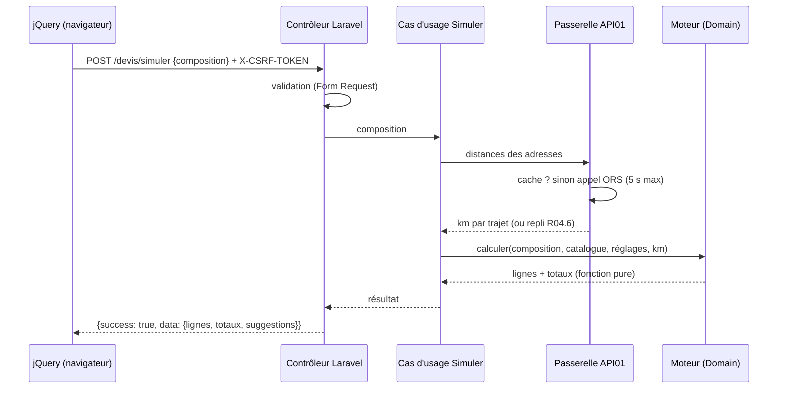
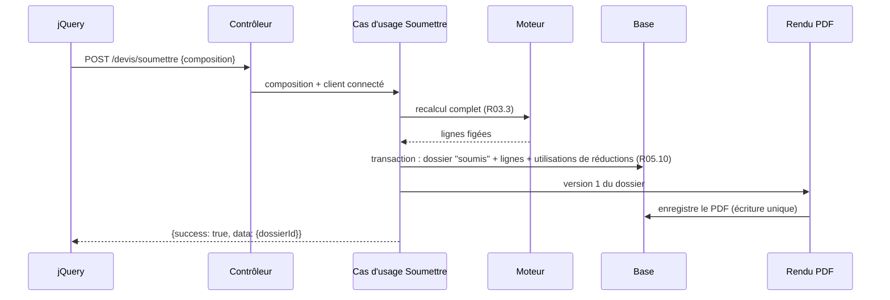

# TRD — PID · Moteur du générateur de devis

> Statut : validé · Version : 1.1 · Validé le : 2026-11-11 · Lit : 01-PRD (v2.1)
> TRD (Technical Requirements Document, exigences techniques) : avec quoi on construit. Rien n'est laissé à deviner.

## En bref
- **Couvre :** architecture de PID autour du moteur et de l'ERP, stack et versions, outils, API tierces (API01 distance, API02 images), emails, commandes planifiées, environnement local, sécurité technique, cibles non fonctionnelles, séquences des flux complexes.
- **Décisions majeures :** moteur en PHP pur dans `app/Domain`, sans dépendance à Laravel (P06, ADR-001) · Laravel 13 autour du moteur, vues Blade + jQuery/AJAX (ADR-001) · PHP 8.4 (ADR-005) · OpenRouteService pour géocodage et distance (ADR-002) · Dompdf pour les PDF (ADR-003) · PID tourne **en local uniquement**, sur Herd + MySQL 8.4 (ADR-004, ADR-006) · images de la vitrine chez Cloudinary (ADR-007) · emails capturés par Mailpit (ADR-008).
- **Ne couvre pas :** la mise en ligne (ADR-004), l'authentification (hors dossier), la traduction TypeScript (projet PortfolioPhotographe), la disposition des écrans (03-APP-FLOW).
- **IDs définis ici :** API01, API02, ADR-001 à ADR-008.

## 1. Architecture globale



**Pattern : Clean Architecture** (`~/.claude/backend-workflow.md`). Le moteur (`app/Domain`) ne dépend de rien : il reçoit des objets PHP et rend des lignes chiffrées (R03.9). Laravel n'est qu'une couche autour : HTTP, base, appels réseau, PDF. Raison : la traduction en TypeScript (P06) ne porte que sur `app/Domain`, et le jeu de cas JSON (R03.10) vérifie qu'elle est juste.

**Règle de dépendance** : aucun fichier de `app/Domain` n'importe une classe `Illuminate\…`, une fonction Laravel (`config()`, `now()`, `DB::`) ni une extension PHP non portable. Contrôle automatique : test d'architecture (§3).

## 2. Stack

| Couche | Technologie | Version | Justification | ADR |
|--------|-------------|---------|---------------|-----|
| Langage serveur | PHP | 8.4.x | Exigé par le code du prof (`new X()->m()`) ; types `enum` et `readonly` utiles au moteur | ADR-005 |
| Framework | Laravel | 13.x (sortie le 17/03/2026, PHP 8.3 minimum, correctifs de sécurité jusqu'au 1er trimestre 2028) | Choix de mentalyas (11/11) ; migrations, Eloquent, validation, Policies, protection CSRF | ADR-001 |
| Moteur | PHP pur (`app/Domain/Devis`) | — | Indépendant du langage et du framework (P06) | ADR-001 |
| Vues | Blade + Tailwind CSS 4 + jQuery 4.0.0 | jQuery 4.0.0 = version du cours | Front de PortfolioPhotographe réécrit en Blade ; interactivité du devis en AJAX (cours : JS/jQuery 15 pts, AJAX 15 pts) | ADR-001 |
| Base de données | MySQL Community Server | 8.4 LTS | Base du cours ; installée à part car la base de Herd est réservée à l'offre payante ; requêtes via migrations et Eloquent uniquement (§6) | ADR-006 |
| Environnement local | Laravel Herd (offre gratuite, Windows) | dernière version ; PHP 8.4 par défaut | Fournit PHP 8.4, Composer, Node, npm et le serveur web ; fait pour Laravel | ADR-006 |
| PDF | `barryvdh/laravel-dompdf` (enveloppe Laravel de Dompdf) | 3.1.x (3.1.2 du 21/02/2026, compatible PHP 8.1 à 8.5) | Gabarit du dossier écrit en HTML + CSS (Blade) | ADR-003 |
| Géocodage et distance | OpenRouteService | API v2 | Géocodage + distance routière dans un seul service, gratuit avec clé | ADR-002 |
| Images de la vitrine | Cloudinary, SDK PHP officiel `cloudinary/cloudinary_php` | version stable courante — **à fixer à l'installation** | Même compte que PortfolioPhotographe, dossier `pid/` ; formats web automatiques | ADR-007 |
| Emails | Laravel Mail + Mailpit (SMTP local) | dernière version de Mailpit | Emails visibles comme le client les recevrait, rien ne part sur Internet | ADR-008 |
| Tâches planifiées | Planificateur Laravel (`php artisan schedule:work` en local) | — | Rappels de paiement, anonymisation | — |
| Graphiques (F11) | Chart.js | version stable courante — **à fixer à l'installation** | Bibliothèque JavaScript sans dépendance, compatible jQuery | — |
| Auth | Hors de ce dossier | — | Le moteur reçoit l'identifiant du client connecté | — |
| Hébergement | Local uniquement | — | Pas de mise en ligne de PID | ADR-004 |
| CI/CD (intégration et déploiement continus) | Aucun déploiement ; tests lancés en local avant chaque commit | — | PID n'est pas déployé (ADR-004) | — |

## 3. Outils et conventions

| Besoin | Outil | Configuration |
|--------|-------|---------------|
| Dépendances PHP | Composer 2 | `composer.json` versionné, `vendor/` ignoré par git |
| Dépendances front | npm + Vite (fourni par Laravel) | `node_modules/` ignoré par git |
| Format du code | Laravel Pint | règles par défaut (PSR-12) |
| Tests unitaires du moteur | PHPUnit | `tests/Unit/Domain/` ; lit `tests/Fixtures/cas-calcul/*.json` (R03.10) |
| Tests d'intégration | PHPUnit + base de test | `tests/Feature/` ; base `pid_test` réinitialisée à chaque test |
| Test d'architecture | PHPUnit | vérifie qu'aucun fichier de `app/Domain` ne référence `Illuminate\` |
| Nommage des tests | `should_<comportement>_when_<condition>` | CLAUDE.md global |

**Structure du dépôt** : `src/` est la racine du projet Laravel (décision Q20, 11/11). `src/prof/` reste à côté, inchangé.

| Dossier | Contenu |
|---------|---------|
| `app/Domain/Devis/` | Moteur pur : catalogue, modes de prix, calcul, transport, réductions, dossier (F01-F07) |
| `app/Domain/Auth/` | Inscription existante (US-AUTH-01, 21/10), déplacée ici ; ses tests passent de `tests/run.php` à PHPUnit |
| `app/Application/` | Cas d'usage : un service par UC du PRD |
| `app/Infrastructure/` | Dépôts Eloquent, passerelle API01, rendu Dompdf |
| `app/Http/` | Contrôleurs, requêtes de validation (Form Requests), Policies |
| `resources/views/` | Vues Blade |
| `resources/js/` | jQuery : simulation, appels AJAX |
| `tests/Fixtures/cas-calcul/` | Jeu de cas commun PHP ↔ TypeScript (R03.10) |
| `src/prof/` | Code du prof, inchangé (référence de cours) |

## 4. API tierces

### API01 — OpenRouteService (géocodage et distance)
- **Usage :** F04 — localiser chaque adresse (R04.1) et calculer la distance routière (R04.6, `routiere`).
- **Auth :** clé d'API dans l'en-tête `Authorization` · variable d'environnement : `ORS_API_KEY`.
- **Endpoints :** `GET /geocode/search` (adresse → coordonnées) · `POST /v2/directions/driving-car` (suite de coordonnées → distance).
- **Limites :** offre gratuite : 2 000 requêtes par jour sur les directions (FAQ officielle) ; quota du géocodage **à confirmer à la création du compte (Q18)**.
- **Économie de quota :** chaque adresse géocodée et chaque distance calculée sont **mises en cache** en base (table de cache définie au Backend) ; une adresse déjà connue ne refait aucun appel.
- **Coût :** gratuit (offre gratuite) ; conditions d'utilisation à relire à la création du compte (Q18).
- **En cas de panne :** délai d'attente de 5 s ; au-delà, repli selon R04.6 (`volOiseau` calculé localement par la formule de haversine, ou `bloquer`).
- **Exemple d'appel :**
  ```http
  POST https://api.openrouteservice.org/v2/directions/driving-car
  Authorization: <ORS_API_KEY>
  Content-Type: application/json

  {"coordinates": [[4.3517, 50.8503], [4.4025, 51.2194]]}
  ```
  Réponse (extrait) : `{"routes": [{"summary": {"distance": 44812.3, "duration": 2730.5}}]}` — distance en mètres, convertie en km avec 1 décimale.
- **Doc :** https://giscience.github.io/openrouteservice/

### API02 — Cloudinary (images de la vitrine)
- **Usage :** F12 — dépôt, recadrage et diffusion des photos de la vitrine (R12.2).
- **Auth :** URL d'accès contenant clé et secret · variable d'environnement : `CLOUDINARY_URL` · dossier `pid/` dans le compte de PortfolioPhotographe.
- **Limites (offre gratuite, instantané des tarifs Cloudinary) :** 25 crédits par mois partagés entre stockage, transformations et bande passante (1 crédit = 1 Go stocké, 1 Go diffusé ou 1 000 transformations) ; image de 10 Mo maximum ; 25 mégapixels maximum. Quota partagé avec PortfolioPhotographe.
- **Coût :** gratuit dans ces limites.
- **En cas de panne :** dépôt refusé avec le message de UC12.1 ; aucune photo à moitié enregistrée (la ligne en base n'est créée qu'après la réponse de Cloudinary) ; les photos déjà publiées restent servies par Cloudinary.
- **Envoi :** depuis le serveur (jamais de dépôt direct du navigateur vers Cloudinary) pour garder le secret côté serveur.
- **Doc :** https://cloudinary.com/documentation/php_integration

## 5. Environnements et configuration

| Environnement | Rôle | Emplacement |
|---------------|------|-------------|
| local | Développement et défense du cours | Poste de mentalyas ; Herd + MySQL 8.4 (ADR-006) |
| test | Tests automatiques | Base `pid_test` sur le même MySQL local |
| production | Aucune pour PID (ADR-004) | — |

| Variable d'environnement | Rôle | Obligatoire |
|--------------------------|------|-------------|
| `APP_KEY` | Clé de chiffrement Laravel (sessions, cookies) | Oui |
| `APP_ENV` | `local` ou `testing` | Oui |
| `APP_DEBUG` | Affichage des erreurs détaillées, `true` en local seulement | Oui |
| `DB_CONNECTION`, `DB_HOST`, `DB_PORT`, `DB_DATABASE`, `DB_USERNAME`, `DB_PASSWORD` | Connexion à la base | Oui |
| `ORS_API_KEY` | Clé OpenRouteService (API01) | Oui |
| `ORS_TIMEOUT_SECONDS` | Délai d'attente des appels API01 | Oui |
| `CLOUDINARY_URL` | Accès à API02 (clé et secret) | Oui |
| `CLOUDINARY_FOLDER` | Dossier des images de PID (`pid`) | Oui |
| `MAIL_MAILER`, `MAIL_HOST`, `MAIL_PORT` | Envoi vers Mailpit (`smtp`, `127.0.0.1`, port SMTP de Mailpit) | Oui |
| `MAIL_FROM_ADDRESS`, `MAIL_FROM_NAME` | Expéditeur affiché dans les emails | Oui |

Les valeurs vivent dans `.env` (ignoré par git) ; `.env.example` liste les noms sans valeur. **Aucun tarif dans `.env`** : les tarifs sont en base, saisis dans l'ERP (P02).

## 6. Sécurité technique

| Risque (OWASP) | Vecteur dans ce projet | Mitigation |
|----------------|------------------------|------------|
| A01 Contrôle d'accès | Un client lit le dossier ou le PDF d'un autre (R07.3) ; un client appelle une action du photographe | Policies Laravel sur chaque dossier, PDF et action ERP ; refus `404` pour un dossier d'autrui (message de CA07.3) |
| A03 Injection | Champs de fiche, adresses, codes promo | Eloquent et requêtes paramétrées uniquement ; aucun SQL concaténé |
| A03 XSS (injection de script) | Libellés saisis dans l'ERP, champs de fiche, motifs de refus, liens moodboard | Échappement Blade `{{ }}` partout ; jQuery `.text()` et jamais `.html()` sur une donnée saisie ; liens `lien` limités à `https://` (UC02.3) |
| CSRF (falsification de requête) | Appels AJAX de simulation, demandes d'ajout, actions ERP | Jeton CSRF Laravel, envoyé par jQuery dans l'en-tête `X-CSRF-TOKEN` |
| A04 Manipulation du prix | Total ou ligne envoyés par le navigateur | Le serveur ne reçoit que la composition et recalcule tout (R03.3) |
| A04 Devinette de codes | Codes promo et codes de parrainage testés en masse | Limitation de débit Laravel sur leur vérification : 10 essais par 15 min par IP ; même message pour inconnu, expiré ou épuisé (UC05.3) |
| A02 Données exposées | Domicile du photographe (R04.8), coordonnées des clients | Le domicile n'est jamais sérialisé dans une réponse au client ; les réponses JSON ne contiennent que les champs listés au Backend |
| A05 Configuration | `APP_DEBUG=true` laissé actif, `.env` commité | `.env` dans `.gitignore` ; erreurs génériques hors `local` |
| A08 Intégrité des versions | Un PDF déjà émis réécrit (R07.6) | Fichiers PDF en écriture unique : un nom par version, jamais écrasé |
| Affectation de masse | Champs `etape`, `prix`, `proprietaire` injectés dans un formulaire | Form Requests avec liste blanche de champs ; `$fillable` explicite |

- Erreurs : jamais de trace de pile hors `local` ; messages utilisateur du PRD ; logs structurés sans email, adresse ni mot de passe.
- Format des réponses AJAX : `{ "success": true, "data": … }` ou `{ "success": false, "error": { "code": "…", "message": "…" } }` (backend-workflow, aligné sur le `ResponseSuccess`/`ResponseError` du cours).

### Commandes planifiées
| Commande | Rôle | Fréquence |
|----------|------|-----------|
| `paiements:rappeler` | Envoie les rappels de paiement réglés (UC10.5) | quotidienne |
| `dossiers:anonymiser` | Anonymise les dossiers échus (UC06.8) | quotidienne |
| `prospects:anonymiser` | Anonymise les prospects échus (R08.9) | quotidienne |
En local, `php artisan schedule:work` les lance tant que la session de travail est ouverte ; chacune peut aussi être lancée à la main.

### Sécurité propre à l'ERP
| Risque | Vecteur | Mitigation |
|--------|---------|------------|
| Dépôt de fichier malveillant | Envoi de photo (F12) | Types MIME vérifiés côté serveur (JPEG, PNG, WebP), 10 Mo maximum, fichier transmis à Cloudinary sans être servi par PID |
| XSS dans les messages | Fil de messages (F08) | Texte seul, échappé ; aucun HTML accepté |
| Fuite par email | Notifications (R08.8) | L'email ne contient jamais le texte du message ni de donnée du dossier, seulement un lien |
| Traçage des visiteurs | Simulations comptées (R11.2) | Aucune IP, aucun cookie d'identification, aucun email dans la table des simulations |
| Export de données | Export CSV (F11) | Réservé au photographe ; ne contient que des agrégats, aucune donnée personnelle |

## 7. Exigences non fonctionnelles chiffrées

| Exigence | Cible | Comment on la vérifie |
|----------|-------|-----------------------|
| Calcul d'une simulation (sans appel API01) | < 200 ms côté serveur pour 20 lignes | Test PHPUnit chronométré sur un cas du jeu commun |
| Simulation avec nouvelle adresse | < 3 s, appel API01 compris | Mesure manuelle en local |
| Génération d'un PDF | < 5 s pour un dossier de 5 shootings | Test d'intégration chronométré |
| Volumétrie | 200 dossiers par an, 50 services, 100 options | Hypothèse de dimensionnement des index |
| Exactitude | 0 écart au centime entre PHP et TypeScript | Jeu de cas commun (R03.10) |
| Statistiques sur une année | < 2 s pour 200 dossiers et 5 000 simulations | Test d'intégration chronométré |

## 8. Séquences techniques

### Simulation avec adresse (F03, F04)


### Soumission et première version PDF (F06, F07)


## Décisions (ADR)
| ID | Décision | Statut |
|----|----------|--------|
| [ADR-001](decisions/ADR-001-moteur-pur-laravel.md) | Moteur PHP pur dans Laravel 13, vues Blade + jQuery | acceptée |
| [ADR-002](decisions/ADR-002-openrouteservice.md) | OpenRouteService pour géocodage et distance | acceptée |
| [ADR-003](decisions/ADR-003-dompdf.md) | Dompdf pour les PDF | acceptée |
| [ADR-004](decisions/ADR-004-pid-local.md) | PID local uniquement ; mise en ligne via PortfolioPhotographe | acceptée |
| [ADR-005](decisions/ADR-005-php-84.md) | PHP 8.4 | acceptée |
| [ADR-006](decisions/ADR-006-herd-mysql.md) | Environnement local : Laravel Herd + MySQL 8.4 LTS | acceptée |
| [ADR-007](decisions/ADR-007-cloudinary.md) | Cloudinary pour les images de la vitrine | proposée |
| [ADR-008](decisions/ADR-008-mailpit.md) | Emails capturés par Mailpit en local | proposée |

## Glossaire
| Terme | Définition |
|-------|------------|
| ADR (Architecture Decision Record) | Fiche de décision technique |
| AJAX (Asynchronous JavaScript And XML) | Requête HTTP lancée par le JavaScript sans recharger la page |
| Blade | Moteur de gabarits HTML de Laravel |
| Clean Architecture | Organisation où le métier ne dépend d'aucune technique |
| CSRF (Cross-Site Request Forgery) | Attaque qui fait exécuter une action à l'insu d'un utilisateur connecté |
| Eloquent | Couche d'accès à la base de Laravel (ORM, Object-Relational Mapping) |
| Form Request | Classe Laravel qui valide les données d'une requête |
| Chart.js | Bibliothèque JavaScript de graphiques |
| Cloudinary | Service en ligne de stockage et de diffusion d'images |
| Herd | Environnement de développement Laravel pour Windows (PHP, Composer, serveur web) |
| Haversine | Formule de distance à vol d'oiseau entre deux coordonnées |
| Mailpit | Faux serveur d'emails local qui capture et affiche les emails envoyés |
| LTS (Long-Term Support) | Version maintenue sur une longue durée |
| Policy | Classe Laravel qui décide si un utilisateur peut faire une action |
| TRD (Technical Requirements Document) | Document d'exigences techniques |
| XSS (Cross-Site Scripting) | Injection de script dans une page vue par d'autres |

## Historique
| Version | Date | Changement |
|---------|------|------------|
| 0.1 | 2026-11-11 | Création |
| 1.0 | 2026-11-11 | Environnement local (ADR-006), emplacement src/, valeurs validées ; validé par mentalyas |
| 1.1 | 2026-11-11 | ERP (PRD v2.0) : API02 Cloudinary, emails Mailpit, commandes planifiées, Chart.js, sécurité ERP |

## Demandes de modification
| Date | Source | Demande | Statut |
|------|--------|---------|--------|
