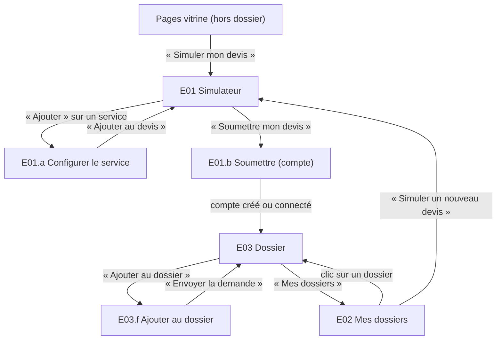
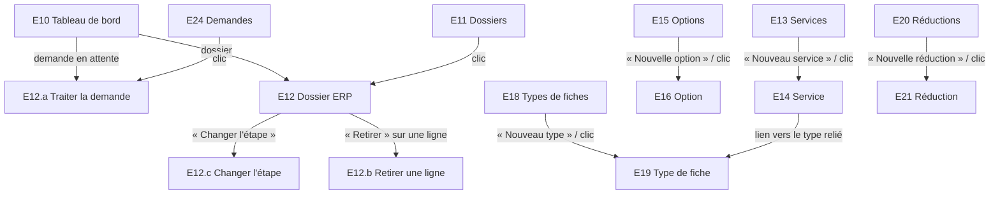

# App Flow — PID · Moteur du générateur de devis

> Statut : validé · Version : 1.2 · Validé le : 2026-11-11 · Lit : 01-PRD (v2.1), 02-TRD (v1.1)
> Chaque écran, chaque action, chaque destination : « si je clique ici, j'arrive où ? ».

## En bref
- **Couvre :** les écrans de PID en trois zones : public (vitrine, simulation), client (dossier), photographe (ERP : moteur, clients, production, argent, statistiques, vitrine, planning) ; chaque action et sa destination ; les états de chaque écran ; 13 parcours reliés aux UC du PRD.
- **Décisions majeures :** simulation sur **une page unique** (catalogue + devis en direct) · création du compte dans un **panneau** de la simulation · dossier client sur **une page à onglets** · ERP à **menu latéral par rubrique** (choix de mentalyas, 11/11).
- **Ne couvre pas :** l'apparence (direction artistique de PortfolioPhotographe, réécrite en Blade, ADR-001), les écrans d'authentification hors soumission (connexion, mot de passe oublié : hors dossier).
- **IDs définis ici :** E01-E06 (public et client), E10-E40 (ERP), sous-écrans E0x.a, P1-P13 (parcours).

## 1. Inventaire des écrans

### Zone publique et client
| ID | Écran | Accès (rôle) | Fonctionnalités | Point d'entrée ? |
|----|-------|--------------|-----------------|------------------|
| E04 | Accueil de la vitrine (sections, services mis en avant, témoignages) | public | F12 | Oui — page d'accueil du site |
| E05 | Galeries (liste des galeries publiées) | public | F12 | Non |
| E06 | Galerie (photos d'une galerie) | public | F12 | Non |
| E01 | Simulateur de devis (catalogue + devis en direct) | public | F01, F03, F04, F05, F13 | Oui — bouton « Simuler mon devis » de E04 |
| E01.a | Panneau « Configurer ce service » | public | F01, F04 | Non |
| E01.b | Panneau « Soumettre mon devis » (compte) | public | F06 | Non |
| E01.c | Panneau « Recevoir ce devis par email » | public | F08 | Non |
| E02 | Mes dossiers | Client | F06 | Oui — après connexion |
| E02.a | Panneau « Supprimer mon compte » | Client | F06 | Non |
| E03 | Dossier (page à onglets) | Client (propriétaire) | F02, F05, F06, F07 | Non |
| E03.a | Onglet Devis | Client | F03, F06 | Non |
| E03.b | Onglet Fiches techniques | Client | F02, F04 | Non |
| E03.c | Onglet Demandes | Client | F06 | Non |
| E03.d | Onglet Documents | Client | F07 | Non |
| E03.e | Onglet Parrainage | Client | F05 | Non |
| E03.f | Panneau « Ajouter au dossier » | Client | F06, F03, F05 | Non |
| E03.g | Onglet Messages | Client | F08 | Non |
| E03.h | Onglet Suivi (production et paiements) | Client | F09, F10 | Non |

### Zone photographe (ERP)
| ID | Écran | Accès | Fonctionnalités | Point d'entrée ? |
|----|-------|-------|-----------------|------------------|
| E10 | Tableau de bord | Photographe | F06 | Oui — après connexion du photographe |
| E11 | Dossiers (liste) | Photographe | F06 | Non |
| E12 | Dossier (ERP) | Photographe | F06, F07 | Non |
| E12.a | Panneau « Traiter la demande » | Photographe | F06 | Non |
| E12.b | Panneau « Retirer une ligne » | Photographe | F06 | Non |
| E12.c | Panneau « Changer l'étape » (accepter, refuser, confirmer, clore, annuler) | Photographe | F06 | Non |
| E13 | Services (liste) | Photographe | F01 | Non |
| E14 | Service (création, édition) | Photographe | F01, F02, F04 | Non |
| E15 | Options (liste) | Photographe | F01 | Non |
| E16 | Option (création, édition) | Photographe | F01 | Non |
| E17 | Catégories | Photographe | F01 | Non |
| E18 | Types de fiches (liste) | Photographe | F02 | Non |
| E19 | Type de fiche (éditeur de champs) | Photographe | F02 | Non |
| E20 | Réductions (liste) | Photographe | F05 | Non |
| E21 | Réduction (création, édition) | Photographe | F05 | Non |
| E22 | Parrainage (réglages) | Photographe | F05 | Non |
| E23 | Réglages généraux | Photographe | F01, F03, F04, F05, F06, F07 | Non |
| E24 | Demandes en attente (liste) | Photographe | F06 | Non |
| E12.d | Onglet Messages du dossier (ERP) | Photographe | F08 | Non |
| E12.e | Onglet Paiements du dossier (échéances, paiements reçus) | Photographe | F10 | Non |
| E12.f | Onglet Production du dossier | Photographe | F09 | Non |
| E25 | Clients et prospects (liste) | Photographe | F08 | Non |
| E26 | Fiche client ou prospect | Photographe | F08 | Non |
| E26.a | Panneau « Nouveau client » (et composition de son devis) | Photographe | F08, F03 | Non |
| E27 | Origines et étiquettes | Photographe | F08 | Non |
| E28 | Production (shootings en cours, retards, échéances proches) | Photographe | F09 | Non |
| E29 | Modèles de production | Photographe | F09 | Non |
| E30 | Modèles d'échéancier | Photographe | F10 | Non |
| E31 | Chiffres (CA signé, encaissé, reste à percevoir, prévisionnel) | Photographe | F10 | Non |
| E32 | Statistiques | Photographe | F11 | Non |
| E33 | Médiathèque (photos) | Photographe | F12 | Non |
| E34 | Galeries (liste) | Photographe | F12 | Non |
| E35 | Galerie (édition) | Photographe | F12 | Non |
| E36 | Textes des sections | Photographe | F12 | Non |
| E37 | Témoignages | Photographe | F12 | Non |
| E38 | Services mis en avant | Photographe | F12 | Non |
| E39 | Planning (mois, semaine, jour) | Photographe | F13 | Non |
| E40 | Capacité et dates bloquées | Photographe | F13 | Non |

## 2. Navigation globale

- **Zone publique** : E04, E05, E06 et E01 sont accessibles sans compte ; l'en-tête de la vitrine porte « Galeries » (→ E05) et « Simuler mon devis » (→ E01). L'en-tête porte « Mes dossiers » (→ E02 si connecté, sinon → connexion, hors dossier, puis E02).
- **Zone client** : en-tête « Mes dossiers » (→ E02) · « Simuler un nouveau devis » (→ E01) · « Se déconnecter ». Dans E03, les onglets changent sans recharger la page (AJAX).
- **Zone ERP** : menu latéral permanent : Tableau de bord (E10) · Planning (E39) · Dossiers (E11) · Demandes (E24) · Clients (E25) · Production (E28) · Argent ▸ Chiffres (E31), Échéanciers (E30) · Statistiques (E32) · Catalogue ▸ Services (E13), Options (E15), Catégories (E17), Fiches techniques (E18), Modèles de production (E29) · Réductions (E20) · Parrainage (E22) · Vitrine ▸ Médiathèque (E33), Galeries (E34), Textes (E36), Témoignages (E37), Services mis en avant (E38) · Réglages ▸ Généraux (E23), Capacité (E40), Origines et étiquettes (E27).
- **Redirections** : non connecté qui ouvre E02, E03 ou une page ERP → connexion, puis retour à la page demandée · Client qui ouvre une page ERP → message « Ce dossier n'existe pas ou ne vous appartient pas. » (même réponse qu'un dossier d'autrui, CA07.3) · Dossier d'un autre client → même message.
- **Retour arrière** : chaque écran de détail (E03, E12, E14, E16, E19, E21) a un lien « ← Retour à la liste » vers sa liste.
- **Panneaux** (E01.a, E01.b, E03.f, E12.a-c) : fermeture par « Annuler », la croix ou la touche Échap, sans perte de la page derrière.

## 3. Fiches écran — zone publique et client

### E01 — Simulateur de devis
**But :** composer un devis ligne par ligne et voir le prix exact · **Accès :** public · **Fonctionnalités :** F01, F03, F04, F05

| Élément | Action | Résultat |
|---------|--------|----------|
| Liste du catalogue (services visibles, groupés par catégorie, R01.8) | clic « Ajouter » sur un service | → E01.a pour ce service |
| Ligne du devis | clic « Modifier » | → E01.a pré-rempli |
| Ligne du devis | clic « Retirer » | ligne retirée, recalcul AJAX (UC03.1), reste sur E01 |
| Champ « Code promo ou de parrainage » | clic « Appliquer » | code valide → ligne de réduction ajoutée ; invalide → message de UC05.3 ou UC05.6 sous le champ |
| Bloc « Suggestions » | clic sur une suggestion (UC05.4) | → E01.a du service suggéré |
| Bloc Totaux (HTVA, TVA, TVAC) | — | mis à jour à chaque changement (R03.1) ; mention « incomplet » tant qu'une adresse manque (UC04.1) |
| Bouton « Soumettre mon devis » | clic | devis complet → E01.b ; adresse manquante → bouton inactif et message de UC04.1 au-dessus |
| Lien « Recevoir ce devis par email » | clic | → E01.c |

| État | Ce qu'on voit |
|------|---------------|
| Chargement | Catalogue en squelette gris ; devis vide |
| Vide | Catalogue vide (aucun service visible) : MSG01 ; devis vide : MSG02 |
| Erreur | Calcul impossible (erreur serveur) : bandeau MSG03, le devis garde son dernier état |
| Succès | Lignes, totaux, suggestions à jour |

La composition est conservée dans le navigateur (R06.1) : rechargement de la page ou retour depuis la connexion → même devis.

### E01.a — Panneau « Configurer ce service »
**But :** renseigner ce qui fait le prix d'un service · **Accès :** public · **Fonctionnalités :** F01, F04

| Élément | Action | Résultat |
|---------|--------|----------|
| Paramètres du mode de prix (durée P2/P3, quantité P4, personnes P5, tranche P6) | saisie | prix du service recalculé dans le panneau ; hors limites → message de UC03.1 sous le champ |
| Options du service (R01.4) | cocher / décocher, quantité | prix recalculé |
| Date du shooting | choix dans un calendrier | requise si le service a une fiche technique ; dates indisponibles grisées (UC13.3) |
| Lieux (groupe répétable, si le type de fiche a un champ `adresse`) | « + Ajouter un lieu » ; saisie adresse + heure de début | transport recalculé (UC04.1) ; adresse introuvable → message de UC04.1 sous le champ |
| Bouton « Ajouter au devis » | clic | → E01, ligne ajoutée ou mise à jour |
| Bouton « Annuler » | clic | → E01 sans changement |

| État | Ce qu'on voit |
|------|---------------|
| Chargement | Indicateur sur le prix pendant le calcul (adresse : jusqu'à 5 s, TRD §4) |
| Vide | Service sans paramètre ni option : seul « Ajouter au devis » |
| Erreur | Distance indisponible : repli R04.6 (mention « distance à vol d'oiseau » ou message de blocage) |
| Succès | Prix du service et du transport affichés |

### E01.b — Panneau « Soumettre mon devis »
**But :** créer le compte et enregistrer le dossier · **Accès :** public · **Fonctionnalités :** F06

| Élément | Action | Résultat |
|---------|--------|----------|
| Formulaire « Créer mon compte » (email, mot de passe) | envoi valide | compte créé (hors dossier), UC06.1 → E03 du nouveau dossier |
| Lien « J'ai déjà un compte » | clic | formulaire de connexion dans le même panneau ; succès → UC06.1 → E03 |
| Récapitulatif mis à jour (catalogue changé, UC03.2) | — | message de UC03.2 en tête ; bouton « Confirmer et soumettre » |
| Bouton « Annuler » | clic | → E01, composition intacte |

| État | Ce qu'on voit |
|------|---------------|
| Chargement | Bouton désactivé « Soumission… » |
| Vide | — (ouvert seulement depuis un devis complet) |
| Erreur | Erreurs de compte sous le champ concerné (hors dossier) ; échec serveur : MSG04 |
| Succès | → E03 |

### E01.c — Panneau « Recevoir ce devis par email »
Champ email + case de consentement de UC08.1. « Envoyer » → UC08.1 → message « Votre devis vous a été envoyé. » (MSG20) et retour à E01 ; erreurs de UC08.1 sous le champ concerné.

### E04 — Accueil de la vitrine
| Élément | Action | Résultat |
|---------|--------|----------|
| Sections (textes de E36) | — | affichées dans l'ordre de la direction artistique |
| Carte d'un service mis en avant (UC12.5) | clic « Simuler mon devis » | → E01 avec E01.a ouvert sur ce service |
| Témoignages publiés | — | affichés |
| Lien « Voir les galeries » | clic | → E05 |
États : chargement en squelette · vide (aucun service mis en avant) : bloc services masqué · erreur : page affichée sans le bloc en défaut.

### E05 — Galeries · E06 — Galerie
E05 : cartes des galeries publiées (couverture, titre, date) → clic → E06. E06 : photos dans l'ordre, texte de la galerie, bouton « Simuler mon devis » (→ E01). Vide : « Aucune galerie pour le moment. » (MSG21).

### E02 — Mes dossiers
**But :** retrouver ses dossiers · **Accès :** Client · **Fonctionnalités :** F06

| Élément | Action | Résultat |
|---------|--------|----------|
| Carte d'un dossier (numéro, date du premier shooting, étape, total TVAC) | clic | → E03 |
| Bouton « Simuler un nouveau devis » | clic | → E01 |
| Lien « Supprimer mon compte » | clic | → E02.a : saisie du mot de passe ; « Confirmer la suppression » → UC06.7 → déconnexion et message de UC06.7 ; mot de passe incorrect → message de UC06.7 sous le champ |

| État | Ce qu'on voit |
|------|---------------|
| Chargement | Cartes en squelette |
| Vide | MSG05 + bouton « Simuler un devis » |
| Erreur | MSG06 |
| Succès | Liste triée du plus récent au plus ancien |

### E03 — Dossier (page à onglets)
**But :** suivre et compléter son dossier jusqu'au jour J · **Accès :** Client propriétaire · **Fonctionnalités :** F02, F05, F06, F07

En-tête permanent : numéro du dossier, étape (R06.8), motif du refus si `refuse` (R06.9), date limite de modification de chaque shooting (R06.4, R06.11), bouton « Ajouter au dossier » (→ E03.f ; masqué si étape ∉ {soumis, accepte, confirme} ou date limite passée, R06.10).

| Onglet | Éléments → action → résultat |
|--------|------------------------------|
| **E03.a Devis** | Lignes et totaux figés (P05), en lecture seule. Mention « Pour retirer une prestation, contactez le photographe. » (R06.5) |
| **E03.b Fiches techniques** | Une carte par shooting, statut « complète » ou « incomplète » ; clic → formulaire de la fiche (UC02.3) ; « Enregistrer » → message de UC02.3 selon le cas ; valeur qui change le prix → message de UC02.3 et nouvelle demande dans E03.c ; date limite passée → formulaire en lecture seule avec le message de UC06.4 |
| **E03.c Demandes** | Liste des demandes (ajout, changement de fiche, changement d'adresse) : en attente · validée · refusée avec motif (R06.9) |
| **E03.d Documents** | Liste des versions PDF (numéro, date, événement, UC07.2) ; clic → ouverture ou téléchargement |
| **E03.g Messages** | Fil du dossier (UC08.5) ; champ texte + « Envoyer » ; message vide → bouton inactif |
| **E03.h Suivi** | Pour chaque shooting : étape de production, date de livraison prévue, lien de livraison une fois livré (R09.5) ; échéances de paiement (libellé, montant, date, payée ou non) (UC10.2) |
| **E03.e Parrainage** | Code de parrainage personnel (R05.11), bouton « Copier » ; liste des bons reçus (R05.13), utilisés ou non |

| État | Ce qu'on voit |
|------|---------------|
| Chargement | Onglet en squelette |
| Vide | E03.b sans shooting : MSG07 · E03.c : MSG08 · E03.e sans bon : MSG15 (affiché seulement si une récompense filleul est réglée, R05.12) |
| Erreur | Version PDF en préparation : message de UC07.1 |
| Succès | Données de l'onglet à jour |

### E03.f — Panneau « Ajouter au dossier »
**But :** demander un ajout · **Accès :** Client · **Fonctionnalités :** F06, F03, F05
Même catalogue et même configuration que E01 / E01.a, limités aux ajouts. Bouton « Envoyer la demande » → UC06.4 → E03.c avec la demande en attente ; date limite passée → message de UC06.4.

## 4. Fiches écran — ERP (photographe)

### E10 — Tableau de bord
| Élément | Action | Résultat |
|---------|--------|----------|
| Compteurs par étape (soumis, accepte, confirme) | clic | → E11 filtré sur l'étape |
| Liste « Demandes en attente » | clic | → E12.a |
| Liste « Prochains shootings » (nombre de jours réglé dans E23, R06.13) | clic | → E12 |

États : chargement en squelette · vide MSG09 · erreur MSG10 · succès.

### E11 — Dossiers (liste)
Filtres par étape et par date de shooting ; recherche par numéro ou email client ; clic sur une ligne → E12. États : vide MSG11.

### E12 — Dossier (ERP)
| Élément | Action | Résultat |
|---------|--------|----------|
| Bouton « Changer l'étape » | clic | → E12.c (seules les transitions permises, R06.8) |
| Ligne du devis | clic « Retirer » | → E12.b |
| Demande en attente | clic | → E12.a |
| Fiches techniques | lecture | réponses du client, statut complète / incomplète |
| Versions PDF | clic | ouverture ou téléchargement |

### E12.a — Traiter la demande
Affiche l'ancien et le nouveau détail côte à côte (UC06.5). « Valider » → nouvelles lignes figées, nouvelle version PDF (UC07.1), → E12. « Refuser » → champ motif obligatoire (message de UC06.2 si vide) → E12.

### E12.b — Retirer une ligne
Case « Appliquer des frais de retrait » + montant (UC06.6, R06.6). « Confirmer le retrait » → recalcul, nouvelle version PDF, → E12.

### E12.c — Changer l'étape
Choix parmi les transitions permises (R06.8). `refuse` → motif obligatoire. `annule` → case « Appliquer des frais d'annulation » + montant (R06.12). « Confirmer » → nouvelle étape, nouvelle version PDF, → E12 ; transition interdite → message de UC06.3.

### E13 / E15 — Services, Options (listes)
Colonnes : libellé, catégories, mode de prix, statut (actif / archivé). « Nouveau service » / « Nouvelle option » → E14 / E16 vide. Clic sur une ligne → E14 / E16. « Supprimer » → UC01.4 (suppression ou archivage, message de UC01.4). Filtre « Afficher les archivés ». Vide : MSG12.

### E14 — Service
Champs de UC01.1 : libellé, description, catégories (R01.10), mode de prix et ses paramètres (R01.5), base HTVA ou TVAC (R01.3), taux de TVA propre (R01.6), type de fiche relié (R02.2), options reliées (R01.4), réglages de transport propres (R04.4, R04.5), date limite propre (R06.4). « Enregistrer » → messages de UC01.1 sous les champs en erreur, ou → E13 avec MSG13.

### E16 — Option
Champs de UC01.2 ; liste de cases des services qui la proposent. « Enregistrer » → E15.

### E17 — Catégories
Liste éditable en place : ajouter, renommer, supprimer (UC01.6, messages de UC01.6).

### E18 / E19 — Types de fiches
E18 : liste, « Nouveau type », « Dupliquer » (UC02.2), clic → E19. E19 : nom ; liste ordonnée de champs (glisser pour réordonner) ; « + Champ » (types R02.4) ; « + Groupe répétable » ; par champ : libellé, obligatoire, valeurs de liste. « Enregistrer » → messages de UC02.1, ou → E18.

### E20 / E21 — Réductions
E20 : liste (libellé, conditions, effet, cible, période, utilisations). E21 : champs de UC05.1 : conditions combinables (R05.2), effet (R05.3), cible (R05.4), limites (R05.6), cumul propre (R05.5), « suggérer au visiteur » (R05.8). « Enregistrer » → messages de UC05.1, ou → E20.

### E22 — Parrainage
Récompenses (`filleul` · `parrain` · `les deux`, R05.12), réduction associée à chacune, étape d'acquisition du bon (R05.13). « Enregistrer » → reste sur E22 avec MSG14.

### E23 — Réglages généraux
Sections : TVA (`tauxTvaGeneral`, méthode `parLigne` / `parTaux`, R01.6, R03.5) · Transport (domicile, km comptés, application du seuil, `seuilKm`, `prixKm`, portée, type de distance, repli, R04.4-R04.6) · Réductions (cumul général, R05.5) · Dossier (date limite en jours, R06.4 ; jours affichés dans « Prochains shootings », R06.13 ; conservation `retentionMois`, R06.14 — non réglée : avertissement de UC06.8) · Document PDF (coordonnées et mentions, R07.5). « Enregistrer » → reste sur E23 avec MSG14 ; domicile vide → avertissement de UC04.2.

### E24 — Demandes en attente
Liste de toutes les demandes `en attente`, la plus ancienne en premier ; clic → E12.a.

### E12.d — Messages (ERP) · E12.e — Paiements · E12.f — Production
- **E12.d :** même fil que E03.g, côté photographe (UC08.5).
- **E12.e :** échéances du dossier (UC10.2), ajustables (date, montant) ; « Enregistrer un paiement » sur une échéance → formulaire de UC10.3 → échéance `payee` ou `partielle` ; première échéance payée d'un dossier `accepte` → proposition de UC10.3 « Passer le dossier à confirmé ? » → E12.c.
- **E12.f :** étape de production de chaque shooting ; « Étape suivante » (UC09.2) ; à l'étape de livraison, champ lien + « Livrer » (UC09.3, message d'erreur de UC09.3).

### E25 — Clients et prospects · E26 — Fiche · E26.a — Nouveau client · E27 — Origines et étiquettes
- **E25 :** liste avec filtres (client / prospect, étiquette, origine) et recherche (nom, email) ; clic → E26 ; « Nouveau client » → E26.a. Vide : « Aucun client pour le moment. » (MSG22).
- **E26 :** coordonnées, origine, étiquettes, dossiers (clic → E12), simulations envoyées, notes privées (modifiables en place), journal des échanges (« + Échange » : date, canal, résumé, message de UC08.3 si vide) (UC08.2, UC08.3).
- **E26.a :** email et nom, puis composition du devis avec le même catalogue que E01 ; « Créer le dossier » → UC08.4 → E12 du nouveau dossier ; email existant → message de UC08.4 avec lien vers E26.
- **E27 :** listes éditables en place des origines et des étiquettes (R08.5).

### E28 — Production · E29 — Modèles de production
- **E28 :** shootings non livrés triés par échéance, marques « en retard » et « échéance proche » (UC09.4) ; clic → E12.f. Vide : « Aucune production en cours. » (MSG23).
- **E29 :** liste des modèles ; création et édition : nom, étapes ordonnées (glisser), services reliés et délai de livraison par service (UC09.1, message de UC09.1).

### E30 — Modèles d'échéancier · E31 — Chiffres
- **E30 :** création et édition d'un modèle : échéances (libellé, pourcentage ou montant, moment), rappels, services reliés (UC10.1, message de UC10.1).
- **E31 :** sélecteur de période ; CA signé, CA encaissé, reste à percevoir (échéances dépassées en premier, clic → E12.e), prévisionnel par mois ; HTVA et TVAC (UC10.4).

### E32 — Statistiques
Sélecteur de période ; quatre blocs (ventes, conversion, réductions et parrainage, transport et production), chacun en tableau + graphique, avec la même période de l'année précédente et l'évolution en % ; « Exporter en CSV » (UC11.1, UC11.2). Vide : MSG19.

### E33 — Médiathèque · E34 / E35 — Galeries · E36 — Textes · E37 — Témoignages · E38 — Services mis en avant
- **E33 :** grille des photos ; « Ajouter des photos » (UC12.1, messages de UC12.1) ; clic → panneau texte alternatif + recadrage.
- **E34 :** liste des galeries (publiée / non publiée) ; « Nouvelle galerie » → E35. **E35 :** titre, texte, date, couverture, photos ordonnées (choisies dans E33), « Publier » / « Dépublier » (UC12.2, message de UC12.2).
- **E36 :** un champ par texte de section, « Enregistrer » → MSG14 (UC12.3).
- **E37 :** liste ordonnée ; ajout et édition (citation, auteur, photo, dossier lié), publier / dépublier (UC12.4).
- **E38 :** cases sur les services actifs, ordre par glisser ; aperçu du « à partir de » calculé (UC12.5, R12.5).

### E39 — Planning · E40 — Capacité et dates bloquées
- **E39 :** vues mois, semaine, jour ; shootings colorés selon l'étape, dates bloquées, échéances de livraison et de paiement ; jour « surchargé » signalé (UC13.4) ; clic sur un élément → E12 ; clic sur un jour vide → « Bloquer cette date » (→ E40 pré-rempli).
- **E40 :** `capaciteJour`, comportement `bloquer` / `avertir`, occupation par service (UC13.1, message de UC13.1) ; liste des dates bloquées, « + Bloquer » (jour entier ou créneau, libellé privé), avertissement de UC13.2.

## 5. Parcours principaux

### P1 — Première visite → devis soumis
| Étape | Écran | Action | UC couvert |
|-------|-------|--------|------------|
| 1 | E01 | parcourt le catalogue | UC01.1 (lecture) |
| 2 | E01.a | configure un mariage : durée, options, 4 lieux avec adresses | UC03.1, UC04.1 |
| 3 | E01 | ajoute un album, voit la réduction « mariage + album » | UC05.2, UC05.4 |
| 4 | E01 | saisit un code de parrainage | UC05.6 |
| 5 | E01.b | crée son compte, soumet | UC06.1, UC03.2 |
| 6 | E03.d | voit la version 1 du PDF | UC07.1, UC07.2 |

### P2 — Client : fiches techniques et ajout
| Étape | Écran | Action | UC couvert |
|-------|-------|--------|------------|
| 1 | E02 → E03.b | remplit la fiche du mariage | UC02.3 |
| 2 | E03.b | change le nombre de personnes → demande créée | UC02.3 |
| 3 | E03.b | change une adresse → demande créée | UC04.3 |
| 4 | E03.f | demande l'ajout d'une option | UC06.4, UC05.5 |
| 5 | E03.c | suit ses demandes | UC06.5 (résultat) |

### P3 — Photographe : traiter un dossier
| Étape | Écran | Action | UC couvert |
|-------|-------|--------|------------|
| 1 | E10 → E12.c | accepte le dossier soumis | UC06.2 |
| 2 | E24 → E12.a | valide une demande, en refuse une avec motif | UC06.5 |
| 3 | E12.c | confirme (acompte reçu), puis clôt après le jour J | UC06.3 |
| 4 | E12 | télécharge la dernière version PDF | UC07.2 |

### P4 — Photographe : construire le catalogue
| Étape | Écran | Action | UC couvert |
|-------|-------|--------|------------|
| 1 | E23 | saisit TVA, transport, domicile, date limite, mentions | UC01.5, UC04.2 |
| 2 | E17 | crée les catégories | UC01.6 |
| 3 | E18 → E19 | crée « Fiche mariage », duplique en « Fiche portrait » | UC02.1, UC02.2 |
| 4 | E13 → E14 | crée le service Mariage, le relie à sa fiche | UC01.1 |
| 5 | E15 → E16 | crée l'option « Second photographe », la relie | UC01.2 |
| 6 | E14 | modifie un prix ; plus tard supprime un service utilisé → archivé | UC01.3, UC01.4 |
| 7 | E19 | modifie la fiche mariage déjà utilisée | UC02.4 |

### P5 — Photographe : réductions et parrainage
| Étape | Écran | Action | UC couvert |
|-------|-------|--------|------------|
| 1 | E20 → E21 | crée « mariage + album » (suggérée) et un code promo limité | UC05.1 |
| 2 | E22 | règle les récompenses et l'étape d'acquisition | UC05.6 (réglages) |

### P6 — Retrait et annulation
| Étape | Écran | Action | UC couvert |
|-------|-------|--------|------------|
| 1 | E12.b | retire l'album avec frais | UC06.6 |
| 2 | E12.c | annule un autre dossier sans frais | UC06.3 |

### P7 — Parrainage récompensé
| Étape | Écran | Action | UC couvert |
|-------|-------|--------|------------|
| 1 | E03.e (parrain) | copie son code | UC05.6 |
| 2 | P1 (filleul) | soumet avec le code | UC05.6, UC06.1 |
| 3 | E12.c | le photographe confirme le dossier du filleul | UC06.3 |
| 4 | E03.e (parrain) | voit son bon ; l'utilise dans E03.f ou E01 | UC05.6 |

### P8 — Prospect puis client
| Étape | Écran | Action | UC couvert |
|-------|-------|--------|------------|
| 1 | E04 → E01 | ouvre le simulateur depuis un service mis en avant | UC12.6, UC12.5 |
| 2 | E01.c | reçoit son devis par email | UC08.1 |
| 3 | E01.b | revient et soumet avec le même email | UC06.1, R08.2 |

### P9 — Photographe : suivi client et dossier créé par téléphone
| Étape | Écran | Action | UC couvert |
|-------|-------|--------|------------|
| 1 | E25 → E26 | consulte la fiche, ajoute une note et un échange | UC08.2, UC08.3 |
| 2 | E26.a | crée un client et son dossier | UC08.4 |
| 3 | E12.d / E03.g | échange des messages avec le client | UC08.5 |

### P10 — Production et livraison
| Étape | Écran | Action | UC couvert |
|-------|-------|--------|------------|
| 1 | E29 | crée « Production mariage » | UC09.1 |
| 2 | E28 → E12.f | fait avancer le shooting, repère un retard | UC09.2, UC09.4 |
| 3 | E12.f | livre avec un lien | UC09.3 |
| 4 | E03.h | le client voit l'avancement et le lien | UC09.3 |

### P11 — Argent
| Étape | Écran | Action | UC couvert |
|-------|-------|--------|------------|
| 1 | E30 | crée un modèle d'échéancier | UC10.1 |
| 2 | E12.c → E12.e | accepte un dossier, échéances créées | UC10.2 |
| 3 | E12.e | enregistre l'acompte, passe à confirmé | UC10.3 |
| 4 | — | rappel automatique d'un solde en retard | UC10.5 |
| 5 | E31 | consulte les chiffres du trimestre | UC10.4 |

### P12 — Statistiques et vitrine
| Étape | Écran | Action | UC couvert |
|-------|-------|--------|------------|
| 1 | E32 | compare mars à l'an dernier, exporte | UC11.1, UC11.2 |
| 2 | E33 → E35 | ajoute des photos, publie une galerie | UC12.1, UC12.2 |
| 3 | E36, E37, E38 | met à jour textes, témoignages, services en avant | UC12.3, UC12.4, UC12.5 |

### P13 — Planning
| Étape | Écran | Action | UC couvert |
|-------|-------|--------|------------|
| 1 | E40 | règle la capacité, bloque ses congés | UC13.1, UC13.2 |
| 2 | E01.a | un visiteur voit les dates grisées | UC13.3 |
| 3 | E39 | consulte le mois | UC13.4 |

## 6. Couverture

| UC | Parcours | Écrans |
|----|----------|--------|
| UC01.1 | P4 | E13, E14 |
| UC01.2 | P4 | E15, E16 |
| UC01.3 | P4 | E14, E16 |
| UC01.4 | P4 | E13, E15 |
| UC01.5 | P4 | E23 |
| UC01.6 | P4 | E17 |
| UC02.1 | P4 | E18, E19 |
| UC02.2 | P4 | E18 |
| UC02.3 | P2 | E03.b |
| UC02.4 | P4 | E19 |
| UC03.1 | P1 | E01, E01.a, E03.f |
| UC03.2 | P1 | E01.b |
| UC04.1 | P1 | E01.a |
| UC04.2 | P4 | E23, E14 |
| UC04.3 | P2 | E03.b |
| UC05.1 | P5 | E20, E21 |
| UC05.2 | P1 | E01 |
| UC05.3 | P1 | E01 |
| UC05.4 | P1 | E01 |
| UC05.5 | P2 | E03.f, E12.a |
| UC05.6 | P1, P5, P7 | E01, E22, E03.e |
| UC06.1 | P1 | E01.b |
| UC06.2 | P3 | E12.c |
| UC06.3 | P3, P6 | E12.c |
| UC06.4 | P2 | E03.f |
| UC06.5 | P2, P3 | E12.a, E24, E03.c |
| UC06.6 | P6 | E12.b |
| UC06.7 | — (action isolée) | E02, E02.a |
| UC06.8 | — (commande système) | E23 (réglage et avertissement) |
| UC07.1 | P1, P3 | E03.d, E12 |
| UC07.2 | P1, P3 | E03.d, E12 |
| UC08.1 | P8 | E01.c |
| UC08.2 | P9 | E25, E26 |
| UC08.3 | P9 | E26 |
| UC08.4 | P9 | E26.a |
| UC08.5 | P9 | E03.g, E12.d |
| UC09.1 | P10 | E29 |
| UC09.2 | P10 | E28, E12.f |
| UC09.3 | P10 | E12.f, E03.h |
| UC09.4 | P10 | E28 |
| UC10.1 | P11 | E30 |
| UC10.2 | P11 | E12.e, E03.h |
| UC10.3 | P11 | E12.e |
| UC10.4 | P11 | E31 |
| UC10.5 | P11 | — (commande planifiée) |
| UC11.1 | P12 | E32 |
| UC11.2 | P12 | E32 |
| UC12.1 | P12 | E33 |
| UC12.2 | P12 | E34, E35 |
| UC12.3 | P12 | E36 |
| UC12.4 | P12 | E37 |
| UC12.5 | P8, P12 | E38, E04 |
| UC12.6 | P8 | E04, E05, E06 |
| UC13.1 | P13 | E40 |
| UC13.2 | P13 | E40 |
| UC13.3 | P13 | E01.a |
| UC13.4 | P13 | E39 |

## Glossaire
| Terme | Définition |
|-------|------------|
| AJAX (Asynchronous JavaScript And XML) | Échange avec le serveur sans recharger la page |
| ERP (Enterprise Resource Planning) | Zone de gestion du photographe (E10-E24) |
| Onglet | Partie de E03 affichée sans recharger la page |
| Panneau | Fenêtre ouverte par-dessus un écran, qui se ferme sans perdre l'écran derrière |
| Squelette | Gabarit gris affiché pendant un chargement |

## Historique
| Version | Date | Changement |
|---------|------|------------|
| 0.1 | 2026-11-11 | Création |
| 1.0 | 2026-11-11 | Messages déplacés au PRD (MSG01-MSG15), R06.13 ; validé par mentalyas |
| 1.1 | 2026-11-11 | Suite au PRD v1.2 : E02.a (UC06.7), réglage `retentionMois` dans E23 (UC06.8) |
| 1.2 | 2026-11-11 | ERP (PRD v2.0) : vitrine publique E04-E06, E01.c, onglets E03.g-h et E12.d-f, écrans E25-E40, parcours P8-P13 ; messages MSG20-MSG23 |

## Demandes de modification
| Date | Source | Demande | Statut |
|------|--------|---------|--------|
| 2026-11-11 | Claude (App Flow) | PRD : ajouter les textes exacts des messages d'états vides, d'erreur et de succès | ✅ traité : PRD v1.1, section « Messages d'interface » (MSG01-MSG15) |
