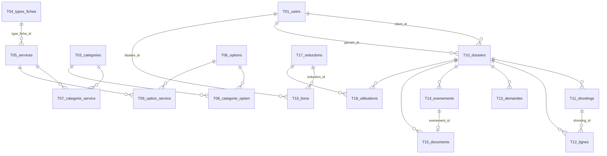
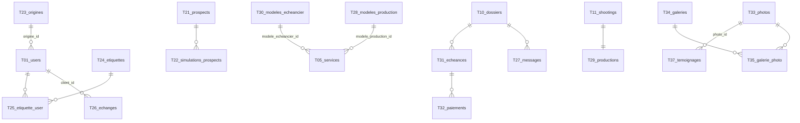

# Schéma Backend — PID · Moteur du générateur de devis

> Statut : validé · Version : 1.1 · Validé le : 2026-11-11 · Lit : 01-PRD (v2.1), 02-TRD (v1.1), 03-APP-FLOW (v1.2)
> Comment les données sont stockées, reliées et protégées.

## En bref
- **Couvre :** les 19 tables du moteur (T01-T19) et les 19 tables de l'ERP (T20-T38), leurs colonnes, contraintes et relations ; les permissions par rôle ; la validation aux frontières ; la rétention et l'anonymisation des données personnelles ; l'ordre des migrations.
- **Décisions majeures :** montants en **entiers de centimes**, taux en **points de base** (2100 = 21,00 %), distances en **mètres** (portable PHP ↔ TypeScript, MySQL ↔ PostgreSQL) · paramètres variables (modes de prix, conditions, champs de fiche, réglages) en **colonnes JSON validées par le moteur**, relations en tables · lignes figées copiées dans le dossier (P05) · rétention réglable puis **anonymisation** · aucune ligne de tarif dans les migrations ni les données de départ (P02).
- **Ne couvre pas :** les tables d'authentification de Laravel (`password_reset_tokens`, `sessions`), créées par Laravel et hors dossier ; le contenu exact des JSON est la structure des objets du moteur (`app/Domain/Devis`), résumée ici par un exemple.
- **IDs définis ici :** T01-T38.

## 1. Modèle de données

*T02 `reglages` et T19 `cache_geo` n'ont pas de relation.*

**Conventions communes**
| Convention | Règle | Raison |
|------------|-------|--------|
| Montants | `bigint` signé, en **centimes** d'euro ; suffixe `_c` | Exact en PHP et en TypeScript ; identique en MySQL et PostgreSQL (P06) |
| Taux et pourcentages | `int`, en **points de base** (1 = 0,01 %) ; suffixe `_pb` | Pas de flottant |
| Distances | `int`, en **mètres** ; affichage en km à 1 décimale (TRD §4) | Pas de flottant |
| Dates et heures | `timestamp` en UTC ; affichage en `Europe/Brussels` | Fuseau explicite |
| JSON | type `json` ; structure validée par le moteur avant écriture | Portable MySQL 8.4 et PostgreSQL |
| Énumérations | `varchar(30)` + validation par un `enum` PHP du moteur | Portable ; ajouter une valeur ne demande pas de migration de type |
| Clés | `id` = `bigint` auto-incrémenté ; FK nommées `<table>_id` | Convention Laravel |
| SQL | Migrations et Eloquent uniquement, aucun SQL propre à MySQL | TRD §6, ADR-004 |

## 2. Tables

### T01 — `users`
**Rôle :** comptes (table Laravel, étendue) · **Fonctionnalités :** F05, F06 · **Écrans :** E01.b, E02, E03.e, E10

| Colonne | Type | Null | Défaut | Contraintes | Exemple |
|---------|------|------|--------|-------------|---------|
| id | bigint | Non | auto | PK | 42 |
| email | varchar(255) | Non | — | UNIQUE | marie.dupont@example.be |
| password | varchar(255) | Non | — | hash bcrypt (hors dossier) | `$2y$12$…` |
| nom | varchar(255) | Oui | NULL | | Marie Dupont |
| telephone | varchar(30) | Oui | NULL | | +32 470 12 34 56 |
| role | varchar(30) | Non | `client` | ∈ {client, photographe} | client |
| code_parrainage | varchar(12) | Oui | NULL | UNIQUE ; généré au premier dossier soumis | MARIE-7K3Q |
| origine_id | bigint | Oui | NULL | FK T23.id `ON DELETE SET NULL` (F08) | 2 |
| notes_privees | text | Oui | NULL | jamais exposé au client (R08.4) | Préfère être contactée le soir |
| anonymise_le | timestamp | Oui | NULL | | NULL |
| created_at, updated_at | timestamp | Non | now() | | 2026-11-11T09:15:00Z |

- **Règles portées :** R05.11 (`code_parrainage` UNIQUE), Q5 (deux rôles seulement).
- **Valeur par défaut `client` :** valeur technique de rôle, pas un tarif (P02 non concerné).

### T02 — `reglages`
**Rôle :** réglages généraux du photographe, une ligne par clé · **Fonctionnalités :** F01, F03-F07 · **Écrans :** E22, E23

| Colonne | Type | Null | Défaut | Contraintes | Exemple |
|---------|------|------|--------|-------------|---------|
| cle | varchar(60) | Non | — | PK | `transport` |
| valeur | json | Non | — | validée par le moteur | `{"domicile": {...}, "kmComptes": "itineraireComplet", "seuil": "franchise", "seuilM": 25000, "prixKm_c": 50, "portee": "parShooting", "distance": "routiere", "repli": "volOiseau"}` |
| updated_at | timestamp | Non | now() | | |

Clés : `tva` (`tauxGeneral_pb`, `methode` ∈ {parLigne, parTaux}) · `transport` · `reductions` (`cumul`) · `dossier` (`delaiModifJours`, `joursProchainsShootings`, `retentionMois`) · `parrainage` (`recompenses`, `reductionFilleulId`, `reductionParrainId`, `etapeAcquisition`) · `pdf` (`coordonnees`, `mentions`) · `production` (`joursAlerteProduction`) · `prospects` (`retentionProspectsMois`) · `planning` (`capaciteJour`, `auDela` ∈ {bloquer, avertir}).
- **Aucune ligne créée par les migrations** (P02, CA01.7) : tant qu'une clé manque, la fonctionnalité concernée refuse de calculer (messages de UC01.1, UC04.2).

### T03 — `categories`
| Colonne | Type | Null | Défaut | Contraintes | Exemple |
|---------|------|------|--------|-------------|---------|
| id | bigint | Non | auto | PK | 3 |
| libelle | varchar(80) | Non | — | UNIQUE | Shootings |
- **Règles portées :** R01.10, UC01.6 (suppression refusée si une réduction active la cible : vérifiée par le moteur, T17.cible JSON).

### T04 — `types_fiches`
**Rôle :** types de fiches techniques · **Fonctionnalités :** F02 · **Écrans :** E18, E19

| Colonne | Type | Null | Défaut | Contraintes | Exemple |
|---------|------|------|--------|-------------|---------|
| id | bigint | Non | auto | PK | 1 |
| nom | varchar(120) | Non | — | UNIQUE | Fiche mariage |
| champs | json | Non | — | liste ordonnée de champs (R02.4) | `[{"cle":"lieux","type":"groupe","libelle":"Lieu","champs":[{"cle":"adresse","type":"adresse","obligatoire":true},{"cle":"heureDebut","type":"heure","obligatoire":true}]},{"cle":"moodboard","type":"lien","obligatoire":false}]` |
| version | int | Non | 1 | +1 à chaque modification | 3 |
| created_at, updated_at | timestamp | Non | now() | | |

### T05 — `services`
**Rôle :** services et produits du catalogue · **Fonctionnalités :** F01, F02, F04, F06 · **Écrans :** E01, E13, E14

| Colonne | Type | Null | Défaut | Contraintes | Exemple |
|---------|------|------|--------|-------------|---------|
| id | bigint | Non | auto | PK | 7 |
| libelle | varchar(160) | Non | — | | Mariage — journée |
| description | text | Oui | NULL | | Des préparatifs au gâteau |
| mode_prix | varchar(30) | Non | — | ∈ {forfait, duree, forfaitDepassement, quantite, parPersonne, paliers} (R01.5) | forfaitDepassement |
| parametres_prix | json | Non | — | validés selon `mode_prix` | `{"prix_c":25000,"dureeIncluseMin":120,"prixDepassement_c":6000,"arrondiMin":30}` |
| base_tva | varchar(10) | Non | — | ∈ {htva, tvac} (R01.3) | htva |
| taux_tva_pb | int | Oui | NULL | 0 ≤ x ≤ 10000 ; NULL = taux général (R01.6) | NULL |
| type_fiche_id | bigint | Oui | NULL | FK T04.id `ON DELETE RESTRICT` | 1 |
| reglages_transport | json | Oui | NULL | remplace T02.`transport` (R04.4, R04.5) | NULL |
| delai_modif_jours | int | Oui | NULL | ≥ 0 ; NULL = réglage général (R06.4) | NULL |
| modele_production_id | bigint | Oui | NULL | FK T28.id `ON DELETE SET NULL` (R09.1) | 1 |
| delai_livraison_jours | int | Oui | NULL | ≥ 0 (R09.2) | 30 |
| modele_echeancier_id | bigint | Oui | NULL | FK T30.id `ON DELETE SET NULL` (R10.1) | 1 |
| occupation | int | Oui | NULL | ≥ 0 ; unités de capacité consommées (R13.1) | 2 |
| mis_en_avant | boolean | Non | false | R12.1 | true |
| ordre_vitrine | int | Oui | NULL | ordre dans E04 | 1 |
| archive_le | timestamp | Oui | NULL | non NULL = archivé (R01.7) | NULL |
| created_at, updated_at | timestamp | Non | now() | | |

- **Index :** `archive_le` (filtre du catalogue visible, R01.8).
- **Suppression :** autorisée seulement si aucune ligne T12 ne référence le service (UC01.4) ; sinon `archive_le = now()`.

### T06 — `options`
Mêmes colonnes que T05 sauf `type_fiche_id`, `reglages_transport`, `delai_modif_jours`. **Règles portées :** R01.4, R01.5, R01.7. **Écrans :** E01.a, E15, E16.

### T07 — `categorie_service` · T08 — `categorie_option` · T09 — `option_service`
Tables de liaison plusieurs à plusieurs.

| Table | Colonnes | Clé primaire | FK |
|-------|----------|--------------|----|
| T07 | categorie_id, service_id | (categorie_id, service_id) | T03 `CASCADE`, T05 `CASCADE` |
| T08 | categorie_id, option_id | (categorie_id, option_id) | T03 `CASCADE`, T06 `CASCADE` |
| T09 | option_id, service_id | (option_id, service_id) | T06 `CASCADE`, T05 `CASCADE` |

`CASCADE` ici supprime seulement le lien, jamais un dossier : les dossiers gardent leurs lignes copiées (T12).

### T10 — `dossiers`
**Rôle :** dossier client, du devis soumis à la clôture · **Fonctionnalités :** F05, F06, F07 · **Écrans :** E02, E03, E10, E11, E12

| Colonne | Type | Null | Défaut | Contraintes | Exemple |
|---------|------|------|--------|-------------|---------|
| id | bigint | Non | auto | PK | 118 |
| numero | varchar(20) | Non | — | UNIQUE ; `AAAA-NNNN` | 2027-0012 |
| client_id | bigint | Non | — | FK T01.id `ON DELETE RESTRICT` | 42 |
| parrain_id | bigint | Oui | NULL | FK T01.id `ON DELETE SET NULL` ; ≠ client_id (R05.15) | 17 |
| etape | varchar(30) | Non | `soumis` | ∈ {soumis, accepte, refuse, confirme, realise, annule} (R06.8) | accepte |
| motif_refus | text | Oui | NULL | obligatoire si `etape = refuse` (R06.9) | |
| composition | json | Non | — | composition soumise (services, options, paramètres, lieux) | `{"elements":[...]}` |
| total_htva_c | bigint | Non | — | somme des lignes actives (R03.2) | 151200 |
| total_tva_c | bigint | Non | — | | 31752 |
| total_tvac_c | bigint | Non | — | | 182952 |
| soumis_le | timestamp | Non | — | | 2026-11-12T18:02:00Z |
| cloture_le | timestamp | Oui | NULL | renseigné à `realise`, `refuse`, `annule` | |
| anonymise_le | timestamp | Oui | NULL | | |
| created_at, updated_at | timestamp | Non | now() | | |

- **Index :** `client_id`, `etape`, `cloture_le` (rétention).
- *L'étape `brouillon` n'existe que dans le navigateur (R06.1) : aucune ligne en base.*

### T11 — `shootings`
**Rôle :** un shooting du dossier et sa fiche technique · **Fonctionnalités :** F02, F04, F06 · **Écrans :** E03.b, E12

| Colonne | Type | Null | Défaut | Contraintes | Exemple |
|---------|------|------|--------|-------------|---------|
| id | bigint | Non | auto | PK | 301 |
| dossier_id | bigint | Non | — | FK T10.id `ON DELETE CASCADE` | 118 |
| service_id | bigint | Oui | NULL | FK T05.id `ON DELETE SET NULL` | 7 |
| date_shooting | date | Non | — | | 2027-06-19 |
| fiche_structure | json | Non | — | copie de T04.champs à la soumission (R02.3) | |
| fiche_version | int | Non | — | T04.version copiée | 3 |
| reponses | json | Non | `{}` | réponses du client, adresses comprises | `{"lieux":[{"adresse":{"rue":"Rue Haute","numero":"12","codePostal":"1000","commune":"Bruxelles"},"heureDebut":"10:00"}],"moodboard":"https://pinterest.com/..."}` |
| statut_fiche | varchar(20) | Non | `incomplete` | ∈ {complete, incomplete} | complete |
| date_limite | date | Non | — | `date_shooting − délai` (R06.4, R06.11) | 2027-05-20 |

### T12 — `lignes`
**Rôle :** lignes figées du devis (P05) · **Fonctionnalités :** F03-F06 · **Écrans :** E03.a, E12

| Colonne | Type | Null | Défaut | Contraintes | Exemple |
|---------|------|------|--------|-------------|---------|
| id | bigint | Non | auto | PK | 905 |
| dossier_id | bigint | Non | — | FK T10.id `ON DELETE CASCADE` | 118 |
| shooting_id | bigint | Oui | NULL | FK T11.id `ON DELETE SET NULL` | 301 |
| origine | varchar(20) | Non | — | ∈ {service, option, transport, reduction, fraisRetrait, fraisAnnulation} (R03.4, R06.6, R06.12) | transport |
| reference_id | bigint | Oui | NULL | id du service, de l'option ou de la réduction d'origine ; aucune FK (l'élément peut être supprimé ou archivé) | 7 |
| libelle | varchar(255) | Non | — | copie au moment du calcul | Départ photographe → Bruxelles : 44,8 km |
| quantite | varchar(40) | Oui | NULL | quantité et unité lisibles | 3 h 30 |
| htva_c | bigint | Non | — | négatif seulement si `origine = reduction` | 1975 |
| taux_tva_pb | int | Non | — | | 2100 |
| tva_c | bigint | Non | — | | 415 |
| tvac_c | bigint | Non | — | | 2390 |
| vol_oiseau | boolean | Non | false | R04.6 | false |
| ordre | int | Non | — | ordre d'affichage | 4 |
| demande_id | bigint | Oui | NULL | FK T13.id `ON DELETE SET NULL` ; ligne issue d'une demande validée | NULL |
| retiree_le | timestamp | Oui | NULL | non NULL = retirée (UC06.6) ; jamais supprimée | NULL |
| created_at | timestamp | Non | now() | | |

- **Index :** `dossier_id`.
- **Immuabilité :** aucune colonne de montant n'est modifiée après insertion ; un retrait renseigne `retiree_le`, un ajout crée de nouvelles lignes (P05).

### T13 — `demandes`
**Rôle :** demandes de modification · **Fonctionnalités :** F02, F04, F05, F06 · **Écrans :** E03.c, E03.f, E12.a, E24

| Colonne | Type | Null | Défaut | Contraintes | Exemple |
|---------|------|------|--------|-------------|---------|
| id | bigint | Non | auto | PK | 55 |
| dossier_id | bigint | Non | — | FK T10.id `ON DELETE CASCADE` | 118 |
| type | varchar(20) | Non | — | ∈ {ajout, fiche, adresse} | ajout |
| statut | varchar(20) | Non | `en_attente` | ∈ {en_attente, validee, refusee} | en_attente |
| contenu | json | Non | — | ajout demandé ou valeurs de fiche modifiées | |
| lignes_proposees | json | Non | — | lignes calculées au jour de la demande (R06.7) | |
| valeurs_precedentes | json | Oui | NULL | restaurées si refus (UC06.5) | |
| motif_refus | text | Oui | NULL | obligatoire si `refusee` (R06.9) | |
| demande_le | timestamp | Non | now() | | |
| traitee_le | timestamp | Oui | NULL | | |

- **Index :** (`statut`, `demande_le`) pour E24.

### T14 — `evenements_dossier`
**Rôle :** historique du dossier (R07.4) · **Écrans :** E03.d, E12

| Colonne | Type | Null | Défaut | Contraintes | Exemple |
|---------|------|------|--------|-------------|---------|
| id | bigint | Non | auto | PK | 700 |
| dossier_id | bigint | Non | — | FK T10.id `ON DELETE CASCADE` | 118 |
| type | varchar(30) | Non | — | ∈ {soumission, etape, demandeValidee, demandeRefusee, retrait} | etape |
| details | json | Non | — | | `{"de":"soumis","vers":"accepte"}` |
| auteur_id | bigint | Oui | NULL | FK T01.id `ON DELETE SET NULL` | 1 |
| le | timestamp | Non | now() | | |

### T15 — `documents`
**Rôle :** versions PDF du dossier (F07) · **Écrans :** E03.d, E12

| Colonne | Type | Null | Défaut | Contraintes | Exemple |
|---------|------|------|--------|-------------|---------|
| id | bigint | Non | auto | PK | 210 |
| dossier_id | bigint | Non | — | FK T10.id `ON DELETE CASCADE` | 118 |
| version | int | Non | — | UNIQUE (dossier_id, version) | 3 |
| evenement_id | bigint | Non | — | FK T14.id `ON DELETE RESTRICT` | 700 |
| chemin | varchar(255) | Oui | NULL | `storage/app/dossiers/<numero>/v<version>.pdf` ; NULL tant que la génération n'a pas abouti (UC07.1) | dossiers/2027-0012/v3.pdf |
| genere_le | timestamp | Oui | NULL | | |

### T16 — `bons`
**Rôle :** bons de réduction du parrain (R05.13, R05.14) · **Écrans :** E03.e

| Colonne | Type | Null | Défaut | Contraintes | Exemple |
|---------|------|------|--------|-------------|---------|
| id | bigint | Non | auto | PK | 9 |
| titulaire_id | bigint | Non | — | FK T01.id `ON DELETE CASCADE` | 17 |
| reduction_id | bigint | Non | — | FK T17.id `ON DELETE RESTRICT` | 4 |
| dossier_filleul_id | bigint | Non | — | FK T10.id `ON DELETE RESTRICT` ; UNIQUE (un bon par dossier filleul) | 118 |
| utilise_dossier_id | bigint | Oui | NULL | FK T10.id `ON DELETE SET NULL` | NULL |
| cree_le | timestamp | Non | now() | | |
| utilise_le | timestamp | Oui | NULL | | |

### T17 — `reductions`
**Rôle :** réductions (F05) · **Écrans :** E20, E21, E22

| Colonne | Type | Null | Défaut | Contraintes | Exemple |
|---------|------|------|--------|-------------|---------|
| id | bigint | Non | auto | PK | 4 |
| libelle | varchar(160) | Non | — | | Mariage + album |
| conditions | json | Non | — | R05.2 | `[{"type":"combinaison","services":[7,12]}]` |
| effet | json | Non | — | R05.3 ; pourcentage en points de base | `{"type":"pourcentage","valeur_pb":1000}` |
| cible | json | Non | — | R05.4 | `{"type":"dossier"}` |
| limites | json | Oui | NULL | R05.6 | `{"debut":"2027-01-01","fin":"2027-03-31","maxUtilisations":20,"unParClient":true,"remiseMax_c":10000}` |
| cumul | varchar(20) | Oui | NULL | ∈ {toutes, plusAvantageuse, priorite} ; NULL = général (R05.5) | NULL |
| priorite | int | Oui | NULL | ordre si `priorite` | |
| code_promo | varchar(40) | Oui | NULL | UNIQUE (UC05.1) | HIVER27 |
| suggerer | boolean | Non | false | R05.8 | true |
| actif | boolean | Non | true | | true |
| created_at, updated_at | timestamp | Non | now() | | |

### T18 — `utilisations_reductions`
**Rôle :** compter les utilisations pour les limites (R05.6, R05.10)

| Colonne | Type | Null | Défaut | Contraintes | Exemple |
|---------|------|------|--------|-------------|---------|
| id | bigint | Non | auto | PK | 31 |
| reduction_id | bigint | Non | — | FK T17.id `ON DELETE CASCADE` | 4 |
| dossier_id | bigint | Non | — | FK T10.id `ON DELETE CASCADE` | 118 |
| client_id | bigint | Non | — | FK T01.id `ON DELETE CASCADE` | 42 |
| le | timestamp | Non | now() | | |
- **Index :** (`reduction_id`, `client_id`) pour « une fois par client ».

### T19 — `cache_geo`
**Rôle :** cache des appels API01 (TRD §4)

| Colonne | Type | Null | Défaut | Contraintes | Exemple |
|---------|------|------|--------|-------------|---------|
| cle | char(64) | Non | — | PK ; SHA-256 de l'adresse normalisée ou de la suite de coordonnées + type | `9f2c…` |
| type | varchar(20) | Non | — | ∈ {geocodage, distance} | distance |
| valeur | json | Non | — | `{"lat":50.8503,"lon":4.3517}` ou `{"metres":44812}` | |
| created_at | timestamp | Non | now() | | |

### Tables de l'ERP (F08-F13)

*T20 `simulations`, T36 `textes_sections` et T38 `dates_bloquees` n'ont pas de relation.*

| Table | Rôle | Colonnes (type · null · contrainte) | Exemple | Règles |
|-------|------|-------------------------------------|---------|--------|
| **T20 `simulations`** | Simulations comptées sans donnée personnelle | id · `cree_le` timestamp · `elements` json (ids de services et options, quantités) · `total_tvac_c` bigint | `{"services":[7],"options":[3]}` · 182952 | R11.2 : **aucune** colonne email, IP, adresse ou cookie |
| **T21 `prospects`** | Visiteurs qui ont demandé leur devis par email | id · `email` varchar(255) UNIQUE · `consentement_le` timestamp non NULL · `derniere_simulation_le` timestamp · `user_id` bigint NULL FK T01 `SET NULL` (devenu client) · `anonymise_le` | lea@example.be | R08.1, R08.2, R08.9 |
| **T22 `simulations_prospects`** | Simulations envoyées à un prospect | id · `prospect_id` FK T21 `CASCADE` · `composition` json · `total_tvac_c` bigint · `envoye_le` | | UC08.1 |
| **T23 `origines`** | Liste des origines des clients | id · `libelle` varchar(80) UNIQUE | Parrainage | R08.5 |
| **T24 `etiquettes`** | Étiquettes libres | id · `libelle` varchar(60) UNIQUE | VIP | R08.5 |
| **T25 `etiquette_user`** | Liaison client ↔ étiquette | `etiquette_id` FK T24 `CASCADE` · `user_id` FK T01 `CASCADE` · PK (les deux) | | R08.3 |
| **T26 `echanges`** | Journal des échanges du client | id · `client_id` FK T01 `CASCADE` · `le` timestamp · `canal` varchar(20) ∈ {telephone, email, rencontre, message, rappelAuto, autre} · `resume` text non NULL | téléphone · « Confirme 120 invités » | UC08.3, UC10.5 ; jamais visible du client (R08.4) |
| **T27 `messages`** | Fil de messages du dossier | id · `dossier_id` FK T10 `CASCADE` · `auteur_id` FK T01 `SET NULL` · `texte` text non NULL · `envoye_le` · `lu_le` NULL | | UC08.5, R08.7 |
| **T28 `modeles_production`** | Modèles d'étapes | id · `nom` varchar(120) UNIQUE · `etapes` json (liste ordonnée, la dernière = livraison) | `["Tri","Retouche","Export","Livraison"]` | R09.1, R09.3 |
| **T29 `productions`** | Production d'un shooting | id · `shooting_id` FK T11 `CASCADE` UNIQUE · `etapes` json (copie du modèle, R09.8) · `etape_index` int · `historique` json (date de chaque passage) · `echeance` date · `lien_livraison` varchar(2048) NULL · `livre_le` NULL | echeance 2027-07-19 | R09.2-R09.6 |
| **T30 `modeles_echeancier`** | Modèles de paiement | id · `nom` varchar(120) UNIQUE · `echeances` json (libellé, `pourcentage_pb` ou `montant_c`, moment, jours) · `rappels` json (`joursAvant`, `joursApresRetard`) | `[{"libelle":"Acompte","pourcentage_pb":3000,"moment":"aLaConfirmation"}]` | R10.1, R10.5 |
| **T31 `echeances`** | Échéances d'un dossier | id · `dossier_id` FK T10 `CASCADE` · `libelle` · `montant_c` bigint · `date_echeance` date · `statut` ∈ {due, partielle, payee} · `ordre` int | Acompte · 30000 · 2027-03-01 | R10.2, R10.3 ; somme = T10.total_tvac_c |
| **T32 `paiements`** | Paiements reçus | id · `echeance_id` FK T31 `RESTRICT` · `montant_c` bigint > 0 · `recu_le` date · `moyen` ∈ {virement, especes, autre} | 30000 · virement | UC10.3 ; jamais modifié (R10.3) |
| **T33 `photos`** | Photos de la vitrine | id · `cloudinary_id` varchar(255) UNIQUE · `alt` varchar(255) NULL · `recadrage` json NULL · `largeur`, `hauteur` int · `created_at` | `pid/mariage-lea-01` | R12.2, R12.3 |
| **T34 `galeries`** | Galeries | id · `titre` · `texte` text NULL · `date` date NULL · `couverture_photo_id` FK T33 `SET NULL` · `publiee` boolean défaut false | | UC12.2, R12.4 |
| **T35 `galerie_photo`** | Photos d'une galerie | `galerie_id` FK T34 `CASCADE` · `photo_id` FK T33 `CASCADE` · `ordre` int · PK (galerie_id, photo_id) | | UC12.2 |
| **T36 `textes_sections`** | Textes du site | `cle` varchar(60) PK · `valeur` text | `hero_titre` | UC12.3 |
| **T37 `temoignages`** | Témoignages | id · `citation` text · `auteur` varchar(120) · `photo_id` FK T33 `SET NULL` · `dossier_id` FK T10 `SET NULL` · `publie` boolean défaut false · `ordre` int | | UC12.4, R12.7 |
| **T38 `dates_bloquees`** | Indisponibilités du photographe | id · `debut` timestamp · `fin` timestamp (> debut) · `jour_entier` boolean · `libelle` varchar(120) (privé) | Congés | UC13.2, R13.5 |

**Calcul de la capacité (R13.1-R13.4)** : occupation d'un jour = Σ `T05.occupation` des shootings (T11.date_shooting) des dossiers `accepte` ou `confirme` ; comparée à T02.`planning`.capaciteJour à la simulation, à la soumission et à l'acceptation, dans une transaction pour la dernière place (CA13.3).

## 3. Authentification
| Élément | Choix | ADR |
|---------|-------|-----|
| Méthode | Sessions Laravel (cookie de session, base `sessions`) — hors dossier | — |
| Hash des mots de passe | bcrypt (`password_hash`), comme `BcryptHasher` existant | — |
| Durée de vie | Réglage par défaut de Laravel — hors dossier | — |
| Réinitialisation | Hors dossier | — |
| Protection force brute | Hors dossier ; codes promo et parrainage : 10 essais par 15 min par IP (TRD §6) | — |

## 4. Permissions

| Rôle | Table | Lire | Créer | Modifier | Supprimer | Condition |
|------|-------|------|-------|----------|-----------|-----------|
| Visiteur | T03, T05, T06, T07-T09 | ✓ | ✗ | ✗ | ✗ | `archive_le IS NULL` (R01.8) |
| Visiteur | T02 | via le moteur seulement | ✗ | ✗ | ✗ | le domicile n'est jamais renvoyé (R04.8) |
| Visiteur | T17 | via le moteur seulement | ✗ | ✗ | ✗ | conditions évaluées côté serveur ; seules les suggestions et lignes appliquées sont renvoyées |
| Visiteur | T10-T12 | ✗ | ✓ à la soumission (UC06.1) | ✗ | ✗ | |
| Client | T10, T11, T12, T14, T15 | ✓ | ✗ | T11.reponses seulement | ✗ | `client_id = utilisateur courant` ; T11 modifiable si `today ≤ date_limite` et étape ∈ {soumis, accepte, confirme} (R06.10) |
| Client | T13 | ✓ | ✓ | ✗ | ✗ | son dossier ; avant la date limite |
| Client | T16 | ✓ | ✗ | ✗ | ✗ | `titulaire_id = utilisateur courant` |
| Client | T01 | sa ligne | — | `nom`, `telephone` | demande d'effacement (§6) | |
| Photographe | T02-T09, T17 | ✓ | ✓ | ✓ | ✓ (T05, T06 : selon UC01.4) | |
| Photographe | T10, T11, T12, T13, T14, T15, T16, T18 | ✓ | ✓ (par les cas d'usage) | T10.etape, T13.statut, T12.retiree_le | ✗ | montants de T12 jamais modifiés (P05) |
| Tous | T19 | ✗ | par le serveur seulement | ✗ | ✗ | |
| Visiteur | T20 | ✗ | par le serveur à chaque simulation | ✗ | ✗ | aucune donnée personnelle |
| Visiteur | T21, T22 | ✗ | ✓ avec consentement (UC08.1) | ✗ | ✗ | |
| Visiteur | T33-T37 | ✓ | ✗ | ✗ | ✗ | seulement `publiee` / `publie` = true ; T38 jamais lu, seule la disponibilité calculée est renvoyée |
| Client | T27 | ✓ | ✓ | ✗ | ✗ | son dossier |
| Client | T29, T31 | ✓ | ✗ | ✗ | ✗ | son dossier (E03.h) |
| Client | T26, T01.notes_privees, T24, T25 | ✗ | ✗ | ✗ | ✗ | jamais (R08.4) |
| Photographe | T20-T38 | ✓ | ✓ | ✓ | ✓ sauf T32 (paiements jamais supprimés) et T20 (statistiques) | |

Mise en œuvre : Policies Laravel par modèle (TRD §6, A01). Accès refusé à un dossier ou à un PDF d'autrui → réponse `404` avec le message de CA07.3.

## 5. Validation aux frontières

| Entrée | Champ | Règle | Erreur renvoyée |
|--------|-------|-------|-----------------|
| Simulation (E01) | `composition.elements[].serviceId` | existe, non archivé | message de UC03.1 |
| Simulation | quantité, durée, personnes | entiers ≥ 0, bornes du mode (R01.5) | message de UC03.1 |
| Simulation | `adresse` | rue, numéro, code postal (4 chiffres), commune obligatoires | message de UC04.1 |
| Simulation | `codePromo` | 1 à 40 caractères `[A-Za-z0-9-]` ; limité en débit | message de UC05.3 |
| Soumission | totaux envoyés | **ignorés** (R03.3) | — |
| Fiche (E03.b) | champ `lien` | URL `https://` de 2 048 caractères maximum | message de UC02.3 |
| Fiche | champ `nombre` | entier ≥ 0 | MSG16 |
| Fiche | champ `date` / `heure` | format ISO (`AAAA-MM-JJ`, `HH:MM`) | MSG17 |
| ERP (E14, E16) | `parametres_prix` | structure du mode, montants ≥ 0 | messages de UC01.1 |
| ERP (E21) | `effet.valeur_pb` | 0 à 10 000 pour un pourcentage | message de UC05.1 |
| ERP (E23) | `tauxGeneral_pb` | 0 à 10 000 | MSG18 |
| Toute requête modifiante | jeton CSRF | présent et valide | 419 (Laravel) |

## 6. Données personnelles et rétention

| Donnée | Table | Sensibilité | Rétention | Suppression |
|--------|-------|-------------|-----------|-------------|
| Email, nom, téléphone | T01 | personnelle | durée du compte | anonymisation sur demande ou à l'échéance |
| Adresses des lieux, réponses de fiche, moodboard | T11.reponses, T10.composition | personnelle (lieux de vie, invités) | `retentionMois` après `cloture_le` (T02.`dossier`) | anonymisation |
| Domicile du photographe | T02.`transport` | personnelle | tant que le réglage existe | — ; jamais exposé (R04.8) |
| Coordonnées dans les PDF | fichiers T15 | personnelle | comme le dossier | **fichier supprimé** à l'anonymisation ; la ligne T15 reste avec `chemin = NULL` |
| Montants et lignes | T10, T12 | non personnelle | sans limite | conservés |
| Cache de géocodage | T19 | adresse hachée | sans limite | — |
| Email des prospects et leurs simulations | T21, T22 | personnelle | `retentionProspectsMois` après la dernière simulation (R08.9) | anonymisation : email remplacé, simulations vidées des adresses |
| Notes privées, étiquettes, journal des échanges | T01, T25, T26 | personnelle | comme le compte | effacés à l'anonymisation |
| Messages du dossier | T27 | personnelle | comme le dossier | textes effacés à l'anonymisation |
| Simulations anonymes | T20 | non personnelle | sans limite | — |
| Témoignages | T37 | personnelle (nom de l'auteur, publié avec accord) | jusqu'à dépublication | suppression à la demande de l'auteur |

**Anonymisation** (décision de mentalyas, 11/11) : `email` → `supprime-<id>@invalid`, `nom` et `telephone` → NULL, `password` → valeur aléatoire, `T11.reponses` et `T10.composition` vidés des adresses et textes, fichiers PDF du dossier supprimés, `anonymise_le` renseigné. Les montants, lignes, étapes et historique sont gardés.
**Déclenchement :** demande du client (droit à l'effacement) ou échéance de `retentionMois` (commande planifiée `dossiers:anonymiser`, lancée à la main ou par le planificateur Laravel en local).

Règles : R06.14 (durée), R06.15 (anonymisation), exception de R07.6 (fichiers PDF supprimés à l'anonymisation) — PRD v1.2.

## 7. Migrations et données de départ
- **Ordre :** T23 → T01 (extension de `users`) → T02 → T03 → T04 → T28 → T30 → T05 → T06 → T07, T08, T09 → T17 → T10 → T11 → T29 → T13 → T12 → T14 → T15 → T16 → T18 → T19 → T20 → T21 → T22 → T24 → T25 → T26 → T27 → T31 → T32 → T33 → T34 → T35 → T36 → T37 → T38. Chaque migration a sa méthode `down()`.
- **Données de départ :** un seul compte photographe, créé par la commande `php artisan pid:photographe <email>` (mot de passe saisi en console, jamais dans un fichier). **Aucun service, option, réduction, taux ni réglage** (P02, CA01.7).
- **Données de test :** fabriques (factories) Laravel avec des valeurs fictives, utilisées seulement par `tests/` ; jamais lancées sur la base `pid`.

## 8. Couverture

| Donnée affichée (écran) | Table.colonne |
|-------------------------|---------------|
| E01 — catalogue visible | T05, T06 (`archive_le IS NULL`), T03 via T07/T08 |
| E01 — lignes, totaux, suggestions | calcul du moteur à partir de T02, T05, T06, T17, T19 (rien n'est écrit) |
| E02 — carte de dossier | T10.numero, T10.etape, T10.total_tvac_c, MIN(T11.date_shooting) |
| E03 en-tête — étape, motif, date limite | T10.etape, T10.motif_refus, T11.date_limite |
| E03.a — devis | T12 (`retiree_le IS NULL`), T10.total_* |
| E03.b — fiches | T11.fiche_structure, T11.reponses, T11.statut_fiche |
| E03.c — demandes | T13 |
| E03.d — documents | T15, T14 |
| E03.e — parrainage | T01.code_parrainage, T16 |
| E10 — compteurs, demandes, prochains shootings | T10.etape, T13.statut, T11.date_shooting + T02.`dossier`.joursProchainsShootings |
| E11, E12 — dossiers | T10, T11, T12, T13, T14, T15 |
| E13-E17 — catalogue | T03-T09 |
| E18, E19 — fiches | T04 |
| E20-E22 — réductions, parrainage | T17, T02.`parrainage` |
| E23 — réglages | T02 |
| E24 — demandes | T13 (`statut = en_attente`) |
| E04-E06 — vitrine | T36, T05 (`mis_en_avant`), T37, T34, T35, T33 |
| E01.a — dates indisponibles | T38, T11, T05.occupation, T02.`planning` |
| E01.c — prospect | T21, T22 |
| E03.g / E12.d — messages | T27 |
| E03.h / E12.e / E12.f — suivi | T29, T31, T32 |
| E25-E27 — clients | T01, T21, T23, T24, T25, T26 |
| E28, E29 — production | T29, T28 |
| E30, E31 — argent | T30, T31, T32, T10 |
| E32 — statistiques | T12, T10, T20, T21, T18, T16, T29 (agrégats) |
| E33-E38 — vitrine (ERP) | T33-T37, T05 |
| E39, E40 — planning | T11, T38, T29, T31, T05.occupation, T02.`planning` |

## Glossaire
| Terme | Définition |
|-------|------------|
| Anonymisation | Remplacement des données personnelles par des valeurs neutres, en gardant les montants |
| CASCADE / RESTRICT / SET NULL | Comportement d'une clé étrangère quand la ligne liée est supprimée : supprimer aussi / refuser / vider le lien |
| ERD (Entity-Relationship Diagram) | Diagramme des tables et de leurs relations |
| FK (Foreign Key) | Clé étrangère : colonne qui pointe vers la clé d'une autre table |
| JSON (JavaScript Object Notation) | Format texte de données structurées |
| PK (Primary Key) | Clé primaire : identifiant unique d'une ligne |
| Point de base | Un centième de pour cent (2100 = 21,00 %) |
| RGPD | Règlement général sur la protection des données |

## Historique
| Version | Date | Changement |
|---------|------|------------|
| 0.1 | 2026-11-11 | Création |
| 1.0 | 2026-11-11 | Messages MSG16-MSG18, règles R06.14-R06.15 reportées au PRD ; validé par mentalyas |
| 1.1 | 2026-11-11 | ERP (PRD v2.0) : tables T20-T38, colonnes ajoutées à T01 et T05, clés de réglages, permissions, rétention, couverture |

## Demandes de modification
| Date | Source | Demande | Statut |
|------|--------|---------|--------|
| 2026-11-11 | Claude (Backend) | PRD R07.6 : exception RGPD | ✅ traité : PRD v1.2 |
| 2026-11-11 | Claude (Backend) | PRD : rétention et anonymisation dans F06 | ✅ traité : PRD v1.2 (R06.14, R06.15, UC06.7, UC06.8) |
