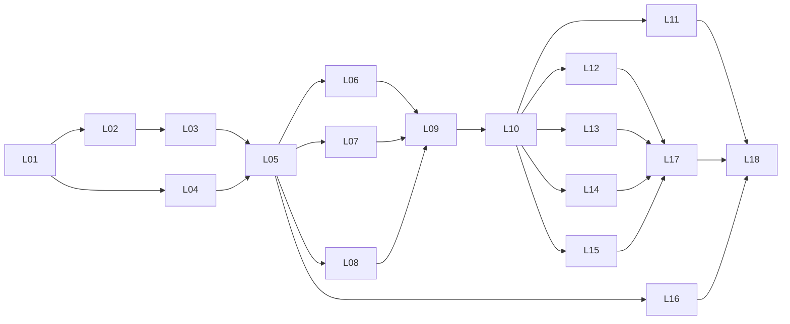

# Plan d'implémentation — PID · Moteur du générateur de devis et ERP

> Statut : validé · Version : 1.0 · Validé le : 2026-11-11 · Lit : 01-PRD (v2.1), 02-TRD (v1.1), 03-APP-FLOW (v1.2), 04-UX-UI (v1.0), 05-BACKEND (v1.1), decisions/ADR-001 à ADR-008
> Les étapes de développement dans l'ordre exact. Tout est décidé dans les 5 documents : ce plan les consolide sans rien perdre.

## En bref
- **Couvre :** 18 lots, du socle Laravel à la revue transverse : moteur pur (F01-F07), puis ERP (F08-F13), chaque fonctionnalité de bout en bout (backend → vues Blade → tests).
- **Décisions majeures :** le moteur pur (L04) est écrit et testé avant tout écran ; aucun verrou de rythme de cours (mentalyas, 11/11) : la colonne « Notion de cours » sert au suivi pédagogique, pas à bloquer ; aucun lot de déploiement (ADR-004).
- **Ne couvre pas :** la traduction TypeScript du moteur (PortfolioPhotographe), la mise en ligne, la réinitialisation du mot de passe et la durée de session (hors dossier, Backend §3).
- **IDs définis ici :** L01-L18.

## 1. Vue d'ensemble

| Lot | Objectif | Dépend de | Couvre | Notion de cours anticipée |
|-----|----------|-----------|--------|---------------------------|
| L01 | Socle : Laravel 13 dans `src/`, outils, conventions | — | TRD §2, §3, §5 ; ADR-001, 004, 005, 006, 008 | JS/jQuery (vu 10/10) |
| L02 | Schéma : 38 migrations, compte photographe | L01 | T01-T38 ; Backend §7 | MySQL (amorcé 07/11, PDO non vu) |
| L03 | Authentification et rôles | L02 | Backend §3, §4 ; domaine Auth existant | Comptes, sécurité (amorcés 07/11) ; accès restreints (non vu) |
| L04 | Moteur pur et jeu de cas commun | L01 | F03 ; calcul de F01, F04, F05 ; R03.10 ; P06 | POO (vue) |
| L05 | F01 Catalogue et réglages généraux | L03, L04 | F01 ; E13-E17, E23 ; T02, T03, T05-T09 | — |
| L06 | F02 Fiches techniques | L05 | F02 ; E18, E19 ; T04 | — |
| L07 | F04 Transport et API01 | L05 | F04 ; API01 ; T19 ; ADR-002 | — |
| L08 | F05 Réductions et parrainage | L05 | F05 ; E20-E22, E03.e ; T16-T18 | — |
| L09 | Simulateur public et soumission | L06, L07, L08 | E01, E01.a, E01.b ; T10-T12, T20 ; UC06.1 | AJAX (vu 17/10) |
| L10 | F06 Cycle de vie du dossier | L09 | F06 ; E02, E02.a, E03, E03.a-c, E03.f, E11, E12, E12.a-c, E24 ; T13, T14 | Sessions (vues 10/10) |
| L11 | F07 Dossier en PDF | L10 | F07 ; E03.d ; T15 ; ADR-003 | — |
| L12 | F08 Suivi clients, prospects, messages | L10 | F08 ; E01.c, E03.g, E12.d, E25-E27, E26.a ; T21-T27 ; ADR-008 | Emails (non vu) |
| L13 | F09 Production | L10 | F09 ; E12.f, E28, E29, E03.h (partie production) ; T28, T29 | — |
| L14 | F10 Argent et chiffre d'affaires | L10 | F10 ; E12.e, E30, E31, E03.h (partie paiements) ; T30-T32 | — |
| L15 | F13 Planning et capacité | L10 | F13 ; E39, E40 ; T38 ; capacité dans E01 | — |
| L16 | F12 Vitrine et API02 | L05 | F12 ; E04-E06, E33-E38 ; T33-T37 ; API02 ; ADR-007 | — |
| L17 | F11 Statistiques et tableau de bord | L12, L13, L14, L15 | F11 ; E10, E32 ; T20 (lecture) | — |
| L18 | Finitions transverses | L01-L17 | TRD §6, §7 ; MSG01-MSG23 ; accessibilité | — |

**Chemin critique du MVP :**

Chemin critique : L01 → L02 → L03 → L05 → L07 → L09 → L10 → L14 → L17 → L18. L04 peut avancer en parallèle de L02-L03 ; L16 (vitrine) en parallèle de L06-L15.

## 2. Lots

### L01 — Socle
- **Objectif :** un projet Laravel 13 qui démarre en local, avec les outils et conventions du TRD, sans perdre `src/prof/` ni le domaine Auth existant.
- **Dépend de :** —
- **Couvre :** TRD §2, §3, §5 ; ADR-001, ADR-004, ADR-005, ADR-006, ADR-008.
- **À faire :**
  1. Sauvegarder `src/` (copie datée hors dépôt) avant toute manipulation.
  2. Installer Laravel Herd (PHP 8.4) et MySQL Community 8.4 LTS ; arrêter le MariaDB de XAMPP s'il occupe le port 3306.
  3. Créer le projet Laravel 13 dans un dossier temporaire, puis le fusionner dans `src/` sans toucher à `src/prof/` ; déplacer `src/app/Domain/Auth` à son emplacement Laravel (TRD §3).
  4. Créer les dossiers `app/Domain/Devis`, `app/Application`, `app/Infrastructure`, `tests/Fixtures/cas-calcul`.
  5. Écrire `.env.example` avec toutes les variables du TRD §5, sans valeur ; vérifier que `.env`, `vendor/`, `node_modules/` sont ignorés par git.
  6. Installer Pint, configurer PHPUnit (base `pid_test`), écrire le test d'architecture « aucun `Illuminate\` dans `app/Domain` ».
  7. Installer Tailwind 4 et jQuery 4.0.0 (npm + Vite) ; copier les tokens de `PortfolioPhotographe/src/app/globals.css` dans `resources/css/app.css` (04-UX-UI §2).
  8. Écrire la mise en page Blade de base (public, client, ERP avec menu latéral) et l'aide jQuery d'appel AJAX : jeton `X-CSRF-TOKEN`, enveloppe `{success, data | error}`.
  9. Installer Mailpit et régler `MAIL_*` dessus.
- **Fichiers / modules :** `src/` (racine Laravel), `.env.example`, `phpunit.xml`, `pint.json`, `resources/css/app.css`, `resources/js/app.js`, `resources/views/layouts/`, `tests/Architecture/`.
- **Fini quand :** la page d'accueil s'affiche sous Herd ; `src/prof/` est identique à la sauvegarde ; le test d'architecture passe ; un email de test apparaît dans Mailpit.
- **Vérification :** `php artisan test` (vert) ; `vendor/bin/pint --test` ; `git status` ne montre ni `.env` ni `vendor/` ; `git diff --stat -- src/prof` vide.

### L02 — Schéma et migrations
- **Objectif :** les 38 tables créées dans l'ordre du Backend §7, chacune réversible.
- **Dépend de :** L01.
- **Couvre :** T01-T38 ; Backend §2, §7.
- **À faire :**
  1. Une migration par table, dans l'ordre exact du Backend §7, chacune avec `down()`.
  2. Montants en centimes (`_c`, bigint), taux en points de base (`_pb`), distances en mètres ; contraintes, index et `ON DELETE` de chaque fiche T.
  3. Modèles Eloquent avec `$fillable` explicite (TRD §6, affectation de masse).
  4. Commande `php artisan pid:photographe <email>` : mot de passe saisi en console.
  5. Fabriques (factories) à valeurs fictives, réservées à `tests/`.
- **Fichiers / modules :** `database/migrations/`, `app/Models/`, `app/Console/Commands/CreerPhotographe.php`, `database/factories/`.
- **Fini quand :** `migrate:fresh` puis `migrate:rollback` complet passent sans erreur ; la base ne contient aucun service, option, réduction, taux ni réglage (CA01.7).
- **Vérification :** `php artisan migrate:fresh && php artisan migrate:rollback --step=38` ; test `should_have_empty_catalogue_when_freshly_installed`.

### L03 — Authentification et rôles
- **Objectif :** sessions Laravel branchées sur le domaine Auth existant (InscriptionService, BcryptHasher) ; rôles Client et Photographe protégés.
- **Dépend de :** L02.
- **Couvre :** Backend §3, §4 ; PRD §3 (matrice des rôles).
- **À faire :**
  1. Passer les tests de `tests/run.php` sous PHPUnit sans changer leur comportement (TRD §3).
  2. Brancher `ComptesRepository` sur Eloquent (T01) et `VerificationMailer` sur Laravel Mail.
  3. Connexion et déconnexion par session ; régénération de l'identifiant de session à la connexion.
  4. Middleware de rôle (zone client, zone ERP) ; Policies de base sur `dossiers`.
  5. Limiteur de débit nommé (10 essais par 15 min par IP), utilisé en L08.
- **Fichiers / modules :** `app/Domain/Auth/`, `app/Infrastructure/Auth/`, `app/Http/Middleware/`, `app/Policies/`, `tests/Unit/Domain/Auth/`.
- **Fini quand :** les 11 tests historiques passent sous PHPUnit ; un client ne peut ouvrir aucune page ERP.
- **Vérification :** `php artisan test --filter=Auth` ; test `should_deny_erp_when_user_is_client`.

### L04 — Moteur pur et jeu de cas commun
- **Objectif :** tout le calcul du devis en PHP pur, sans Laravel, prouvé par le jeu de cas JSON qui servira à la version TypeScript.
- **Dépend de :** L01.
- **Couvre :** F03 (R03.*) ; calculs de F01 (modes P1-P6, TVA, R01.*), F04 (franchise, seuil, `itineraireComplet`, `parDossier`, `toutOuRien`), F05 (cumul, plafond, `plusAvantageuse`) ; R03.10 ; P02, P06.
- **À faire :**
  1. Objets de valeur : `Montant` (centimes entiers), `Taux` (points de base), `Distance` (mètres).
  2. Les 6 modes de prix et le calcul d'une ligne (HTVA, TVA, TVAC ; prix saisi TVAC exact, Q11).
  3. Arrondi au centime, demi-centime vers le haut ; méthode de TVA réglable (`parLigne` ou globale).
  4. Ordre de calcul de F03, réductions sur HTVA, transport à partir de distances déjà connues (pas d'API dans le moteur).
  5. Jeu de cas `tests/Fixtures/cas-calcul/*.json` (valeurs fictives) et test qui les rejoue tous.
- **Fichiers / modules :** `app/Domain/Devis/`, `tests/Unit/Domain/Devis/`, `tests/Fixtures/cas-calcul/`.
- **Fini quand :** les CA de calcul passent en unitaire ; aucune valeur tarifaire dans `app/` ; le test d'architecture reste vert.
- **Vérification :** `php artisan test --testsuite=Unit` ; `grep` d'un nombre suspect dans `app/Domain` = revue manuelle (P02).

### L05 — F01 Catalogue et réglages généraux
- **Objectif :** le photographe crée, modifie, archive ses services, options et catégories, et règle la TVA et l'arrondi.
- **Dépend de :** L03, L04.
- **Couvre :** F01, UC01.* ; E13, E14, E15, E16, E17, E23 ; T02, T03, T05, T06, T07, T08, T09.
- **À faire :**
  1. Services d'application (un par UC), Form Requests, Policies photographe.
  2. Validation des paramètres JSON de chaque mode de prix par le moteur (L04).
  3. Suppression = archivage si le service est utilisé, suppression définitive sinon.
  4. Écrans Blade E13-E17, E23 avec leurs états (vide, erreur, succès).
- **Fichiers / modules :** `app/Application/Catalogue/`, `app/Http/Controllers/Erp/`, `resources/views/erp/catalogue/`.
- **Fini quand :** CA01.3 à CA01.7 passent.
- **Vérification :** `php artisan test --filter=Catalogue` ; contrôle manuel des écrans E13-E17, E23.

### L06 — F02 Fiches techniques
- **Objectif :** types de fiches et champs configurables, reliés aux services ; remplissage par le client.
- **Dépend de :** L05.
- **Couvre :** F02, UC02.* ; E18, E19 ; T04 (et colonnes de fiche de T11/T12 selon le Backend).
- **À faire :**
  1. Éditeur de champs (4 groupes de types, groupes répétables, champs obligatoires), duplication de type.
  2. Fiche remplie figée : un champ retiré du type reste lisible (CA02.2).
  3. Liens `lien` limités à `https://` (UC02.3).
- **Fichiers / modules :** `app/Application/Fiches/`, `resources/views/erp/fiches/`, composant Blade de fiche partagé avec E03.b.
- **Fini quand :** CA02.1, CA02.2, CA02.3, CA02.5, CA02.6 passent (CA02.4 en L10).
- **Vérification :** `php artisan test --filter=Fiche`.

### L07 — F04 Transport et API01
- **Objectif :** distances calculées depuis les adresses du devis, avec cache, délai de 5 s et repli.
- **Dépend de :** L05.
- **Couvre :** F04, UC04.* ; API01 ; T19 ; ADR-002 ; réglages de transport de T02.
- **À faire :**
  1. Passerelle OpenRouteService (géocodage + itinéraire) derrière une interface du domaine.
  2. Cache T19, délai `ORS_TIMEOUT_SECONDS`, repli `volOiseau` (haversine) ou blocage selon le réglage.
  3. Domicile du photographe jamais sérialisé vers le client (R04.8).
  4. Créer le compte ORS et noter les quotas réels dans le TRD (Q18).
- **Fichiers / modules :** `app/Infrastructure/Distance/`, `app/Application/Transport/`.
- **Fini quand :** CA04.1, CA04.5, CA04.7 passent (CA04.2-4 en L04, CA04.6 en L10) ; Q18 fermée.
- **Vérification :** `php artisan test --filter=Transport` (API simulée par `Http::fake()`) ; un appel réel manuel avec la clé.

### L08 — F05 Réductions et parrainage
- **Objectif :** réductions conditionnelles, codes promo, suggestions et parrainage.
- **Dépend de :** L05.
- **Couvre :** F05, UC05.* ; E20, E21, E22, E03.e ; T16, T17, T18.
- **À faire :**
  1. Conditions, limites d'usage, plafonds, cumul ; suggestion « ajoutez X pour obtenir Y ».
  2. Codes vérifiés sous le limiteur de débit de L03 ; même message pour inconnu, expiré ou épuisé.
  3. Parrainage : code personnel, interdiction de l'auto-parrainage, bon acquis à l'étape réglée.
- **Fichiers / modules :** `app/Application/Reductions/`, `resources/views/erp/reductions/`, onglet E03.e.
- **Fini quand :** CA05.1, CA05.4, CA05.6, CA05.8, CA05.9 passent (CA05.2, 3, 5 en L04 ; CA05.7 en L10).
- **Vérification :** `php artisan test --filter=Reduction`.

### L09 — Simulateur public et soumission
- **Objectif :** le visiteur compose son devis en direct, puis le soumet en créant son compte.
- **Dépend de :** L06, L07, L08.
- **Couvre :** E01, E01.a, E01.b ; T10, T11, T12, T20 ; UC03.*, UC06.1 ; parcours P1.
- **À faire :**
  1. Commande AJAX de calcul : le navigateur n'envoie que la composition, le serveur recalcule tout (R03.3).
  2. Comptage anonyme des simulations (T20, sans IP ni email).
  3. Soumission : adresse obligatoire, création du compte via le domaine Auth, dossier à l'étape `soumis`, lignes figées.
- **Fichiers / modules :** `resources/js/simulateur.js`, `app/Http/Controllers/Public/SimulateurController.php`, `app/Application/Soumission/`.
- **Fini quand :** CA03.4, CA06.1, CA11.2 passent.
- **Vérification :** `php artisan test --filter=Simulateur` ; parcours P1 joué à la main dans le navigateur.

### L10 — F06 Cycle de vie du dossier
- **Objectif :** les 7 étapes, les demandes de modification, les retraits, la suppression de compte et l'anonymisation.
- **Dépend de :** L09.
- **Couvre :** F06, UC06.* ; E02, E02.a, E03, E03.a, E03.b, E03.c, E03.f, E11, E12, E12.a, E12.b, E12.c, E24 ; T13, T14 ; commande `dossiers:anonymiser`.
- **À faire :**
  1. Machine à états des 7 étapes, transitions par le photographe uniquement, journal T14.
  2. Demandes d'ajout ou de changement au prix du jour de la demande ; date limite par shooting ; refus motivé.
  3. Retrait de ligne avec ou sans frais ; prix soumis jamais modifiés (P05).
  4. Suppression de compte (RGPD) et commande `dossiers:anonymiser` (rétention réglable).
- **Fichiers / modules :** `app/Domain/Devis/Dossier/`, `app/Application/Dossiers/`, `resources/views/client/`, `resources/views/erp/dossiers/`.
- **Fini quand :** CA01.6, CA02.4, CA04.6, CA05.7, CA06.2 à CA06.9 passent.
- **Vérification :** `php artisan test --filter=Dossier` ; `php artisan dossiers:anonymiser` sur des données de test.

### L11 — F07 Dossier en PDF
- **Objectif :** une version PDF par changement, jamais réécrite, téléchargeable par le seul propriétaire.
- **Dépend de :** L10.
- **Couvre :** F07, UC07.* ; E03.d ; T15 ; ADR-003.
- **À faire :**
  1. Vérifier d'abord la compatibilité de `barryvdh/laravel-dompdf` 3.1.x avec Laravel 13.
  2. Gabarit Blade du dossier (lignes, fiches, lien moodboard cliquable, mentions figées par version).
  3. Écriture unique (un nom par version) ; suppression des fichiers à l'anonymisation.
- **Fichiers / modules :** `app/Infrastructure/Pdf/`, `resources/views/pdf/dossier.blade.php`, `storage/app/dossiers/`.
- **Fini quand :** CA07.1 à CA07.4 passent.
- **Vérification :** `php artisan test --filter=Pdf` ; ouverture manuelle d'un PDF généré.

### L12 — F08 Suivi clients, prospects et messages
- **Objectif :** fiches clients, prospects consentis, journal des échanges, fil de messages notifié.
- **Dépend de :** L10.
- **Couvre :** F08, UC08.* ; E01.c, E03.g, E12.d, E25, E26, E26.a, E27 ; T21-T27 ; colonnes `origine_id` et `notes_privees` de T01 ; commande `prospects:anonymiser` ; ADR-008.
- **À faire :**
  1. « Recevoir ce devis par email » avec consentement obligatoire ; rattachement du prospect quand il soumet.
  2. Client créé par le photographe, lien d'activation du compte.
  3. Messages en texte seul ; email de notification sans contenu (TRD §6).
  4. Origines, étiquettes, notes privées jamais visibles du client.
- **Fichiers / modules :** `app/Application/Clients/`, `app/Mail/`, `resources/views/erp/clients/`.
- **Fini quand :** CA08.1 à CA08.5 passent.
- **Vérification :** `php artisan test --filter=Client` (`Mail::fake()`) ; emails vérifiés à l'œil dans Mailpit.

### L13 — F09 Production
- **Objectif :** suivi des shootings de la confirmation à la livraison.
- **Dépend de :** L10.
- **Couvre :** F09, UC09.* ; E12.f, E28, E29, E03.h (production) ; T28, T29 ; colonnes `modele_production_id`, `delai_livraison_jours` de T05.
- **À faire :**
  1. Modèles d'étapes, copiés dans la production à la confirmation.
  2. Échéance de livraison, retards signalés, livraison avec lien obligatoire et email.
- **Fichiers / modules :** `app/Application/Production/`, `resources/views/erp/production/`.
- **Fini quand :** CA09.1 à CA09.4 passent.
- **Vérification :** `php artisan test --filter=Production`.

### L14 — F10 Argent et chiffre d'affaires
- **Objectif :** échéanciers, paiements, rappels, chiffres signé / encaissé / reste / prévisionnel.
- **Dépend de :** L10.
- **Couvre :** F10, UC10.* ; E12.e, E30, E31, E03.h (paiements) ; T30, T31, T32 ; colonne `modele_echeancier_id` de T05 ; commande `paiements:rappeler`.
- **À faire :**
  1. Échéances générées depuis le modèle ; recalcul des seules échéances non payées (Q23).
  2. Paiements partiels, statuts ; un paiement n'est jamais supprimé.
  3. Commande `paiements:rappeler` et planificateur (`schedule:work`).
- **Fichiers / modules :** `app/Domain/Devis/Echeancier/`, `app/Application/Paiements/`, `routes/console.php`.
- **Fini quand :** CA10.1 à CA10.5 passent.
- **Vérification :** `php artisan test --filter=Paiement` ; `php artisan paiements:rappeler` avec une date simulée.

### L15 — F13 Planning et capacité
- **Objectif :** calendrier du photographe, capacité par jour, dates bloquées visibles dans le simulateur.
- **Dépend de :** L10.
- **Couvre :** F13, UC13.* ; E39, E40 ; T38 ; colonne `occupation` de T05 ; dates grisées dans E01.
- **À faire :**
  1. Calcul de l'occupation (dossiers acceptés et confirmés, Q25) ; modes `bloquer` et `avertir`.
  2. Soumission sous verrou de transaction pour la dernière place libre (CA13.3).
  3. Vues mois, semaine, jour ; dates bloquées privées (libellé seulement pour le photographe, mot générique pour le visiteur).
- **Fichiers / modules :** `app/Application/Planning/`, `resources/views/erp/planning/`, `resources/js/calendrier.js`.
- **Fini quand :** CA13.1 à CA13.4 passent.
- **Vérification :** `php artisan test --filter=Planning`.

### L16 — F12 Vitrine et API02
- **Objectif :** site public alimenté par l'ERP : sections, galeries, témoignages, services mis en avant.
- **Dépend de :** L05.
- **Couvre :** F12, UC12.* ; E04, E05, E06, E33-E38 ; T33-T37 ; colonnes `mis_en_avant`, `ordre_vitrine` de T05 ; API02 ; ADR-007.
- **À faire :**
  1. Fixer la version du SDK `cloudinary/cloudinary_php` ; envoi depuis le serveur dans le dossier `pid/`, types MIME et 10 Mo vérifiés.
  2. Médiathèque, galeries (couverture obligatoire pour publier), texte alternatif obligatoire.
  3. Pages publiques E04-E06 ; « à partir de » calculé par le moteur ; services archivés retirés.
- **Fichiers / modules :** `app/Infrastructure/Images/`, `app/Application/Vitrine/`, `resources/views/public/`, `resources/views/erp/vitrine/`.
- **Fini quand :** CA12.1 à CA12.5 passent.
- **Vérification :** `php artisan test --filter=Vitrine` (Cloudinary simulé) ; un envoi réel manuel.

### L17 — F11 Statistiques et tableau de bord
- **Objectif :** indicateurs de conversion, comparaison sur un an, export CSV, tableau de bord d'accueil de l'ERP.
- **Dépend de :** L12, L13, L14, L15.
- **Couvre :** F11, UC11.* ; E10, E32 ; T20 en lecture.
- **À faire :**
  1. Fixer la version de Chart.js.
  2. Requêtes d'agrégats indexées (objectif < 2 s, TRD §7) ; comparaison N-1.
  3. Export CSV séparateur `;`, virgule décimale, encodage lisible par Excel en français ; agrégats seulement.
  4. Tableau de bord E10 : raccourcis vers demandes, retards, échéances proches.
- **Fichiers / modules :** `app/Application/Statistiques/`, `resources/views/erp/stats/`, `resources/js/graphiques.js`.
- **Fini quand :** CA11.1, CA11.3, CA11.4 passent ; les statistiques s'affichent en moins de 2 s sur les fabriques de test.
- **Vérification :** `php artisan test --filter=Statistique` ; ouverture manuelle du CSV dans Excel.

### L18 — Finitions transverses
- **Objectif :** vérifier l'ensemble contre la sécurité, les messages et l'accessibilité avant la défense.
- **Dépend de :** L01-L17.
- **Couvre :** TRD §6 (OWASP), §7 ; MSG01-MSG23 ; états vide / chargement / erreur de chaque écran (App Flow).
- **À faire :**
  1. Revue OWASP de chaque ligne du tableau TRD §6 et de la sécurité ERP.
  2. Chaque MSG du PRD affiché tel quel à l'endroit prévu.
  3. Accessibilité : contraste des tokens, navigation au clavier, textes alternatifs.
  4. Mettre à jour `docs/RYTHME-COURS.md` (notions anticipées par le projet) et les notes de `docs/academique/`.
- **Fichiers / modules :** tout le projet (lecture), corrections ciblées.
- **Fini quand :** les 74 CA passent ; aucune trace de pile hors `local` ; revue de sécurité sans point ouvert.
- **Vérification :** `php artisan test` complet ; `/security-review` ; parcours P1-P13 joués à la main.

## 3. Couverture des critères d'acceptation
| Critères | Fonctionnalité | Lot | Vérification |
|----------|----------------|-----|--------------|
| CA01.1, CA01.2 | F01 | L04 | unitaire moteur + jeu de cas |
| CA01.3, CA01.4, CA01.5, CA01.7 | F01 | L05 (CA01.7 aussi en L02) | Feature `Catalogue` |
| CA01.6 | F01 | L10 | Feature `Dossier` |
| CA02.1, CA02.2, CA02.3, CA02.5, CA02.6 | F02 | L06 | Feature `Fiche` |
| CA02.4 | F02 | L10 | Feature `Dossier` |
| CA03.1, CA03.2, CA03.3 | F03 | L04 | unitaire moteur + jeu de cas |
| CA03.4 | F03 | L09 | Feature `Simulateur` |
| CA03.5 | F03 | L04 (côté PHP) | jeu de cas ; côté TypeScript vérifié dans PortfolioPhotographe |
| CA04.1, CA04.5, CA04.7 | F04 | L07 | Feature `Transport` (`Http::fake()`) |
| CA04.2, CA04.3, CA04.4 | F04 | L04 | unitaire moteur |
| CA04.6 | F04 | L10 | Feature `Dossier` |
| CA05.1, CA05.4, CA05.6, CA05.8, CA05.9 | F05 | L08 | Feature `Reduction` |
| CA05.2, CA05.3, CA05.5 | F05 | L04 | unitaire moteur |
| CA05.7 | F05 | L10 | Feature `Dossier` |
| CA06.1 | F06 | L09 | Feature `Simulateur` |
| CA06.2 à CA06.9 | F06 | L10 | Feature `Dossier` ; commande `dossiers:anonymiser` |
| CA07.1 à CA07.4 | F07 | L11 | Feature `Pdf` |
| CA08.1 à CA08.5 | F08 | L12 | Feature `Client` (`Mail::fake()`) |
| CA09.1 à CA09.4 | F09 | L13 | Feature `Production` |
| CA10.1 à CA10.5 | F10 | L14 | Feature `Paiement` |
| CA11.1, CA11.3, CA11.4 | F11 | L17 | Feature `Statistique` ; CSV ouvert dans Excel |
| CA11.2 | F11 | L09 | Feature `Simulateur` |
| CA12.1 à CA12.5 | F12 | L16 | Feature `Vitrine` |
| CA13.1 à CA13.4 | F13 | L15 | Feature `Planning` |

**Contrôle :** 74 critères sur 74 affectés ; 38 tables sur 38 (L02 les crée, chaque lot fonctionnel les exploite) ; 56 écrans et sous-écrans sur 56 dans la colonne « Couvre » du §1.

## 4. Risques et points de vigilance
| Risque | Lot | Parade |
|--------|-----|--------|
| La fusion Laravel dans `src/` écrase `src/prof/` ou le domaine Auth | L01 | Sauvegarde datée avant ; projet créé à part puis fusionné ; `git diff -- src/prof` vide |
| MariaDB de XAMPP (10.4) et MySQL 8.4 sur le même port | L01 | Arrêter XAMPP ou changer `DB_PORT` |
| `laravel-dompdf` 3.1.x pas encore déclaré compatible Laravel 13 | L11 | Vérifier en tête de L11 ; sinon ADR-003 rouverte (Dompdf direct sans enveloppe) |
| Quotas ORS inconnus (Q18) | L07 | Cache T19, `Http::fake()` en test, quotas notés dans le TRD à la création du compte |
| Quota Cloudinary partagé avec PortfolioPhotographe | L16 | Envois manuels limités pendant le développement ; tests avec Cloudinary simulé |
| Erreurs d'arrondi | L04 | Centimes entiers partout ; jeu de cas commun rejoué à chaque commit |
| Double réservation de la dernière place | L15 | Verrou de transaction (`lockForUpdate`) à la soumission |
| `pid.struct.sql` du prof contient un mot de passe MySQL d'exemple | L01 | Ne pas le copier dans `src/` ni le commiter tel quel |
| Écart avec le framework du cours (Laravel ≠ mini-framework du prof) | L18 | Notes `docs/academique/` qui relient chaque notion du cours à son équivalent Laravel |

## 5. Checklist « prêt à coder »
- [x] Les 5 documents précédents sont `validé` (UX/UI : validé, sans objet)
- [x] Chaque critère d'acceptation du PRD est couvert par un lot (74/74, §3)
- [x] Chaque table du Backend et chaque écran de l'App Flow apparaissent dans un lot (§1)
- [x] Chaque technologie du TRD est fixée et chaque API tierce a sa fiche ; versions exactes du SDK Cloudinary et de Chart.js relevées à l'installation (L16, L17)
- [x] Les choix UX/UI sont figés : tokens de PortfolioPhotographe copiés en L01 (04-UX-UI §2)
- [x] Aucune question ouverte bloquante dans le README (Q18 ouverte, non bloquante, fermée en L07)
- [x] Les variables d'environnement sont listées (`.env.example` prévu en L01)

## Glossaire
| Terme | Définition |
|-------|------------|
| CA | Critère d'acceptation du PRD (Étant donné / Quand / Alors) |
| Fabrique (factory) | Générateur Laravel de données fictives pour les tests |
| Feature (test) | Test d'intégration PHPUnit qui passe par Laravel et la base `pid_test` |
| Herd | Environnement local Laravel pour Windows (PHP, Composer, serveur web) |
| Jeu de cas commun | Fichiers JSON de calculs attendus, rejoués par les versions PHP et TypeScript du moteur (R03.10) |
| Lot | Étape de développement livrable de bout en bout |
| Mailpit | Serveur SMTP local qui capture les emails et les affiche dans une page web |
| OWASP | Open Web Application Security Project, référentiel des risques de sécurité web |
| Pint | Outil Laravel de mise en forme du code PHP (PSR-12) |
| `schedule:work` | Commande Laravel qui lance les tâches planifiées tant qu'elle tourne |

## Historique
| Version | Date | Changement |
|---------|------|------------|
| 0.1 | 2026-11-11 | Création |
| 1.0 | 2026-11-11 | 18 lots, couverture 74 CA, aucun verrou de rythme de cours (décision mentalyas) ; validé par mentalyas |

## Demandes de modification
| Date | Source | Demande | Statut |
|------|--------|---------|--------|
